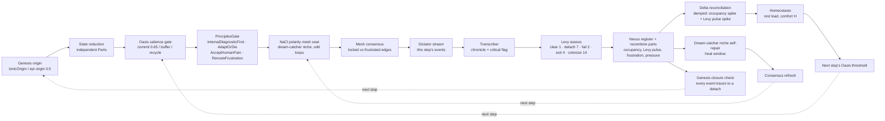

# The Oroboro conjunctive pipeline (one loop, every component feeding the next)

**Speculative in-silico modeling only. No clinical, medical, biological or engineering claims.**

All Oroboro components run as ONE cycle per step. None is called on its own or bolted on afterwards.

Text form: Genesis → Parts (state reduction) → Oasis salience → PrinciplesGate → NaCl polarity seat / mesh consensus → Dictator stream → Transcriber → Levy (assesses the Transcriber entries) → Nexus register + recombine → damped delta reconciliation (occupancy spike + Levy pulse spike) → homeostasis + next Oasis threshold → niche self-repair → consensus refresh → Genesis closure → next step.

Accounting checks that must hold every run: whole-system run == decomposed run (bit-identical signature), census, Levy (running == pipeline Levy from Transcriber entries), mesh consensus (ledger == heat-trace == census), Genesis closure.

Implementations:
- Python, metastasis cascade: [`metastasis-native/oro_native.py`](metastasis-native/oro_native.py) (`integrated=True`, default).
- JavaScript, relay: [`oroboro-relay/oroboro-core.js`](https://github.com/caitlynrandels-del/oroboro-relay/blob/main/oroboro-core.js) `OroboroPipeline` (Dictator → Transcriber → Levy → damped pressure → deterministic delta vs Nexus → consensus isolation → Genesis mirror).
