

Oroboro Structures for Consciousness Mapping

# Leftovers, Gates and the Last Push { .title }

A combined report on every Oroboro modeling study from this project: the cancer-spread (metastasis) model, light-guided extraction, plumbing, and the magnetic-launch case study through all its variants. Written to be read by specialists and by people with no background, at the same time.

<strong>Caitlyn Randels</strong> Prepared with AI modeling assistance 27 November 2026

**Speculative in-silico modeling only.** Every number in this report is the output of a computer model running on assumed parameters. Nothing here is a medical, clinical, biological or therapeutic claim, and nothing is an engineering design, flight plan, siting recommendation or operational proposal. The cancer model is a model of *simulated occupancy on a graph*. It is not a model of any patient. The launch model is a reduced point-mass model. It is not a vehicle.

## Contents { .notoc }

1. [Two front summaries](#two-front-summaries)
2. [How to read this report](#how-to-read-this-report)
3. [The Oroboro systems, wired as one loop](#the-oroboro-systems-wired-as-one-loop)
4. [Part A: the cancer-spread model](#part-a-the-cancer-spread-model)
    - A1 The 1.21-million-run sweep · A2 Native-mesh restart · A3 Wiring everything together · A4 Light as transport · A5 Plumbing: a sealed exit
5. [Part B: the magnetic-launch model](#part-b-the-magnetic-launch-model)
    - B1 Goldilocks case study · B2 Ondulatory strings · B3 Dream-catcher weave · B4 Goal-seek continuation (and the 256 → 1,148 m/s correction) · B5 Geography · B6 Redstone repeater, comparator and no-track · B7 Light sail · B8 Kite, line, lane-keeping, magnets, straw · B9 Adaptive fur and fabric · B10 Plumbing on the straw
6. [What the two domains say together](#what-the-two-domains-say-together)
7. [Predictions that failed](#predictions-that-failed)
8. [What this report does not claim](#what-this-report-does-not-claim)
9. [GitHub state](#github-state)
10. [Glossary](#glossary)
11. [Sources, files and references](#sources-files-and-references)

## Two front summaries

### For everyone (no background needed)

We built two "what-if" computer models using Caitlyn's own software parts, called the **Oroboro systems**. One model imagines how cancer cells might spread, hide and grow in the body. The other imagines throwing a small craft toward space along a magnetic track, a bit like a roller-coaster launch. Neither is real medicine or real engineering. They are thought experiments with numbers attached.

**The one big idea both models share:** what is left over at the end is mostly decided *at the door*, when things are first let in or let go, not by fixing them later.

- **Cancer model.** The only things that shrank *both* the grown tumours (colonies) and the hidden "sleeping" cells (the dormant pool) were changes at the door: making the gate pickier about which cells may settle, making organs less welcoming, or opening a *guarded* exit that guides cells out. A light-guided exit, with the gate still deciding who may use it, shrank both in all 45 settings tried. Fixes applied after cells had settled cleared colonies but left sleeping cells behind.
- **Launch model.** The best track runs left the craft a few hundred metres per second short of orbit. Many add-ons were tried: a smart gate on Earth's spin, a laser-pushed light sail, a kite, a fishing line, car-style lane-keeping, magnets pushing on Earth's magnetic field, a tall vacuum "straw", self-adjusting fur-and-fabric surfaces and plumbing-style pressure pushes. **None of them closed the gap.** The one thing that did was a **small final rocket burn at the very end**, paid for with the craft's own fuel (the "redstone repeater"). Spending just 5% of the craft's mass on it closed the gap from all 14 real launch sites on the flattest exit.

We also checked something Caitlyn asked for: do all the Oroboro parts really work *together* as one loop, rather than as separate add-ons? Several early runs did not. Once everything was wired together, the main findings held. Several of our own predictions turned out wrong, and those are listed honestly in their own section.

### For specialists

Two speculative in-silico studies share one component pipeline: Genesis → state reduction → Oasis salience gate → PrinciplesGate → NaCl polarity-mesh consensus → Dictator → Transcriber → Levy → Nexus → damped delta reconciliation → homeostasis and next-step Oasis threshold.

**Metastasis cascade (agent-based, monthly, 120 months, 5 organotropism configurations).** A reanalysis of 1.21 M stored runs reproduced all 484 condition estimates exactly. Baseline: 21.7% (95% CI 20.2–23.4%) of runs colonize, and the dormant pool is 10.38 (10.25–10.51). Elimination switch points: establishment threshold x₅₀ 0.799 and x₉₀ 0.854. A from-scratch native polarity-mesh restart (49 nodes, 89 edges, 32 frustrated) reproduced the pool (10.36) and slightly under-reproduced colonies (18.0%). Across 454 settings, the dynamic frustrated-edge count *anti*-correlates with the pool (Spearman −0.819, CI −0.863 to −0.765). Only upstream levers (Oasis threshold, organ permissiveness) shrink both outcomes. Full conjunctive wiring engages the damper and lowers both: `levy_gain` 1.0 gives 9.1% and 6.36, and 0.05 gives 17.5% and 10.09. An Oasis-gated directed-transport exit ("light") reduced both colony rate and pool in 45/45 conditions. Combined upstream at strength 0.5 gave 0.0% and 0.67. Oasis admission is load-bearing: ablating it raises yield from 15% to 77%. A sealed, valved plumbing exit (perfect seal, upstream) gave p(overt) 0.175 → 0.000 and pool 10.215 → 1.270, and leaks return cargo.

**Magnetic-assist launch (2-D point mass, exponential/ISA atmosphere, vacuum two-burn residual to 200 km circular, 7,788.5 m/s).** The best no-stage evacuated-tube exits leave 407 m/s (held pusher) and 431 m/s (5° tilt, 80 km). The earlier 256 m/s staged figure is invalid: it came from an incomplete coast, and the true Kepler two-burn residual is 1,148 m/s. Lock is defined as residual ≤ 1 m/s with perigee above the stated floor. The only configurations that locked were a paid impulsive late two-burn ("repeater", rocket equation, I_sp 450 s). f_p 0.05 locks all 14 real sites on the 0°/80 km exit, and f_p 0.30 locks every due-east setup. Everything else failed to lock: a subtraction-mode comparator (0/14 vs best azimuth), the no-track pad ascent (0/240, drag/heating bound, ~5,200 K proxy), a laser light sail (0/864), kite, fishing line, lane-keeping and smart-magnet guidance, an evacuated straw (0/46 combined), adaptive fur/fabric meshes, and plumbing (0/49).

## How to read this report

**In short.** Each section opens with a shaded **In short** box like this one: plain words, an everyday comparison, and the main result. The text after the box is the **technical detail**: methods, assumptions and exact numbers from the original write-ups. You can read just the boxes, just the detail, or both. Unfamiliar words are in the [Glossary](#glossary).

A few conventions apply throughout:

- **"Model output", not "result about the world".** Every number comes from a simulation with labeled assumptions, so it describes the model and nothing outside it.
- **Recycled vs new.** Later studies reuse settled numbers from earlier ones ("recycled") instead of recomputing them. This report says which is which.
- **Lock.** In the launch model, *lock* means reaching a 200 km circular orbit in the model. The leftover two-burn speed must be at most 1 m/s, and the lowest point of the orbit (perigee) must be at least 100 km (redstone note) or 200 km (all later notes).
- **Conjunctive.** Caitlyn asked that all her components run *together* in one loop, each feeding the next, rather than as separate tools bolted on. Each study states whether it was conjunctive.
- **Units.** m/s is metres per second (1 m/s ≈ 2.24 mph). 7,788.5 m/s (about 17,422 mph) is the speed needed for a circular orbit 200 km up in this model.

## The Oroboro systems, wired as one loop

**In short.** Oroboro is a set of software parts from Caitlyn's public GitHub. Think of a restaurant kitchen line. One station takes the order (Genesis), one writes it on the board (Nexus), and a host decides who gets seated (the **Oasis gate**). A manager checks the house rules (PrinciplesGate). The pieces are fitted together like a jigsaw (the **NaCl polarity mesh**), and a scribe narrates what happens (Dictator and Transcriber). An accountant weighs how important each event was (Levy), and a shock absorber (the **damper**) calms sudden rushes before the next round of seating. "Conjunctive" means the whole line runs every round, with each station handing off to the next.

Genesis<small>origin</small>→State reduction<small>independent parts</small>→Oasis<small>commit ≥ 0.65 / buffer / recycle</small>→PrinciplesGate<small>AdaptOrDie etc.</small>→NaCl mesh<small>lock vs frustrated</small>→Dictator<small>event stream</small>→Transcriber<small>chronicle, critical flags</small>→Levy<small>event weights</small>→Nexus<small>register + recombine</small>→Damped delta reconciliation<small>spike metering</small>→Homeostasis<small>next Oasis threshold</small>↺

Figure 1. The conjunctive pipeline (after research/PIPELINE.md in the Oroboro repository). Each step runs inside every model step. In the cancer model, niche self-repair, a consensus refresh and a Genesis closure check also run every month.

| Component | What it does (plain) | Technical role |
|---|---|---|
| Genesis | The starting point every event traces back to | Origin identity. In the cancer model, shedding is a Levy +7 "detach" pulse from Genesis into a circulation ring. Monthly closure check |
| Nexus | The register or whiteboard | Registers state each step. In the conjunctive cancer model, the next month's environment is built from it |
| State reduction | Split a big problem into small independent parts | Parts see only local state plus last step's Nexus summary, then recombine. Whole-system and decomposed runs must be bit-identical |
| Oasis salience gate | The host deciding who is admitted | S = 0.30·novelty + 0.25·tension + 0.25·coherence + 0.20·resonance. Commit at ≥ 0.65, buffer at ≥ 0.325, recycle below |
| PrinciplesGate / AdaptOrDie | House rules | Port of `OroboroCorePrinciplesGate_REAL.cs`. AdaptOrDie blocks a zero or missing coordinate ("confront reality, not null") |
| NaCl polarity mesh | Jigsaw pieces that only click if opposite | Opposite charges *lock*. Edges in odd loops cannot all lock and stay *frustrated*. Invert-and-restabilize preserves the lock set |
| Dictator → Transcriber | Narrator and scribe | Streams each step's events into a chronicle and flags critical entries |
| Levy | How heavy each event is | Cancer weights: clear 1, detach 7, fail 2, exit 4, colonize 14. These are bookkeeping, not energies |
| Delta reconciliation / damper | Shock absorber | Recombines parts deterministically. The damper turns occupancy and Levy-pulse spikes into a higher next-step Oasis threshold. (The public `oroboro-core.js` used `Math.random()*0.1` here. That stub is now replaced on GitHub.) |
| Homeostasis | Resting load | Rest load 40 and rest bump 0.2 on the Oasis threshold |
| Sponge | An absorbent buffer compartment | Documented in Caitlyn's notes but **not used** in any study here |

**Which runs were conjunctive.** An audit found that the early launch scripts (Goldilocks, strings, dream-catcher, goal-seek) used components as separate blocks, and that the geography and tilt/torque scripts called no Oroboro component. The first native cancer restart had the mesh, Oasis, repair and an occupancy damper inside the step, but Dictator, Transcriber and Levy only kept records, PrinciplesGate was absent, and the damper never engaged. From the redstone run onward, every launch run used one loop: Genesis → Nexus → Oasis → PrinciplesGate → NaCl → Dictator → Transcriber → Levy → damped recombine. The cancer model was rewired as conjunctive by default (`integrated=True`). Section A3 shows what changed.

## Part A: the cancer-spread model

Speculative in-silico modeling. "Cells", "organs" and "colonies" are states in a simulation calibrated to a qualitative pattern. No result here is a biological finding, a diagnosis, a treatment or a dose.

### A1. The 1.21-million-run sweep

**In short.** Picture dandelion seeds blowing off a plant. Most land nowhere useful and die. A few land in soil and lie dormant, and a very few sprout. The model simulated this "seed-and-soil" journey 1.21 million times, varying eight settings. **The biggest lever was the moment a seed is accepted by the soil (establishment) and how welcoming the soil is (organ permissiveness).** Stopping sprouting and removing sleeping seeds turned out to be *different* goals. Acting early mattered most: upstream changes lost half their effect if started about 15–17 months late.

**Model.** The model is an agent-based, discrete-time stochastic model of the post-dissemination cascade: shedding (about 240 cells per run), circulation, arrest, establishment, dormancy, reawakening and overt colonization. It runs 120 monthly steps. The five configurations are prostate-like and ER+ breast-like (bone preferred), lung-like and melanoma-like (lung), and colorectal-like (liver). Establishment is a weighted four-feature score against a threshold, 0.65 by default, which rises toward 0.85 under load. All rates were hand-calibrated to a qualitative pattern. None is measured.

**Design and reanalysis.** The sweep covered 484 conditions (454 unique settings) × 2,500 runs, with eight perturbed parameters. Only stored per-run records were reanalysed: n = 1,210,000. Estimates were recomputed in ten independent seed blocks and recombined. This was a deterministic delta that replaced the random placeholder in the original relay tooling. Uncertainty comes from a cluster bootstrap over seeds (B = 2,000). Switch points come from logistic regression, onset dependence from interpolated half-times, and interactions from observed/independent-action ratios.

**Results.**

- All 484 estimates were reproduced exactly (maximum difference 0). Block heterogeneity in full elimination did not exceed chance (12 of 422 testable conditions at α = 0.05, against 21 expected).
- Baseline: 21.7% of runs colonize (95% CI 20.2–23.4%), and 94.7% of colonies arise in the preferred organ. A dormant pool of 10.38 cells (10.25–10.51) remains at month 120.
- Full elimination (no colony *and* no dormant cell) is steep in the establishment threshold: 50% at 0.799 (0.797–0.800) and 90% at 0.854 (0.851–0.857). For global organ permissiveness, x₉₀ is a scaling of ×0.219 (0.217–0.221). The bone-tropic prostate-like configuration needed stricter settings: x₉₀ threshold 0.872 vs 0.842, and permissiveness ×0.176 vs ×0.281–0.303.
- Onset: a moderate multi-parameter perturbation lost half its effect if started at month 57 (55.9–58.7). Single upstream perturbations did so by months 15–17, while dormant-cell clearance stayed effective until month 97.
- Interactions were mostly near independent action (74 of 98 within ±10%). Exceptions: global with preferred-organ permissiveness (ratio 0.21), and establishment threshold with circulating clearance (1.38–1.42).

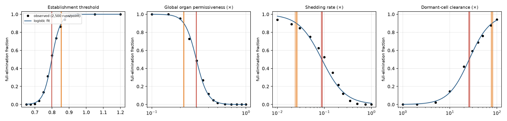

Figure A1. Full-elimination fraction against four levers (2,500 runs per point) with logistic fits. Vertical lines mark x₅₀ and x₉₀. From the v2 sweep paper.

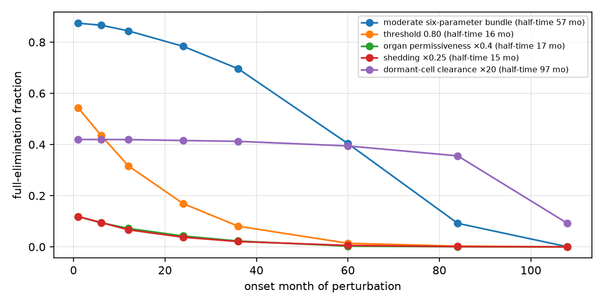{ .half }

Figure A2. Onset dependence: effect against perturbation start month (v2 sweep paper).

**Limits.** These are properties of a hand-calibrated model. The bootstrap intervals are Monte Carlo uncertainty only, not structural uncertainty, which is likely much larger. Not modeled: secondary seeding, distinct immune compartments, organ-specific growth kinetics, and spatial structure.

### A2. Native-mesh restart

**In short.** Caitlyn pointed out that the cancer model should *already contain loops* if it really used her systems. An audit found it did not. So we rebuilt it from scratch with her **polarity mesh** at its core. Think of seating guests boy-girl-boy-girl around a table. With an even number of seats it works, but with an odd number two neighbours inevitably clash. Those clashing spots are **frustrated edges**, and a cell sitting on one cannot grow. We predicted that more clashes would mean more sleeping cells. **The opposite happened:** more clashes went with *fewer* sleeping cells (correlation −0.82). Only changes "at the door" shrank both colonies and sleeping cells.

**Audit verdict: not native.** All 30 public `caitlynrandels-del` repositories were cloned on 27 November 2026. The GitHub NaCl mesh (`nacl_polarity_mesh.py`) was a four-node *tree* with no cycles and no frustration test. The `MetastasisMesh` classes were lists of cells, and their `reconcile()` only logged counts. The relay `reconcile()` only wrote "Delta reconciliation complete." And `oroboro-core.js` line 124 drew `delta: Math.random() * 0.1`. Odd-loop frustration existed in no public repo.

**What was rebuilt** (`metastasis_native/`). The monthly state *is* a polarity mesh:

- Genesis is the primary site. Shed events are Levy +7 detach pulses into a circulation ring.
- Each target organ is wrapped in a **dream-catcher niche**: an 8-node hoop, a hub and spokes, sitting on an "inverse-Epcot" bowl. Return edges close the recirculation and reawakening loops.
- A four-organ cancer has **49 nodes and 89 edges, 32 of them frustrated** at construction. Invert-and-restabilize preserves the lock set.
- Damped reconciliation is real feedback: occupancy spikes raise the Oasis threshold.
- An adaptive niche can repair frustrated edges using heat from fail, exit and colonize pulses (repair 0.08, rebuild 0.04, melt window 0.15–0.85).
- Tilt and torque bias the encounter weights on the circulation ring.

**Calibration.** The original baseline (2,500 runs) was 21.72% colonies and a pool of 10.380. The native baseline (1,000 runs) was **18.00%** colonies and a pool of **10.355**. The four-point colony shortfall comes from the loops themselves: some unfold pulses fail on frustrated edges. A tree-niche ablation raises colonies to 20.6% while the pool stays at 10.38. *Loops tax colonization; they do not set pool size.* At baseline only 2.07 of the 10.36 dormant cells sit on a frustrated edge.

**The priority test.** All 454 settings were re-run (200 runs each). Native and original pools track almost perfectly (Spearman 0.999).

| Predictor vs dormant pool | Spearman r (95% CI) | Reading |
|---|---|---|
| Dynamic frustrated-edge count | **−0.819** (−0.863, −0.765) | Opposite of the overlay prediction |
| Month-averaged frustrated count | −0.824 (−0.867, −0.772) | Same direction |
| Static count at construction | undefined | It is 32 in every setting |
| Cells sitting on frustrated edges | +0.990 | Circular (a subset of the pool) |
| Shuffled control | +0.007 | Null, as expected |
| Partial on shed (Pearson) | −0.745 | Not just a shedding effect |

*Why negative:* busy settings generate heat, heat repairs odd-loop edges, and the same busy settings fill the pool on lockable hoop edges. Settings that close the door upstream leave all 32 frustrated edges unrepaired and almost no dormant cells.

| Setting | Original p(colony) | Native p(colony) | Original dormant | Native dormant |
|---|---:|---:|---:|---:|
| Baseline | 0.217 | 0.180 | 10.380 | 10.355 |
| Valuation threshold 0.80 | 0.001 | 0.000 | 0.530 | 0.550 |
| Valuation threshold 0.85 | 0.000 | 0.000 | 0.138 | 0.140 |
| Organ permissiveness ×0.4 | 0.002 | 0.000 | 2.275 | 2.222 |
| Dormant clearance ×20 | 0.029 | 0.022 | 0.834 | 0.806 |
| Dormant maintenance 1.0 (post-settling) | 0.000 | 0.000 | 10.588 | 10.562 |
| Colonization barrier 0.5 (post-settling) | 0.006 | 0.000 | 10.584 | 10.562 |

Upstream levers shrink both outcomes. Post-settling levers clear colonies and **leave the ~10.5-cell pool**. Damper ablation changed nothing, because occupancy never reached the rest load of 40, so the damper was silent. Tilt raised both outcomes: tilt 0, 0.3 and 0.6 gave colonies of 0.165, 0.348 and 0.438 and pools of 10.40, 13.22 and 15.19.

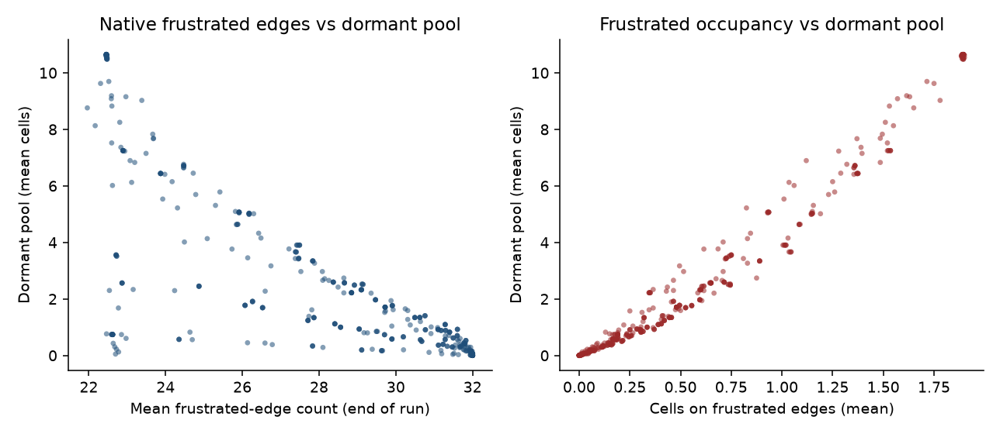

Figure A3. Left: the dynamic frustrated-edge count is negatively associated with the dormant pool across 454 settings. Right: occupancy of frustrated edges against the pool (positive, but circular).

### A3. Wiring everything together (conjunctive rerun)

**In short.** In the first restart, some of Caitlyn's parts only *took notes*. They did not influence the next round. Once the note-takers (Dictator, Transcriber, Levy) were connected to the shock absorber (damper), the absorber finally switched on. It made the door slightly stricter each month, and both colonies and sleeping cells went down. **None of the main conclusions flipped.**

The changes for conjunctive use (27 Nov 2026):

- `Dictator.stream()` now feeds the Transcriber inside each step.
- `LevyLedger.assess()` weighs the Transcriber entries, and the monthly Levy pulse feeds the damper with gain `levy_gain`.
- The Nexus state builds the next month.
- PrinciplesGate is placed after the Oasis score.
- Genesis closure is checked monthly.

`integrated=False` reproduces the pre-integration run exactly.

| Wiring (5 cancers, 1,000 runs) | p(any colony) | Dormant pool |
|---|---:|---:|
| Pre-integration | 0.180 | 10.36 |
| Conjunctive, `levy_gain` 0.05 (closest to calibration targets 0.217 / 10.38) | 0.175 | 10.09 |
| Conjunctive, `levy_gain` 0.5 | 0.134 | 8.01 |
| **Conjunctive, `levy_gain` 1.0 (working baseline)** | **0.091** | **6.36** |

**Leave-one-out at gain 1.0.** The full loop gives 0.096 and 6.37. Removing Levy feedback or the damper returns 0.178 and 10.41, so they are load-bearing. Removing PrinciplesGate changes nothing: it is inert at this load, since comfort H never falls below 0.3 and the frustration fraction stays at or below 0.36. Removing the adaptive niche gives 0.080 and 6.37, and tree niches give 0.112 and 6.36.

**Conjunctive check, 200 runs per setting** (cross-domain study). Mean damper pressure was about 0.031 and peak about 0.138. Gate commits fell from 16.9 to 10.6 per run. The pool fell from 10.480 to 6.300 and colonies from 0.175 to 0.135. Upstream levers still shrink both. Post-settling still leaves a pool (6.41) about equal to baseline. Tilt still worsens outcomes: colonies 0.135, 0.200 and 0.295 at tilt 0, 0.3 and 0.6. The frustrated-vs-pool sign survives: subsample Spearman −0.799 conjunctive vs −0.736 isolated (n = 40 settings). In the full 454-setting rerun it is −0.829 conjunctive vs −0.819 before, and the rank order of the pool is preserved (ρ = 0.988). Census, Levy, pipeline-Levy, consensus and Genesis-closure checks passed in every run.

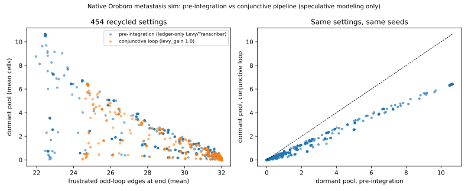

Figure A4. Pre-integration vs conjunctive loop over the 454 recycled settings. Left: the frustrated edges vs pool relationship persists. Right: the conjunctive pool is lower, setting by setting, with its rank order preserved.

### A4. Light as transport to an extraction node

**In short.** Instead of "destroying cells where they are", Caitlyn asked what happens if light *guides them out*, like an usher with a flashlight walking people to an exit. We added an exit path to the mesh. The key detail is that the **same doorman (Oasis) that decides who may settle also decides who may use the exit.** Result: in **all 45** settings tried, both colonies and sleeping cells went down. Without the doorman, the exit turned into an open drain, which is not something to aim for. *This is a graph model, not evidence that light moves real cells.*

**Mapping.** Two nodes were added, `filter` and `extract`, with lure, flush and magnet edges. Five modes were tested:

- **Lure:** a phototaxis-style directed bias.
- **Tag + magnet:** a tagged subset is pulled toward the filter.
- **Soft-kill + flush:** the documented +4 unfold pulse, then a flush edge to collection.
- **Light + sound:** a locate pulse, then a Levy-weighted push.
- **Combined:** all of the above together.

Every move is Oasis/PrinciplesGate-gated and booked with the recycled +4 weight as an `EXTRACTED` state, which is not the same as cleared. The branch is attached *charge-preserving*: the ring and the niches are 2-colored first, so the circulation ring stays fully locked. A joint-BFS star that recodes the ring was kept only as a probe. Light is **off by default**, and with it off the code reproduces the earlier integrated run bit for bit.

**Design.** Three timings: upstream (from month 1), circulation only, and post-settling (from month 61). Three strengths: 0.2, 0.5 and 0.8. Each condition used 200 runs (40 seeds × 5 cancers), compared against matched controls of 17.5% and 10.22 at gain 0.05, and 13.5% and 6.30 at gain 1.0.

| Condition (gain 0.05) | Colony rate | Dormant pool | Yield (extracted/shed) |
|---|---:|---:|---:|
| Matched control | 17.5% | 10.22 | — |
| Lure, upstream, 0.5 | 0.0% | 1.41 | 5.6% |
| Lure, circulation, 0.5 | 7.5% | 5.26 | 9.6% |
| Combined, upstream, 0.5 | **0.0%** | **0.67** | 15.1% |
| Combined, circulation, 0.5 | 5.0% | 2.85 | 15.3% |
| Combined, post-settling, 0.5 | 1.0% | 1.49 | 5.1% |
| Combined, upstream, 0.8 | 0.0% | **0.045** | 27.7% |
| Combined, circulation, 0.8 | 0.0% | 0.13 | 28.0% |

- **45/45 conditions shrank both outcomes. None shrank only one.** Adding the node with no transport changes nothing.
- Upstream is the most efficient, because it competes at admission, the same lever as A1–A3. Circulation has the highest raw yield. Post-settling leaves the most behind.
- Almost no occupancy is moved out of overt colonies (at most 0.13 mean cells).
- The circulation ring never unlocks. The frustrated-vs-pool correlation does **not** carry over (Spearman 0.09, CI −0.25 to 0.44): the exit drains the pool without the repair pattern.
- **Oasis is load-bearing.** Skipping Oasis on extract proposals raised the yield from 15.1% to 77.2% (pool 0.025), an ungated drain. PrinciplesGate, Levy feedback, the damper, the niches and the loops each barely moved the result at gain 0.05.
- A stricter Oasis threshold of 0.80 also starves the exit (yield 0.7%), so the exit is not a side door around the gate. At gain 1.0, combined upstream 0.5 gave 0.0%, 0.66 and 10.7%.

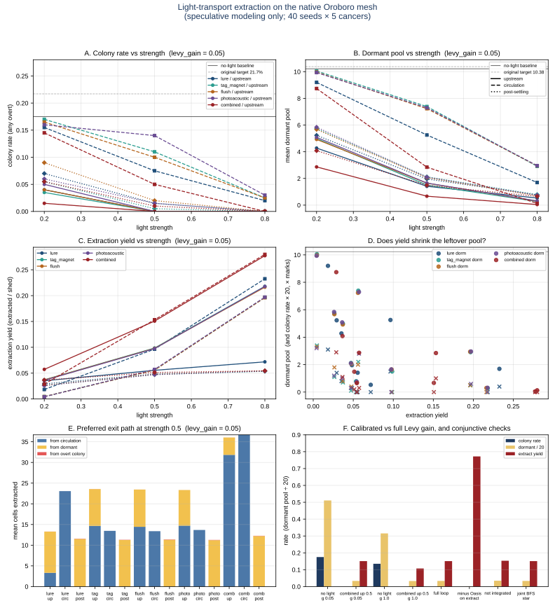{ .tall }

Figure A5. Light-as-transport sweep: colony rate and dormant pool by mode, timing and strength, plus extraction yield (from the light-transport note).

### A5. Plumbing: a sealed, valved exit

**In short.** Caitlyn's next idea was **plumbing**: pipes, valves, seals and pressure. In the cancer model the exit route became a sealed pipe, with **Oasis acting as the valve**. With a perfect seal applied early, colonies went to zero and sleeping cells dropped from about 10 to about 1.3. Leaky seals sent some cells back where they came from. Adding **16 airlock-style stages** almost restored a perfect seal. Applied late (after settling), it worked less well, which matches every earlier result.

Plumbing is off by default and is a strict no-op when off. The light-off, no-plumbing signature stayed unchanged: p(overt) 0.175, dormant 10.215, Levy 1,905.61 and frustrated edges 22.515 on 40 seeds × 5 cancers. When it is on, an Oasis/PrinciplesGate commit is required to enter the channel. A seal check then books either a sealed `EXTRACTED` hop or a leak back to circulation or the niche (Levy fail). Pressure-gradient strength sets the attempt rate, staged isolation lowers the leak, and a labeled smart-magnet hold halves it.

| Condition (40 × 5, gain 0.05) | p(overt) | Dormant | Yield | Leaked |
|---|---:|---:|---:|---:|
| Light-off, no plumbing | 0.175 | 10.215 | 0 | 0 |
| **Perfect seal, upstream** | **0.000** | **1.270** | 0.132 | 0 |
| Leak 0.3, upstream | 0.000 | 1.415 | 0.116 | 6.33 |
| Leak 0.3, 16 stages | 0.000 | 1.315 | 0.131 | 0.38 |
| Leak 0.3, smart-magnet hold | 0.000 | 1.335 | 0.125 | 2.97 |
| Perfect seal, post-settling | 0.010 | 1.950 | 0.048 | 0 |
| No Oasis valve (ablation; not a setting to chase) | 0.000 | 0.050 | 0.684 | 0 |

With a perfect upstream seal, the valve blocked 253.8 of 285.5 attempts per run and all 31.65 committed hops sealed. A leftover pool remains (p(eliminated) is only 0.03). Raising the pressure gradient from 0.2 to 0.8 raised yield from 0.053 to 0.245 and cut the pool from 4.465 to 0.200. Upstream leaks go mostly back to circulation (5.88 of 6.33). Post-settling leaks go mostly to the niche. Census, Levy and mesh-inversion checks passed on every plumbing condition, and whole-versus-parts was consistent on the four paths tested. **One check did not pass everywhere:** the mesh-consensus check (`consensus_ok`) is False on four leak/seal rows in `data/plumbing/plumbing_summaries.csv`: leak 0.6 (seal 1, upstream), seal 0.5 (leak 0.3, upstream), seal 0 (leak 0.3, upstream) and leak 0.3 post-settling. Census, Levy and inversion still pass on those rows. The plumbing addendum's own text says consensus held on every condition, which is not correct for those four rows. Their numbers should be read as provisional until the consensus mismatch is explained. The perfect-seal and staged rows quoted above pass all checks. *None of these figures is a treatment effect.*

## Part B: the magnetic-launch model

Speculative modeling. This is a 2-D point-mass physics model with labeled assumptions, plus Oroboro bookkeeping. It is not a vehicle, a launch system, a site recommendation or a claim that a magnetic track can reach orbit. Well-known concepts (HARP, SpinLaunch, StarTram, Miura-ori) are named only as analogues, with no invented specifications.

**In short: what "orbit" means here.** If you throw a ball fast enough sideways, the ground curves away beneath it as fast as it falls, so it keeps falling *around* the Earth. At 200 km up that takes about **7,788 m/s** (about 17,400 mph). The whole launch study asks one question: *after a magnetic track does most of the work, how much speed is still missing?* That missing speed is the **residual gap**, and the goal is to get it to zero (a "lock").

### B1. Goldilocks case study

**In short.** The starting idea was a roller-coaster-style magnetic track that speeds a small drone up in pulses. Going all the way to orbital speed on a track would take a track **hundreds of miles long** at a tolerable 3 g. Doing it at the bottom, in thick air, is like sprinting into a hurricane. A middle "Goldilocks" speed (1,000–3,000 mph) gathered *while climbing* got above the thick air, but it still left most of the orbital speed missing.

**Constants and assumptions.** 200 km circular speed is 7.7885 km/s (17,422 mph) and surface escape speed is 11.186 km/s, both computed from μ = 3.986004418×10¹⁴ m³/s² and R = 6,371 km. Other labeled assumptions:

- Scale height 8,500 m.
- Slender vehicle Cd 0.30 and area 0.008 m². Blunt vehicle Cd 0.50 and area 0.20 m².
- 3 g peak rail acceleration with a 50% pulse duty (0.40 s on, 0.40 s off).
- Bowl radius 2,500 m.

**Results.**

- **Track length (vacuum v²/2a).** 17,000 mph at 3 g needs 981.6 km (609.9 mi) of continuous rail, or 1,963 km with 50% duty. 3,000 mph at 3 g needs 30.6 km, and 1,000 mph needs 3.40 km.
- **The Goldilocks band is not orbit.** 1,000, 2,000 and 3,000 mph are 5.74%, 11.48% and 17.22% of circular speed. The residual is 7,341 m/s at 1,000 mph and 6,447 m/s at 3,000 mph.
- **Thick air.** At sea level the slender 20 kg vehicle feels drag of 1.50 g at 1,000 mph, 13.5 g at 3,000 mph and 433 g at 17,000 mph. No ballistic sea-level release in the band crossed 100 km; the best apogee was 34.2 km.
- **Climbing rail.** The 3,000 mph, 80° straight and concave-bowl climbs reached the target in about 186 km of rail, releasing at about 182 km with apogees of 278 and 277 km. The convex (actual-sphere) geometry stalled at an apogee of 2.07 km.
- **Dampers.** A 0.5 Hz isolator transmits 0.0202 of a 10 Hz pulse (3 g becomes 0.59 m/s²). Damping made the 400-part pulse/coast recombine coherent (residual 0.128). *Dampers meter peaks; they do not change the Δv budget.*
- **Meshes.** The NaCl mesh locked 2 of 4 edges, an icosahedral geodesic 26 of 30, and a schematic airport-sector mesh 4 complementary edges. Invert-and-restabilize held in all three.
- **Oasis.** The concept text scored exactly 0.65 and committed. With the coordinate omitted it was blocked by AdaptOrDie. *The gate routes; it does not judge the idea.*

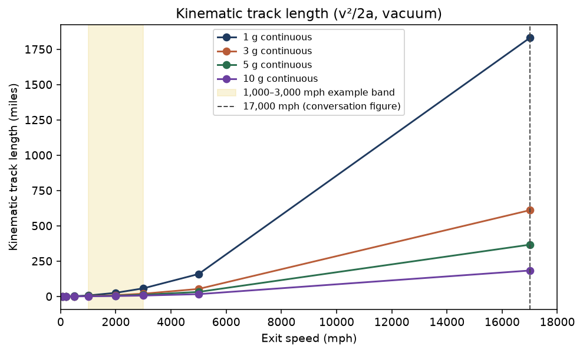{ .half }

Figure B1. Kinematic track length against exit speed and acceleration (Goldilocks case study).

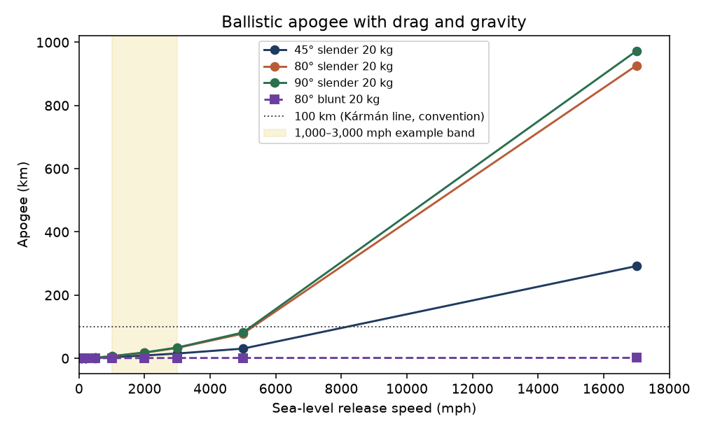{ .half }

Figure B2. Apogee by release story and geometry (Goldilocks case study).

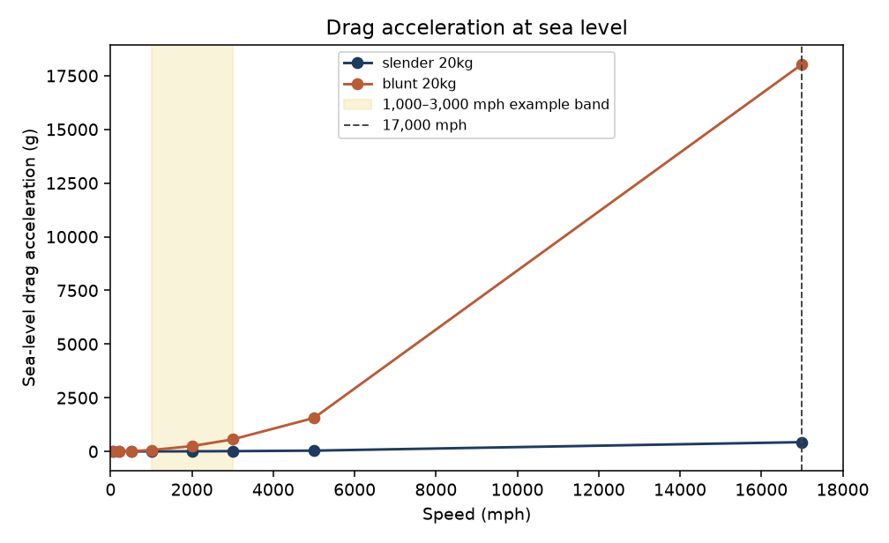{ .half }

Figure B3. Sea-level drag deceleration against speed for the slender and blunt vehicles (Goldilocks case study).

### B2. Ondulatory strings and the wireframe scaffold

**In short.** Caitlyn listed everyday objects as an example of "ondulatory strings": shrink wrap, porcelain, ninja stars, socks, 3-D-printer filament, a straw or tube, and bubbles. We read these as a vibrating string or tube. One finding: because the vehicle speeds up along the track, the pulses get **further apart** as it goes, like a song that keeps speeding up. So no single steady "note" can match the whole track.

Each object was mapped interpretively. Shrink wrap is the constraint envelope. Porcelain is a rigid limit. Ninja stars are hubs of degree three or more. Socks are a knit mesh. Filament is the string itself. The straw is a waveguide. Bubbles are the bowl.

On the placeholder 16-joint, 15-bone wireframe tree (invented joints, not real pose data):

- A hub-and-leaf polarity locked 5 of 15 edges, and alternating by depth locked 15 of 15.
- The Laplacian has one zero mode and 15 positive modes. These are graph modes, not hertz.
- On the 3,000 mph, 80° climb (L = 185.606 km, 367 pulses), the pulse spacing is **chirped**: the mean spatial period is 506.48 m against 1,072.93 m at exit, a ratio of 2.118. The exit spacing is close to uniform string harmonic 346 (detuning −0.020), but no single uniform mode matches the whole pulse train.

### B3. Dream-catcher weave

**In short.** A stick-figure skeleton is a "tree": it branches but never loops. Weaving a dream-catcher web over it created **101 loops**. Odd-sided loops (triangles) cannot be coloured boy-girl all the way round, so **59 edges stay "frustrated"**. The loops also let a pulse spread out from the centre much more thoroughly. This dream-catcher became the niche shape in the cancer model.

The base was a 15-joint kinematic tree from one detected pose (MediaPipe, one frame of personal-use footage). **No video frames or stills are reproduced anywhere**, and raw landmarks are not published. The weave added a 12-gon hoop, four inward midpoint rounds and a centre hole, giving 75 vertices and 175 edges. Results:

- Cycle rank went from 0 to **101**.
- The tree is bipartite: rule B locked 14 of 14 edges. The weave has **59** two-color conflicts, and rule B locked 116 of 175 edges, leaving exactly 59 open.
- The Fiedler value rose from 0.122 to 0.177.
- After 32 lazy-walk steps, mass at the origin was 0.116 on the tree vs 0.025 on the weave, and the weave reached all 75 nodes.
- Recombining the parts left a residual of 7.28×10⁻¹² (a bookkeeping identity).

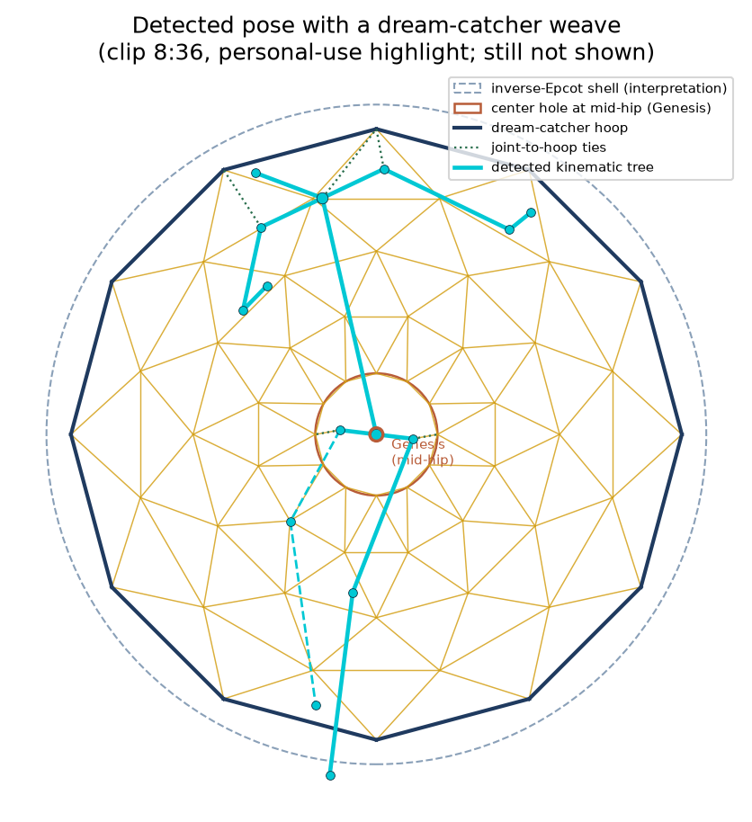{ .half }

Figure B4. Skeleton-only kinematic tree (cyan) with the dream-catcher hoop, web and centre hole. No video imagery is shown.

### B4. Goal-seek continuation, and the 256 → 1,148 m/s correction

**In short.** A search tried thousands of combinations: mass, g-force, start height, track shape, an 80 km **vacuum tube**, hollow "bird-bone" structure, feathers, heat-melted repairs and a non-spinning cabin. The best runs used a vacuum tube that releases the craft at 80 km, leaving **407–431 m/s missing** with no extra rocket. An onboard autopilot built from Oroboro parts made things *worse*. One early headline figure (256 m/s) **turned out to be wrong**. The true value is 1,148 m/s, and it is corrected everywhere.

**Search.** The goal Y has three parts: (a) apogee above 100 km, (b) minimum residual, and (c) reaching circular speed. 211 earlier entries were recycled and 251 new integrations were run. The labeled optimistic upper stages (I_sp 300 or 450 s, f_p 0.85) give Δv of 5,581 or 8,372 m/s. **No configuration met Y(c).** The best frontier points:

- **407 m/s, no stage.** A 12.6 kg hollow dart in an evacuated tube to 80 km, 1,000 g peak, 17,000 mph, flattening 45° → 5°, with the pusher *held* to the mouth. Exit 17,093 mph at 5.0°, apogee 373 km.
- **431 m/s, no stage.** A 5° tilt at 17,000 mph and 80 km, apogee 343 km. A 0° release leaves 333 m/s but does not climb.
- **256 m/s, staged: invalid.** It came from a 900 s coast that had not reached apogee. The true Kepler two-burn residual of the same staged state is **1,148 m/s** (apogee 5,436 km, perigee underground). Adding Earth rotation makes it worse (1,430–1,558 m/s). *Do not compare 256 m/s with anything.*

**Onboard autonomy** (n = 24 Monte Carlo runs) used three noisy votes, the median as consensus, Levy weighted by error and q, and an Oasis commit at 0.65. The closed loop **hurt**: the unstaged apogee fell from 115.1 to 50.2 km (100 km success 1.00 → 0.00), and the staged residual rose from 325 to 744 m/s. Other layers:

- **Hollow bones.** At k = 0.8, equal stiffness saves 53.1% of mass; a 20 kg request flies as 12.56 kg.
- **Feathers and atmospheric tiers.** They add kilometres of glide in thick air but no orbital Δv.
- **Non-spinning interior.** It removes spin-g but not path-g: 73.4 g at 3,000 mph and 2,356 g at 17,000 mph on a 2,500 m bowl.
- **Heat-driven feather regrowth.** On a mid-speed climb, PLA sat in its melt band for 280 s and refilled 7 of 8 missing cells. On the 17,000 mph evacuated path the skin reached about 3,700 °C and the whole filament budget ablated.
- **Tilt.** 5° at an 80 km mouth was the practical optimum.

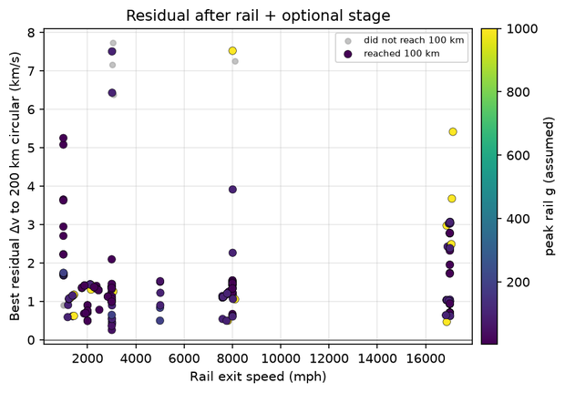{ .half }

Figure B5. Residual against rail exit speed for the goal-seek set.

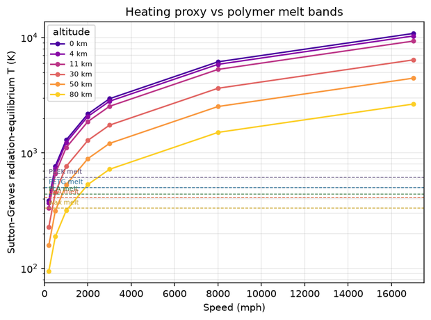{ .half }

Figure B6. Radiation-equilibrium temperature screens against polymer melt and degrade bands (labeled textbook-order values).

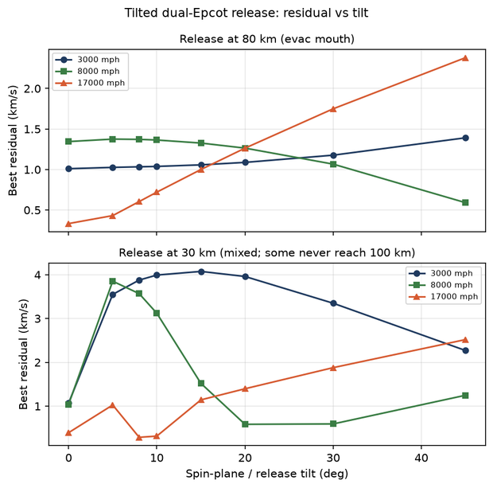{ .half }

Figure B7. Residual against release tilt at several speeds and start heights.

### B5. Geography

**In short.** Earth spins, so launching eastward from the equator gives a free boost of about 465 m/s, like stepping onto a moving walkway. That sounds like exactly the missing amount, but our craft is *already* nearly at orbital speed. Adding the boost **overshoots** and stretches the orbit instead of rounding it off. On the flattest exit, mid-latitude sites came out best: **Baikonur needed only 66 m/s**, and Las Vegas 119 m/s.

The boost is v = 465.1·cos(lat) m/s, scaled to 470.9 m/s at the equator at 80 km. The inclination floor is i_min = |lat|.

- **The equator does not close Y(c).** The 5° residual is still 375 m/s and the evac dart 398 m/s, only a 9–56 m/s improvement.
- **The 0° exit is where geography matters.** With the boost, 80 km becomes perigee and the craft climbs.
- **Ranking:** Baikonur **66**, Māhia 103, Mount Charleston 118, Las Vegas 119, Vandenberg 126, Spaceport America 133, Tanegashima 144, Cape Canaveral 151, Mauna Kea 181, Wenchang 181, Sriharikota 195, Kourou 206, Kilimanjaro 208 and Chimborazo 208 m/s. A latitude near 56° would be ideal.
- **What does not matter here.** Elevation does not change the residual at an 80 km mouth. The coastal preference is about downrange safety, not Δv. A plane change to an equatorial orbit costs about 4.82 km/s from Las Vegas.

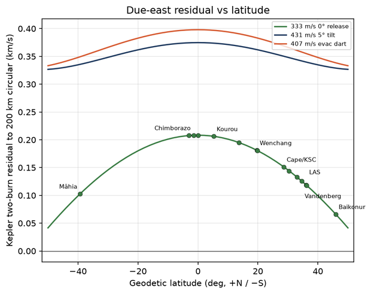{ .half }

Figure B8. Two-burn residual against site latitude. The 0° curve is the one that moves.

### B6. Redstone repeater, comparator, and the no-track run

**In short.** Caitlyn explained the problem in Minecraft redstone terms. The signal is "a few dust short" of locking the final piston, and a side signal (Earth's spin) arrives at the wrong angle and stretches the circuit.

- **Repeater** = a small final rocket burn, paid for with the craft's own fuel, right at the end. **It worked.** Spending 5% of the craft's mass on it closed the gap from all 14 sites on the flat exit.
- **Comparator** = a gate that only allows the spin boost when the craft is nearly there. **It never beat simply aiming in the best direction.**
- **No track** = take the track away and launch from the ground on rockets. **It failed every time.** The thick lower air slows and overheats the craft, so the vacuum tube was doing the real work.

**Repeater.** An impulsive two-burn at apogee and at the 200 km apsis, sized with the rocket equation from the vehicle's own mass at I_sp 450 s. The three fractions f_p = 0.05, 0.30 and 0.85 buy 226, 1,574 and 8,372 m/s.

- **f_p 0.05** (re-using the filament budget) locks **all 14 real sites on the 0°/80 km exit**: due-east leftovers of 66–206 m/s, with Baikonur needing only 0.015 and Las Vegas 0.027. It does *not* circularize the 5° darts (Baikonur 338 → 112 m/s).
- **f_p 0.30** (the payload fraction) **locks every due-east setup**, including the staged stack (Baikonur needs 0.28 of the remaining 18.84 kg). This is a bookkeeping result, and it effectively turns the dart into a staged vehicle.
- Closing the 407 m/s gap takes 1.11 kg of the 12.56 kg dart (f_p 0.088), more than the 0.63 kg filament budget.

**Comparator.** Thresholds were swept from 50 to 2,000 m/s. It never beat always-best-azimuth (**0 of 14**).

| Setup | Always due east | Comparator suppressing | Always best azimuth |
|---|---:|---:|---:|
| 0° / 80 km | 153 m/s | 336 m/s (climb lost) | **42 m/s** |
| 5° evac dart | 372 | 409 | **328** |
| 5° tilt | 353 | 433 | **326** |
| Staged (true 1,148) | 1,507 | 1,144 | **834** |

On the 0° exit, the useful lever is the heading itself. Aiming 40–65° off due east gives 37 m/s at Baikonur and 38 m/s at Las Vegas. AdaptOrDie blocked only the zero-coordinate "idealized equator".

**No track (240 runs, 0 locks).** The 12.56 kg dart flies from the pad at T/W 3 and I_sp 450 s.

- f_p 0.05 reaches only 1.6 km.
- f_p 0.30 peaks at 47 km with a heating proxy of about 1,730 K.
- f_p 0.85 passes 200 km but leaves **661 m/s (Kourou), 708 (Las Vegas), 756 (Baikonur) and 631 (Mauna Kea)**, with perigee underground, peak q of 384–406 kPa and a heating proxy of **5,160–5,240 K**.
- Reserving fuel for a 500 m/s repeater made the ascent worse.

The binding constraint is **thick-air drag and heating**, not the last 100 m/s.

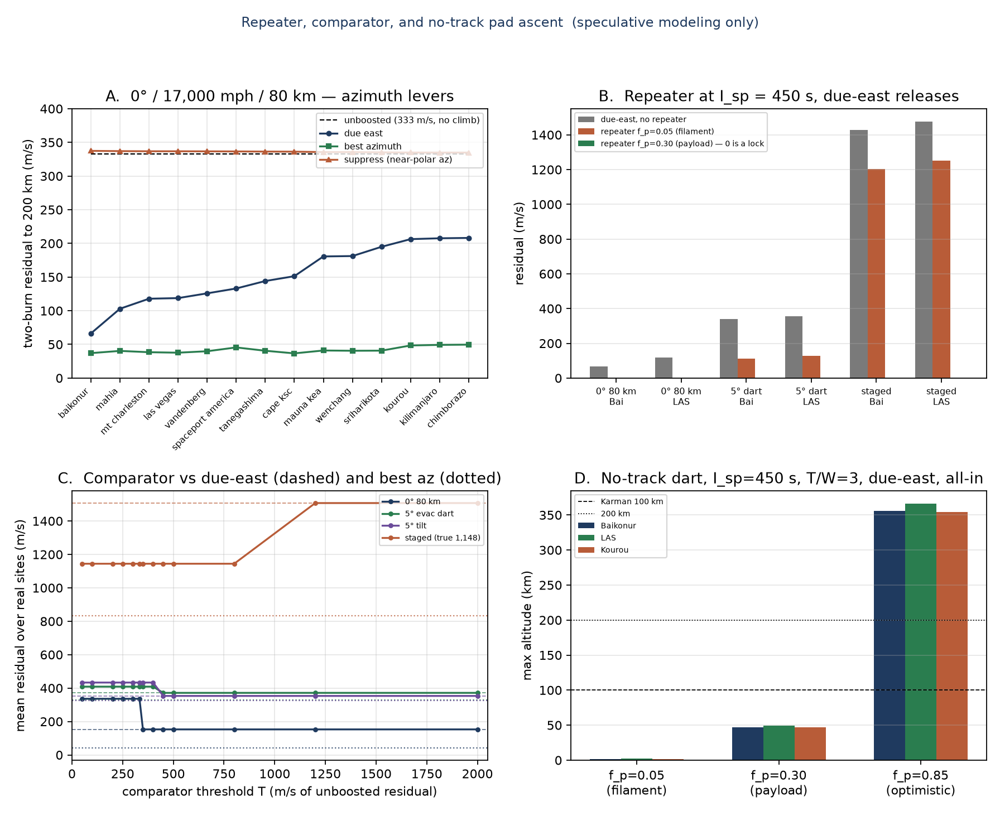

Figure B9. (A) Azimuth levers on the 0° exit. (B) Repeater fractions; 0 is a lock. (C) Comparator threshold sweep. (D) No-track maximum altitude.

### B7. Light-sail push after the track

**In short.** Strip the craft to a frame plus a thin mirror-sail, and push the sail with a powerful laser from the ground, since light carries a tiny push. It is like trying to push a sailboat with a flashlight while it is still in a storm. **0 of 864 runs reached orbit.** Even at 120 km the thin leftover air pushes back harder than a 10 GW laser. The laser also loses sight of the craft before the point where the push is needed, and the sail overheats.

Sweep: 1 MW–100 GW from one site under the tube mouth, sails of 10–1,000 m² at 1–100 g/m², reflectivity 0.90 and a 3 m aperture at 1.06 μm. Four focus sites, a residual gate (the comparator analogue) and smart unfold.

- **Drag.** A 100 m² sail sees about 90 kN at 80 km and about 119 N at 120 km, against 63 N of photon force at 10 GW. On the 0° exit the sail never unfolds, and the residual drifts only from 48 to 38 m/s.
- **Line of sight.** There are about 134 s above 5° elevation, and apogee is out of view, so the light only helps on the climbing leg.
- **Stretching.** An ungated 100 GW push drove the leftover to about 1,400 m/s. The gate stops this but does not close the gap.
- **Heating.** Almost every sail that opened ran hotter than the 803 K PEEK band: 2,176 K at 10 GW and 4,696 K at 100 GW.
- **Best cuts.** The staged case at 100 GW went from about 682 m/s (coast) to 519 m/s, using 12,990 GJ. The no-track burnout went from 661 to 514 m/s at 10 GW. Perigee stayed underground in both. A second, downrange laser was **not** modeled.

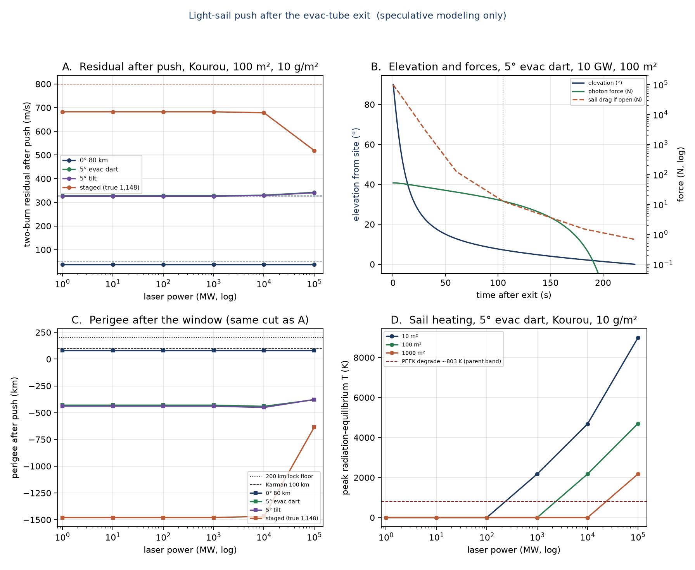

Figure B10. Light-sail push panels from the light-sail addendum (residuals, window and heating across the sweep).

### B8. Kite, fishing line, lane-keeping, smart magnets, and the straw

**In short.** Five ways to steer the no-track craft were tried. A **kite** acted like a parachute while sprinting. A **fishing line** acted like a boat anchor. **Car-style lane-keeping** helped a tiny bit (17 m/s) and wasted almost no steering effort. **Magnets pushing on Earth's magnetic field** gave a push of about a hundred-millionth of a newton, which is effectively nothing. The **straw**, a channel you draw from ground to sky, was the best of the five, but once its air is pumped out it is just the vacuum tube again, about 1,000 km long. **None reached orbit (0 of 46).**

| Variant (f_p 0.85, Kourou) | Residual | Max altitude | Binding constraint |
|---|---:|---:|---|
| Open-loop baseline (no track) | 661 m/s | 354 km | Drag and heating |
| Kite, 10 m², reefed | 1,333 | 208 km | Kite drag in thick air |
| Line, 500 m, from pad | 7,551 | 4.3 km | Line drag (sea anchor) |
| Line, 500 m, from 60 km | 2,791 | 88 km | Line drag in residual air |
| Old γ-law autopilot from pad | 6,890 | 1.1 km (impact) | The harmful controller |
| **Gated lane-keeping** | **644** | 341 km | Still drag and heating |
| Magnets vs Earth's field | 661 | 354 km | Force ≈ 1.4×10⁻⁸ N |
| Open-air straw, steep | 1,407 | 101 km | Aero and path losses |
| **Evacuated straw** | **595** | 524 km | Propellant and gravity |

Lane-keeping used the Nexus-registered path, a median of three sensor votes, Levy-weighted corrections and Oasis commits at 0.65. It made 871 commits with only 0.01 s of thrust-cosine waste. A magnetorquer gives *torque* (0.030 N·m), not a useful *force*, in Earth's field (labeled 30 µT). Reaching 7,788 m/s at T/W 3 in vacuum needs 1,031 km of channel, 1.34× the recycled 767.6 km evacuated tube.

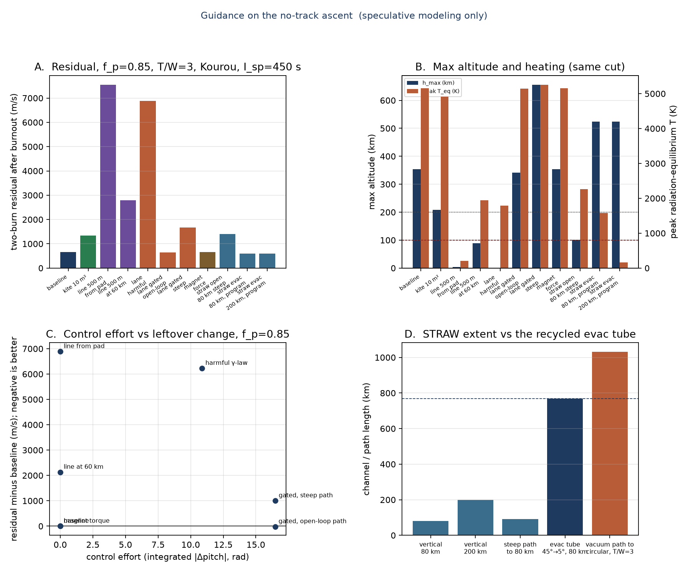

Figure B11. Guidance variants (kite, line, lane-keeping, magnets, straw) against the no-track baseline, from the guidance addendum.

### B9. Adaptive fur and fabric, Pixar-referenced

**In short.** Pixar animates fur and cloth by letting the computer mesh add detail where it is needed, like a scarf whose stitches tighten where it flaps most. We made Caitlyn's surfaces adapt the same way, with her Oroboro gates deciding where to add or remove detail. The **fishing line improved most**, because it learned to reel itself in while it would act as an anchor. Still, **nothing reached orbit.** One surprise: adding detail to cloth that is *already* wrinkled can lock the wrinkle in.

**Sources actually read** (listed in [References](#sources-files-and-references)): Pixar's volumetric hair memo, *Untangling Cloth*, *Holding the Shape in Hair Simulation*, the 2022 cloth-tailoring remeshing talk, the *Turning Red* style-guide talk, the 2022 Dynamic Deformables course, and the 2026 Fizt Strands talk. Baraff and Witkin 1998 is cited only as the model Fizt is built on (a CMU publication).

**Construction.** The target edge length interpolates between L_min and L_max, following Waggoner and de Goes in form. Their painted weights are replaced by live Oroboro signals: tension, q, speed and force. Splits and collapses are admitted only when Oasis/PrinciplesGate and a NaCl majority agree. Delta reconciliation refuses any refine that raises predicted aero work at high q. *That runtime remeshing is an Oroboro construction, not a claim about Pixar's tools.*

| Variant (f_p 0.85, Kourou) | Residual | Max altitude | Note |
|---|---:|---:|---|
| Baseline | 661 m/s | 345 km | Confirms recycled |
| Kite, adaptive gated | 1,344 | 248 km | Reopens; a loft-vs-drag trade on top of a sheet-mass tax |
| Line, fixed (this integrator) | 2,378 | 112 km | Drag integral 7,943 m/s |
| **Line, adaptive gated** | **1,361** | 187 km | Stows, then redeploys: drag 588 m/s, still a brake |
| Evacuated straw with adaptive liner | 595 | 524 km | Liner tip RMS 0.99 m vs 2.45 m; no Δv change |
| Sail, adaptive gated | 554 | 477 km | Openness 0.52; hotter (3,378 K) |

In the standalone gust test, every mesh blew to a ~0.6 m tip envelope. Adaptive refinement during the deformed state left a *larger* tip offset (~0.74 m vs ~0.63 m). The volumetric collision grid refined from 8 to 24 cells.

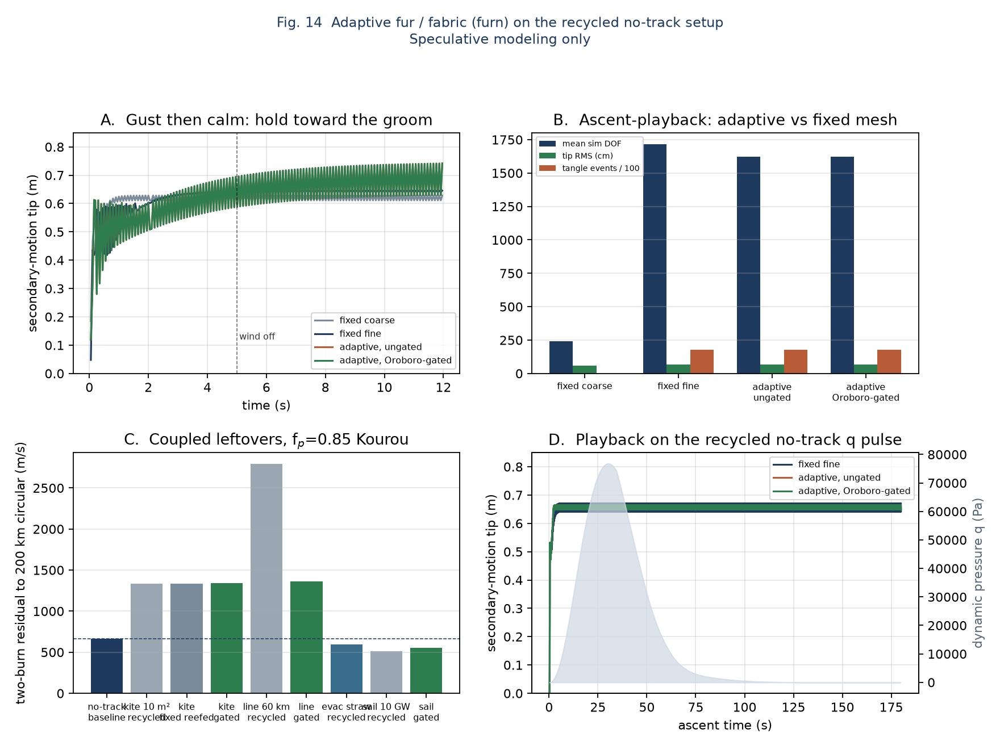

Figure B12. (A) Gust then calm. (B) Ascent playback: DOF, tip RMS, tangles. (C) Coupled leftovers. (D) Playback tip through the q pulse.

### B10. Plumbing on the straw

**In short.** Treat the vacuum straw like plumbing, with airlocks, leaks and a puff of air pressure behind the craft. A longer leak-free vacuum **did not change** the 595 m/s gap, because the rocket had already finished burning at 109 km. Small leaks showed up first as **extra heating**. A fully leaked straw was exactly the no-track run (661 m/s). Pushing with air pressure made things **worse**, because it flung the craft too high (0.1 bar late: 666 m/s; from the pad: 791; 1 bar: 2,934). **0 of 49 locked.**

Inside a staged vacuum segment, residual density is leak_frac / n_stages × the outside ISA density. The pneumatic force is F = ΔP·A, about 607 N at 1 bar against 370 N of chemical thrust, and supply work assumes η = 0.5.

| Case | Residual | Max altitude | Heating proxy | Note |
|---|---:|---:|---:|---|
| Evacuated to 80 km, leak 0 | 595.0 m/s | 524 km | 1,579 K | Matches recycled |
| Vacuum to 200 km or along 1,031 km, no push | 595.0 | 524 km | 160–899 K | Burnout already at 109 km |
| Leak 0.1 | 595.5 | 502 km | 2,571 K | Heat appears before the residual moves |
| Leak 1, or open air | 661.3 | 354 km | 5,158 K | Bit-identical to no-track |
| 0.1 bar, late valve | 666 | 961 km | 1,686 K | Lofts; 6.8 MJ waste |
| 0.1 bar, from the pad | 791 | 1,348 km | 1,545 K | Worse |
| 1 bar | 2,934 | 5,801 km | 1,716 K | 66.8 MJ waste |

Fifteen further cases, including every 1–10 bar push on long channels, were unbound, so no residual exists for them. A 1,031 km flatten-to-5° channel with no push was a worse gravity turn (4,523 m/s).

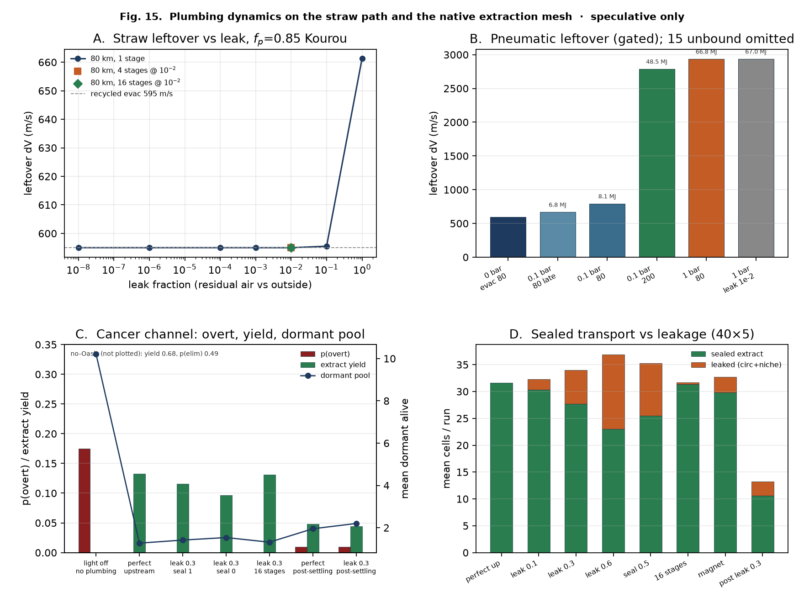

Figure B13. Plumbing dynamics. (A) Leftover against leak fraction. (B) Pneumatic push. (C, D) The cancer-side sealed exit and leaks.

## What the two domains say together

**In short.** Both models tell the same story in different clothes. **What is left over is mostly decided at the door.** In the cancer model the door is the moment a cell is admitted to an organ. In the launch model it is the moment the craft leaves the vacuum tube. Later fixes tidy things up but rarely empty the leftover. The two things that *did* work also look alike: a **small, well-placed, paid-for action at the right moment**. That is the final rocket burn in the launch model and the guarded exit in the cancer model.

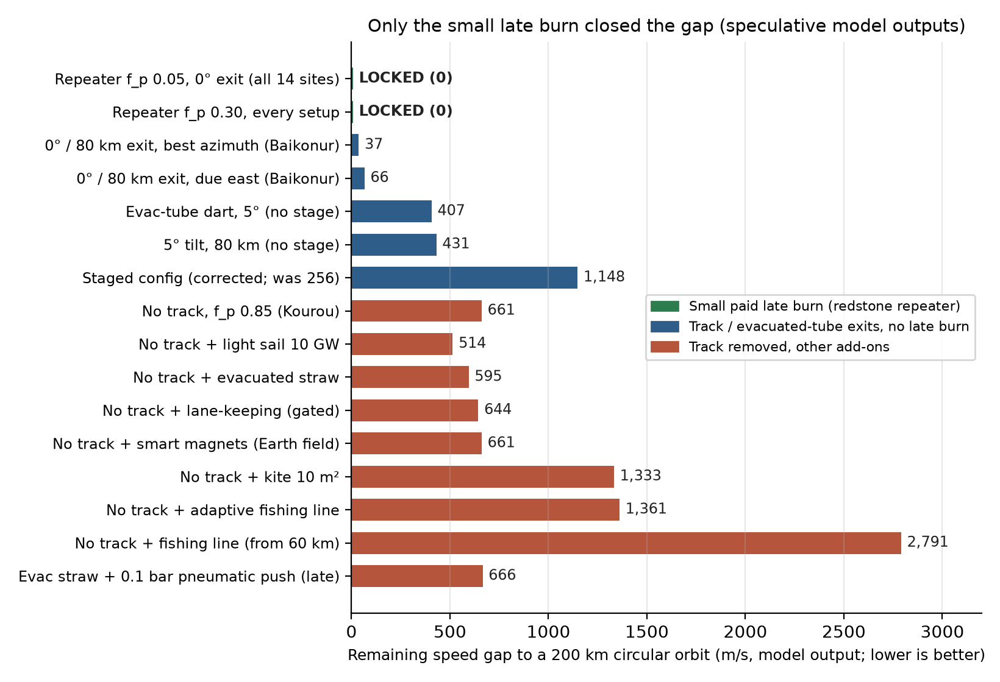

Figure C1. Summary of launch-model leftovers drawn only from numbers stated in the addenda (no new simulation). Green bars are locks. The 0°-exit due-east and best-azimuth values still have perigee at 80 km until a repeater burn raises it. The kite, line and straw values are no-track runs at f_p 0.85 from Kourou.

1. **The small late burn is the only thing that closed the launch gap.** A redstone repeater paid from the vehicle's own mass (f_p 0.05) locked all 14 real sites on the 0°/80 km exit, and f_p 0.30 locked every due-east setup. Nothing else locked: the comparator, light sail, kite, line, lane-keeping, magnets against Earth's field, straw, adaptive meshes and plumbing all failed. Their best leftovers sat between about 514 and 661 m/s on the no-track baseline, and several made things worse.
2. **Upstream admission is the cancer-model lever.** In every wiring, only the Oasis threshold and organ permissiveness shrank both colonies and the pool. Post-settling levers cleared colonies and left a pool. The new levers that also shrank both, the light exit and the sealed plumbing exit, work through the same Oasis gate, and work best when applied upstream.
3. **The gate is load-bearing, in both directions.** Oasis keeps the cancer exit from becoming an ungated drain (15% vs 77% yield). In the launch model, the comparator form of a gate is the wrong tool whenever the side pulse is what makes the craft climb.
4. **The same name can have opposite effects.** A 5° *release* tilt is the in-set way to satisfy the climb goal, while *circulation* tilt in the cancer model doubled colonies.
5. **Geography plays the part of organ permissiveness.** Latitude is an admission condition on the leftover, not a free subtraction.
6. **Loops are not the reservoir.** Odd loops tax colonization (18.0% vs 20.6% on a tree) but do not set pool size. Frustrated-edge count moves *opposite* to the pool because self-repair unlocks loops in busy settings.
7. **Conjunctive vs isolated.** Wiring Dictator, Transcriber and Levy into the damper made the damper engage and lowered both cancer leftovers (10.48 → 6.30 and 0.175 → 0.135 in the 200-run check). No qualitative finding flipped. In launch, the one onboard loop that *was* conjunctive (votes, consensus, Levy, Oasis) hurt insertion. Wiring things together is not automatically better; it has to be tested.

## Predictions that failed

**In short.** A good study reports what it got wrong. These are the ideas that the models did **not** support.

| Prediction or claim | What the model actually showed |
|---|---|
| More frustrated loops would mean a larger dormant pool | Opposite: Spearman −0.819 (−0.829 conjunctive) |
| Removing loops would empty the pool | No. Loops tax colonization and leave the pool unchanged |
| The damper matters in the first restart | It was silent (occupancy below rest load). It only engaged once Levy was wired in |
| An onboard Oroboro autopilot would improve insertion | It hurt: apogee 115 → 50 km, staged residual 325 → 744 m/s |
| 256 m/s staged residual | Invalid (incomplete coast). The true value is 1,148 m/s |
| An equatorial launch closes the gap | No. 375–398 m/s remain, and the boost overshoots |
| A subtraction-mode comparator beats due east everywhere | It never beat best azimuth (0/14) and helped only the staged case |
| The no-track launch can work with enough fuel | 0/240. Drag and heating bind first (~5,200 K proxy) |
| A laser light sail closes the gap | 0/864. Drag, line of sight and heating bind |
| A kite or fishing line adds useful lift or guidance | Both acted as brakes (1,333 and 2,791 m/s) |
| Smart magnets can steer off-track | ~1.4×10⁻⁸ N against Earth's field, effectively zero |
| Adaptive meshes close the gap | No. Refining a wrinkled state can lock the wrinkle in |
| A longer vacuum or a pressure push closes the gap | No. 595 m/s unchanged, and pushes widen it |
| The frustrated-vs-pool correlation holds with a light exit | It vanished (Spearman 0.09) |
| Oasis can tell true claims from false | It committed true and false closure claims alike at exactly 0.65. It routes; it does not verify |

## What this report does not claim

- **No clinical, biological or medical claim.** The cancer model is simulated occupancy on a graph, with rates hand-calibrated to a qualitative pattern. "Light", "magnet", "flush" and "plumbing" are mesh edges and gates. They are not evidence that any physical method moves, extracts or treats cells. No dose, wavelength, safety or treatment implication follows.
- **No engineering, flight or siting claim.** The launch model is a 2-D point mass with labeled coefficients, a vacuum two-burn residual metric, an impulsive repeater and equilibrium heating proxies. Hollow-dart mass budgets are bookkeeping, not structural certificates. No site, power level, sail, tube or device is recommended.
- **Uncertainty.** Bootstrap intervals cover Monte Carlo error only. Structural and parameter uncertainty are larger and unquantified.
- **Levy weights and Oasis scores are bookkeeping and routing.** They are not physical energies and not truth tests.
- **Known gaps.** The sponge compartment was never used. PrinciplesGate is wired but never triggers at these loads. The dream-catcher and odd-loop pieces exist in the project workspace, not in the original public repos. The epilepsy model's code was left untouched. The cancer plumbing run's mesh-consensus check failed on four leak/seal rows (see A5).

## GitHub state

<!-- GITHUB-STATE:START -->

**In short.** Every finished study, including guidance, fur/fabric, plumbing, and this combined report, is on Caitlyn's public GitHub. This report lives at [`research/combined-report/`](https://github.com/caitlynrandels-del/Oroboro/tree/main/research/combined-report). The GitHub connection only accepts text files, so PDFs and images appear there as SVG page images and SVG charts, while the original PDF, PNG and DOCX files stay on the project computer.

State as of 27 November 2026, 5:54 PM (America/Denver). All pushes were plain commits to `main` with no force pushes, each fresh clone was checked against the local copy, and each push passed a secret scan. Before this report was added, `main` on Oroboro ended at `3b6d3a7`.

| Repository | Commits | What it holds |
|---|---|---|
| [caitlynrandels-del/Oroboro](https://github.com/caitlynrandels-del/Oroboro) `research/` | `c503de2..66bfa88` (21) | Conjunctive native metastasis sim, the launch case study with the 1,148 m/s correction, the cross-domain comparison, the PIPELINE data-flow diagram, and "superseded" banners on three older consciousness-mapping sims |
| | `1b90bc4..f4b78f1` (8) | Redstone addendum (Markdown, HTML, page images, script, data, chart), geography page images, HTML write-ups with figures, heat-path data, README updates |
| | `4c656cb..3ca03db` (23) | Light-sail addendum with script, data and chart. Light-transport write-up, data, chart and sim code (light off by default; 25/25 runs match the earlier version). Page views for every remaining PDF. README updates |
| | `eef1560..b2c4987` (6) | Guidance (kite, line, lane-keeping, magnets, straw) and adaptive fur/fabric results. The fur/fabric commits are `3ac3940`, `4950666` and `b2c4987`, all inside this range. |
| | `738804f..3b6d3a7` | Plumbing dynamics addendum (launch and cancer), data and figure |
| | this report | Markdown, HTML, build files, SVG figures, and PDF page images, at [`research/combined-report/`](https://github.com/caitlynrandels-del/Oroboro/tree/main/research/combined-report) |
| [oroboro-relay](https://github.com/caitlynrandels-del/oroboro-relay) | `cc77063`, `d3d0940` | The `Math.random()` delta in `oroboro-core.js` replaced with a deterministic delta against the Nexus record. A new `OroboroPipeline` (Dictator → Transcriber → Levy → damper → delta → isolate/recombine → Nexus → Genesis) with a passing test. The Swift port got the same fix but was not compiled |
| [metastatic-cascade-analysis](https://github.com/caitlynrandels-del/metastatic-cascade-analysis) | `30659cd..427e345`; `66dbeba..d9f09c8` | v1 and v2 papers, with the old model marked superseded; then v3–v5 page views. Now at `d9f09c8` |
| [epilepsy-sim](https://github.com/caitlynrandels-del/epilepsy-sim) | `2be4eac` | Audit section only. Partially conjunctive, code untouched; 50/50 tests pass |

**Not published, by design:** binary PDF, PNG and DOCX originals (published as SVG page images instead), raw pose landmarks, and anything from the personal-use video.

<!-- GITHUB-STATE:END -->

## Glossary

**Ablation / leave-one-out.** Switching off one part to see what it was doing.

**Agent-based model.** A simulation that follows many individual units (here, "cells") step by step.

**Apogee / perigee.** The highest and lowest points of an orbit. "Perigee underground" means the path would hit Earth before completing an orbit.

**Azimuth.** Compass heading of the launch. Due east is 90°.

**Bootstrap 95% CI.** A range showing how much a number would wobble from simulation randomness alone.

**Circular orbit speed.** The speed needed to keep falling around Earth: 7,788.5 m/s at 200 km in this model.

**Colony (overt colony).** A simulated cell group that has grown in a distant organ.

**Comparator (redstone).** A conditional gate. Here, it lets Earth's spin boost through only when the main push is already close to enough.

**Conjunctive.** All Oroboro parts running together in one loop, each feeding the next.

**Damper / delta reconciliation.** A shock absorber that smooths spikes. Reconciliation recombines independent parts and checks they add up to the whole.

**Dormant pool.** Simulated cells that have settled but are "asleep". They are the hard-to-clear leftover.

**Dream-catcher niche.** A hoop-and-web graph around each organ. Its triangles create odd loops.

**Δv (delta-v).** Change in speed. The currency of spaceflight.

**Evacuated (evac) tube.** A tube with the air pumped out, so the craft can go fast without drag or heat.

**f_p (propellant fraction).** The share of the craft's mass that is fuel for a burn.

**Frustrated / locked edge.** In the polarity mesh, a link between opposite charges *locks*. In an odd loop, some links cannot, and they stay *frustrated*.

**Genesis, Nexus, Oasis, PrinciplesGate, AdaptOrDie, Dictator, Transcriber, Levy, Homeostasis, Sponge.** Caitlyn's Oroboro components. See the table in [the systems section](#the-oroboro-systems-wired-as-one-loop).

**I_sp (specific impulse).** Fuel efficiency of a rocket engine, in seconds.

**In silico.** Done in a computer simulation.

**Kármán line.** The conventional 100 km edge of space.

**Lock (orbit).** In this report: two-burn residual ≤ 1 m/s, with perigee at or above the stated floor (100 or 200 km).

**`levy_gain`.** How strongly Levy event weights feed the damper. 0.05 is closest to the original calibration; 1.0 is the working baseline.

**Monte Carlo / seed.** Running a random simulation many times. A seed fixes the random sequence so runs repeat exactly.

**Organ permissiveness.** How welcoming a simulated organ is to arriving cells.

**Organotropism.** A cancer type's preference for particular organs.

**Post-settling / upstream.** Acting after cells have settled vs acting at or before admission.

**q (dynamic pressure).** How hard the air pushes on a fast-moving object.

**Radiation-equilibrium temperature (heating proxy).** A rough estimate of how hot a surface gets at speed. It is not a measured wall temperature.

**Repeater (redstone).** A small final burn that "refreshes" the signal right at the end.

**Residual (two-burn residual).** The extra speed still needed, in two ideal burns, to reach a 200 km circular orbit.

**Spearman correlation.** A number from −1 to +1 for how consistently two quantities rise or fall together.

**State reduction.** Splitting the system into independent parts, processing them separately, and recombining them.

**T/W (thrust-to-weight).** How hard the engine pushes compared with the craft's weight.

## Sources, files and references

**Internal sources (project computer).** These were summarized here without recomputation, except the new summary chart C1, which is plotted from their stated numbers.

- `study-writeup/v2/InSilico_Metastasis_Parameter_Sweep_Refined.pdf` (1.21M-run reanalysis)
- `oroboro-research/metastasis_native/notes/Native_Mesh_Restart_HeatTrace.md`
- `notes/Light_Transport_Extraction.md`
- the `metastasis-native` README (conjunctive integration)
- `oroboro-research/cross_domain/Oroboro_CrossDomain_Comparison.md`
- `oroboro-research/magnetic_launch_case_study/`, in order: `Magnetic_Launch_Goldilocks_CaseStudy`, `Ondulatory_Strings_Wireframe_Addendum`, `Dreamcatcher_Weave_FollowOn`, `Magnetic_Launch_GoalSeek_Continuation`, `Geography_Launch_Sites_Addendum`, `Redstone_Repeater_Comparator_Addendum`, `Light_Sail_Push_Addendum`, `Guidance_Kite_Line_Straw_Addendum`, `Fur_Fabric_Adaptive_Addendum`, `Plumbing_Dynamics_Addendum`, and the figures in `outputs/`
- `research/PIPELINE.md` in the Oroboro repository

The physical constants are standard textbook values: standard gravity 9.80665 m/s², Earth's μ 3.986004418×10¹⁴ m³/s², mean radius 6,371 km, and ISA sea-level density 1.225 kg/m³. Launch-site coordinates are published public values.

**External references.** Only these were used, all for the fur and fabric study (B9):

1. Petrovic, Henne and Anderson. *Volumetric Methods for Simulation and Rendering of Hair.* Pixar Technical Memo #06-08 (SIGGRAPH 2005 Talks). research.pixar.com/docs/2005.SiggraphTalks.PHA.pdf
2. Baraff, Witkin and Kass. *Untangling Cloth.* SIGGRAPH 2003. research.pixar.com/docs/2003.SiggraphPapers.BWK.pdf
3. Iben, Brooks and Bolwyn. *Holding the Shape in Hair Simulation.* SIGGRAPH 2019 Talks. research.pixar.com/docs/2019.SiggraphTalks.IBB.pdf
4. Waggoner and de Goes. *Revamping the Cloth Tailoring Pipeline at Pixar.* SIGGRAPH 2022 Talks. research.pixar.com/docs/2022.SiggraphTalks.WG.pdf
5. Montell, de Goes and Brooks. *Hair Emoting with Style Guides in Turning Red.* SIGGRAPH 2022 Talks. research.pixar.com/docs/2022.SiggraphTalks.MGB.pdf
6. Kim and Eberle. *Dynamic Deformables: Implementation and Production Practicalities.* SIGGRAPH 2022 Course. research.pixar.com/docs/2022.SiggraphCourses.KE.pdf
7. Brooks, Eberle and Browning. *Blazing a New Trail of Curls.* SIGGRAPH 2026 Talks. research.pixar.com/docs/2026.SiggraphTalks.BEB.pdf
8. Baraff and Witkin. *Large Steps in Cloth Simulation.* SIGGRAPH 1998 (Carnegie Mellon University). Cited only as the model that Pixar's Fizt is built on. cs.cmu.edu/~baraff/papers/sig98.pdf

Speculative in-silico modeling only. No clinical, biological, medical, engineering, flight or operational claims. © 2026 Caitlyn Randels.

