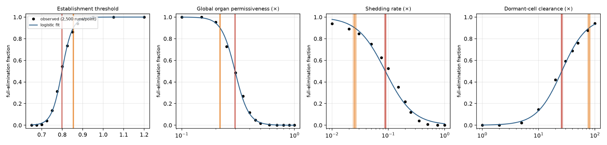
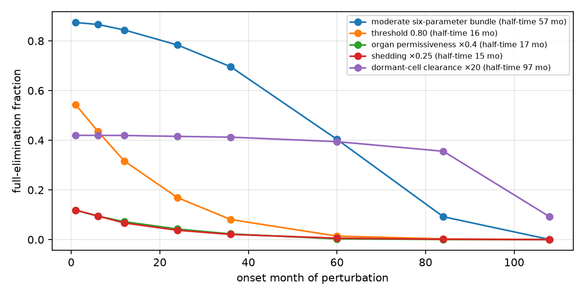
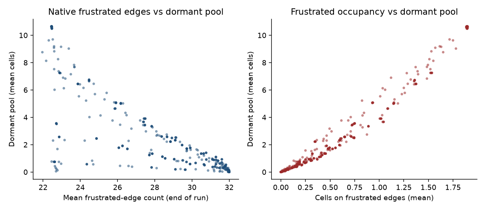
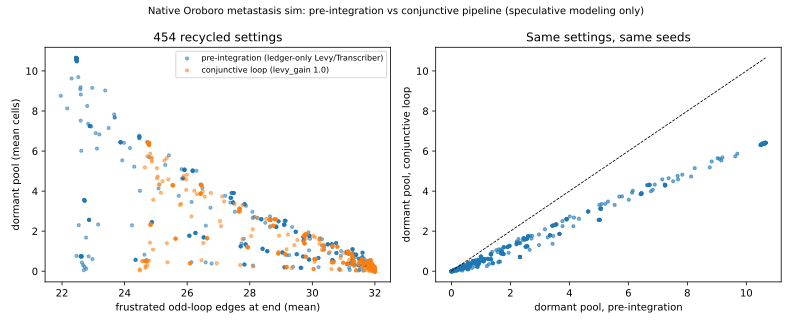
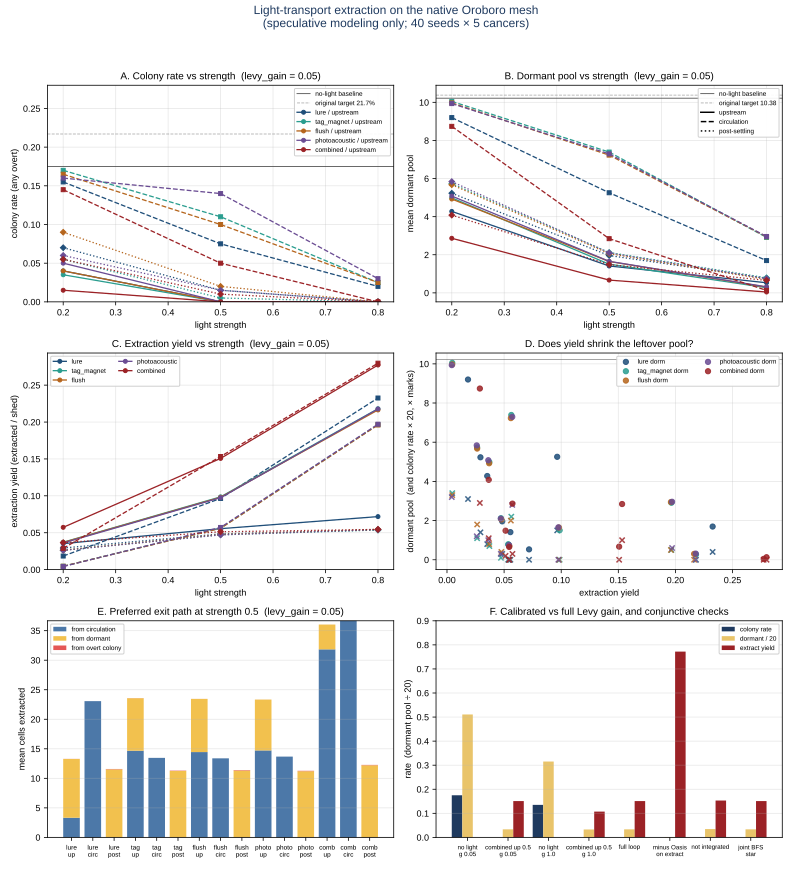

## Part A: the cancer-spread model

Speculative in-silico modeling. "Cells", "organs" and "colonies" are states in a simulation calibrated to a qualitative pattern. No result here is a biological finding, a diagnosis, a treatment or a dose.

### A1. The 1.21-million-run sweep

**In short.** Picture dandelion seeds blowing off a plant. Most land nowhere useful and die. A few land in soil and lie dormant, and a very few sprout. The model simulated this "seed-and-soil" journey 1.21 million times, varying eight settings. **The biggest lever was the moment a seed is accepted by the soil (establishment) and how welcoming the soil is (organ permissiveness).** Stopping sprouting and removing sleeping seeds turned out to be *different* goals. Acting early mattered most: upstream changes lost half their effect if started about 15–17 months late.

**Model.** The model is an agent-based, discrete-time stochastic model of the post-dissemination cascade: shedding (about 240 cells per run), circulation, arrest, establishment, dormancy, reawakening and overt colonization. It runs 120 monthly steps. The five configurations are prostate-like and ER+ breast-like (bone preferred), lung-like and melanoma-like (lung), and colorectal-like (liver). Establishment is a weighted four-feature score against a threshold, 0.65 by default, which rises toward 0.85 under load. All rates were hand-calibrated to a qualitative pattern. None is measured.

**Design and reanalysis.** The sweep covered 484 conditions (454 unique settings) × 2,500 runs, with eight perturbed parameters. Only stored per-run records were reanalysed: n = 1,210,000. Estimates were recomputed in ten independent seed blocks and recombined. This was a deterministic delta that replaced the random placeholder in the original relay tooling. Uncertainty comes from a cluster bootstrap over seeds (B = 2,000). Switch points come from logistic regression, onset dependence from interpolated half-times, and interactions from observed/independent-action ratios.

**Results.**

- All 484 estimates were reproduced exactly (maximum difference 0). Block heterogeneity in full elimination did not exceed chance (12 of 422 testable conditions at α = 0.05, against 21 expected).
- Baseline: 21.7% of runs colonize (95% CI 20.2–23.4%), and 94.7% of colonies arise in the preferred organ. A dormant pool of 10.38 cells (10.25–10.51) remains at month 120.
- Full elimination (no colony *and* no dormant cell) is steep in the establishment threshold: 50% at 0.799 (0.797–0.800) and 90% at 0.854 (0.851–0.857). For global organ permissiveness, x₉₀ is a scaling of ×0.219 (0.217–0.221). The bone-tropic prostate-like configuration needed stricter settings: x₉₀ threshold 0.872 vs 0.842, and permissiveness ×0.176 vs ×0.281–0.303.
- Onset: a moderate multi-parameter perturbation lost half its effect if started at month 57 (55.9–58.7). Single upstream perturbations did so by months 15–17, while dormant-cell clearance stayed effective until month 97.
- Interactions were mostly near independent action (74 of 98 within ±10%). Exceptions: global with preferred-organ permissiveness (ratio 0.21), and establishment threshold with circulating clearance (1.38–1.42).

Figure A1. Full-elimination fraction against four levers (2,500 runs per point) with logistic fits. Vertical lines mark x₅₀ and x₉₀. From the v2 sweep paper.

{ .half }

Figure A2. Onset dependence: effect against perturbation start month (v2 sweep paper).

**Limits.** These are properties of a hand-calibrated model. The bootstrap intervals are Monte Carlo uncertainty only, not structural uncertainty, which is likely much larger. Not modeled: secondary seeding, distinct immune compartments, organ-specific growth kinetics, and spatial structure.

### A2. Native-mesh restart

**In short.** Caitlyn pointed out that the cancer model should *already contain loops* if it really used her systems. An audit found it did not. So we rebuilt it from scratch with her **polarity mesh** at its core. Think of seating guests boy-girl-boy-girl around a table. With an even number of seats it works, but with an odd number two neighbours inevitably clash. Those clashing spots are **frustrated edges**, and a cell sitting on one cannot grow. We predicted that more clashes would mean more sleeping cells. **The opposite happened:** more clashes went with *fewer* sleeping cells (correlation −0.82). Only changes "at the door" shrank both colonies and sleeping cells.

**Audit verdict: not native.** All 30 public `caitlynrandels-del` repositories were cloned on 27 November 2026. The GitHub NaCl mesh (`nacl_polarity_mesh.py`) was a four-node *tree* with no cycles and no frustration test. The `MetastasisMesh` classes were lists of cells, and their `reconcile()` only logged counts. The relay `reconcile()` only wrote "Delta reconciliation complete." And `oroboro-core.js` line 124 drew `delta: Math.random() * 0.1`. Odd-loop frustration existed in no public repo.

**What was rebuilt** (`metastasis_native/`). The monthly state *is* a polarity mesh:

- Genesis is the primary site. Shed events are Levy +7 detach pulses into a circulation ring.
- Each target organ is wrapped in a **dream-catcher niche**: an 8-node hoop, a hub and spokes, sitting on an "inverse-Epcot" bowl. Return edges close the recirculation and reawakening loops.
- A four-organ cancer has **49 nodes and 89 edges, 32 of them frustrated** at construction. Invert-and-restabilize preserves the lock set.
- Damped reconciliation is real feedback: occupancy spikes raise the Oasis threshold.
- An adaptive niche can repair frustrated edges using heat from fail, exit and colonize pulses (repair 0.08, rebuild 0.04, melt window 0.15–0.85).
- Tilt and torque bias the encounter weights on the circulation ring.

**Calibration.** The original baseline (2,500 runs) was 21.72% colonies and a pool of 10.380. The native baseline (1,000 runs) was **18.00%** colonies and a pool of **10.355**. The four-point colony shortfall comes from the loops themselves: some unfold pulses fail on frustrated edges. A tree-niche ablation raises colonies to 20.6% while the pool stays at 10.38. *Loops tax colonization; they do not set pool size.* At baseline only 2.07 of the 10.36 dormant cells sit on a frustrated edge.

**The priority test.** All 454 settings were re-run (200 runs each). Native and original pools track almost perfectly (Spearman 0.999).

| Predictor vs dormant pool | Spearman r (95% CI) | Reading |
|---|---|---|
| Dynamic frustrated-edge count | **−0.819** (−0.863, −0.765) | Opposite of the overlay prediction |
| Month-averaged frustrated count | −0.824 (−0.867, −0.772) | Same direction |
| Static count at construction | undefined | It is 32 in every setting |
| Cells sitting on frustrated edges | +0.990 | Circular (a subset of the pool) |
| Shuffled control | +0.007 | Null, as expected |
| Partial on shed (Pearson) | −0.745 | Not just a shedding effect |

*Why negative:* busy settings generate heat, heat repairs odd-loop edges, and the same busy settings fill the pool on lockable hoop edges. Settings that close the door upstream leave all 32 frustrated edges unrepaired and almost no dormant cells.

| Setting | Original p(colony) | Native p(colony) | Original dormant | Native dormant |
|---|---:|---:|---:|---:|
| Baseline | 0.217 | 0.180 | 10.380 | 10.355 |
| Valuation threshold 0.80 | 0.001 | 0.000 | 0.530 | 0.550 |
| Valuation threshold 0.85 | 0.000 | 0.000 | 0.138 | 0.140 |
| Organ permissiveness ×0.4 | 0.002 | 0.000 | 2.275 | 2.222 |
| Dormant clearance ×20 | 0.029 | 0.022 | 0.834 | 0.806 |
| Dormant maintenance 1.0 (post-settling) | 0.000 | 0.000 | 10.588 | 10.562 |
| Colonization barrier 0.5 (post-settling) | 0.006 | 0.000 | 10.584 | 10.562 |

Upstream levers shrink both outcomes. Post-settling levers clear colonies and **leave the ~10.5-cell pool**. Damper ablation changed nothing, because occupancy never reached the rest load of 40, so the damper was silent. Tilt raised both outcomes: tilt 0, 0.3 and 0.6 gave colonies of 0.165, 0.348 and 0.438 and pools of 10.40, 13.22 and 15.19.

Figure A3. Left: the dynamic frustrated-edge count is negatively associated with the dormant pool across 454 settings. Right: occupancy of frustrated edges against the pool (positive, but circular).

### A3. Wiring everything together (conjunctive rerun)

**In short.** In the first restart, some of Caitlyn's parts only *took notes*. They did not influence the next round. Once the note-takers (Dictator, Transcriber, Levy) were connected to the shock absorber (damper), the absorber finally switched on. It made the door slightly stricter each month, and both colonies and sleeping cells went down. **None of the main conclusions flipped.**

The changes for conjunctive use (27 Nov 2026):

- `Dictator.stream()` now feeds the Transcriber inside each step.
- `LevyLedger.assess()` weighs the Transcriber entries, and the monthly Levy pulse feeds the damper with gain `levy_gain`.
- The Nexus state builds the next month.
- PrinciplesGate is placed after the Oasis score.
- Genesis closure is checked monthly.

`integrated=False` reproduces the pre-integration run exactly.

| Wiring (5 cancers, 1,000 runs) | p(any colony) | Dormant pool |
|---|---:|---:|
| Pre-integration | 0.180 | 10.36 |
| Conjunctive, `levy_gain` 0.05 (closest to calibration targets 0.217 / 10.38) | 0.175 | 10.09 |
| Conjunctive, `levy_gain` 0.5 | 0.134 | 8.01 |
| **Conjunctive, `levy_gain` 1.0 (working baseline)** | **0.091** | **6.36** |

**Leave-one-out at gain 1.0.** The full loop gives 0.096 and 6.37. Removing Levy feedback or the damper returns 0.178 and 10.41, so they are load-bearing. Removing PrinciplesGate changes nothing: it is inert at this load, since comfort H never falls below 0.3 and the frustration fraction stays at or below 0.36. Removing the adaptive niche gives 0.080 and 6.37, and tree niches give 0.112 and 6.36.

**Conjunctive check, 200 runs per setting** (cross-domain study). Mean damper pressure was about 0.031 and peak about 0.138. Gate commits fell from 16.9 to 10.6 per run. The pool fell from 10.480 to 6.300 and colonies from 0.175 to 0.135. Upstream levers still shrink both. Post-settling still leaves a pool (6.41) about equal to baseline. Tilt still worsens outcomes: colonies 0.135, 0.200 and 0.295 at tilt 0, 0.3 and 0.6. The frustrated-vs-pool sign survives: subsample Spearman −0.799 conjunctive vs −0.736 isolated (n = 40 settings). In the full 454-setting rerun it is −0.829 conjunctive vs −0.819 before, and the rank order of the pool is preserved (ρ = 0.988). Census, Levy, pipeline-Levy, consensus and Genesis-closure checks passed in every run.

Figure A4. Pre-integration vs conjunctive loop over the 454 recycled settings. Left: the frustrated edges vs pool relationship persists. Right: the conjunctive pool is lower, setting by setting, with its rank order preserved.

### A4. Light as transport to an extraction node

**In short.** Instead of "destroying cells where they are", Caitlyn asked what happens if light *guides them out*, like an usher with a flashlight walking people to an exit. We added an exit path to the mesh. The key detail is that the **same doorman (Oasis) that decides who may settle also decides who may use the exit.** Result: in **all 45** settings tried, both colonies and sleeping cells went down. Without the doorman, the exit turned into an open drain, which is not something to aim for. *This is a graph model, not evidence that light moves real cells.*

**Mapping.** Two nodes were added, `filter` and `extract`, with lure, flush and magnet edges. Five modes were tested:

- **Lure:** a phototaxis-style directed bias.
- **Tag + magnet:** a tagged subset is pulled toward the filter.
- **Soft-kill + flush:** the documented +4 unfold pulse, then a flush edge to collection.
- **Light + sound:** a locate pulse, then a Levy-weighted push.
- **Combined:** all of the above together.

Every move is Oasis/PrinciplesGate-gated and booked with the recycled +4 weight as an `EXTRACTED` state, which is not the same as cleared. The branch is attached *charge-preserving*: the ring and the niches are 2-colored first, so the circulation ring stays fully locked. A joint-BFS star that recodes the ring was kept only as a probe. Light is **off by default**, and with it off the code reproduces the earlier integrated run bit for bit.

**Design.** Three timings: upstream (from month 1), circulation only, and post-settling (from month 61). Three strengths: 0.2, 0.5 and 0.8. Each condition used 200 runs (40 seeds × 5 cancers), compared against matched controls of 17.5% and 10.22 at gain 0.05, and 13.5% and 6.30 at gain 1.0.

| Condition (gain 0.05) | Colony rate | Dormant pool | Yield (extracted/shed) |
|---|---:|---:|---:|
| Matched control | 17.5% | 10.22 | — |
| Lure, upstream, 0.5 | 0.0% | 1.41 | 5.6% |
| Lure, circulation, 0.5 | 7.5% | 5.26 | 9.6% |
| Combined, upstream, 0.5 | **0.0%** | **0.67** | 15.1% |
| Combined, circulation, 0.5 | 5.0% | 2.85 | 15.3% |
| Combined, post-settling, 0.5 | 1.0% | 1.49 | 5.1% |
| Combined, upstream, 0.8 | 0.0% | **0.045** | 27.7% |
| Combined, circulation, 0.8 | 0.0% | 0.13 | 28.0% |

- **45/45 conditions shrank both outcomes. None shrank only one.** Adding the node with no transport changes nothing.
- Upstream is the most efficient, because it competes at admission, the same lever as A1–A3. Circulation has the highest raw yield. Post-settling leaves the most behind.
- Almost no occupancy is moved out of overt colonies (at most 0.13 mean cells).
- The circulation ring never unlocks. The frustrated-vs-pool correlation does **not** carry over (Spearman 0.09, CI −0.25 to 0.44): the exit drains the pool without the repair pattern.
- **Oasis is load-bearing.** Skipping Oasis on extract proposals raised the yield from 15.1% to 77.2% (pool 0.025), an ungated drain. PrinciplesGate, Levy feedback, the damper, the niches and the loops each barely moved the result at gain 0.05.
- A stricter Oasis threshold of 0.80 also starves the exit (yield 0.7%), so the exit is not a side door around the gate. At gain 1.0, combined upstream 0.5 gave 0.0%, 0.66 and 10.7%.

{ .tall }

Figure A5. Light-as-transport sweep: colony rate and dormant pool by mode, timing and strength, plus extraction yield (from the light-transport note).

### A5. Plumbing: a sealed, valved exit

**In short.** Caitlyn's next idea was **plumbing**: pipes, valves, seals and pressure. In the cancer model the exit route became a sealed pipe, with **Oasis acting as the valve**. With a perfect seal applied early, colonies went to zero and sleeping cells dropped from about 10 to about 1.3. Leaky seals sent some cells back where they came from. Adding **16 airlock-style stages** almost restored a perfect seal. Applied late (after settling), it worked less well, which matches every earlier result.

Plumbing is off by default and is a strict no-op when off. The light-off, no-plumbing signature stayed unchanged: p(overt) 0.175, dormant 10.215, Levy 1,905.61 and frustrated edges 22.515 on 40 seeds × 5 cancers. When it is on, an Oasis/PrinciplesGate commit is required to enter the channel. A seal check then books either a sealed `EXTRACTED` hop or a leak back to circulation or the niche (Levy fail). Pressure-gradient strength sets the attempt rate, staged isolation lowers the leak, and a labeled smart-magnet hold halves it.

| Condition (40 × 5, gain 0.05) | p(overt) | Dormant | Yield | Leaked |
|---|---:|---:|---:|---:|
| Light-off, no plumbing | 0.175 | 10.215 | 0 | 0 |
| **Perfect seal, upstream** | **0.000** | **1.270** | 0.132 | 0 |
| Leak 0.3, upstream | 0.000 | 1.415 | 0.116 | 6.33 |
| Leak 0.3, 16 stages | 0.000 | 1.315 | 0.131 | 0.38 |
| Leak 0.3, smart-magnet hold | 0.000 | 1.335 | 0.125 | 2.97 |
| Perfect seal, post-settling | 0.010 | 1.950 | 0.048 | 0 |
| No Oasis valve (ablation; not a setting to chase) | 0.000 | 0.050 | 0.684 | 0 |

With a perfect upstream seal, the valve blocked 253.8 of 285.5 attempts per run and all 31.65 committed hops sealed. A leftover pool remains (p(eliminated) is only 0.03). Raising the pressure gradient from 0.2 to 0.8 raised yield from 0.053 to 0.245 and cut the pool from 4.465 to 0.200. Upstream leaks go mostly back to circulation (5.88 of 6.33). Post-settling leaks go mostly to the niche. Census, Levy and mesh-inversion checks passed on every plumbing condition, and whole-versus-parts was consistent on the four paths tested. **One check did not pass everywhere:** the mesh-consensus check (`consensus_ok`) is False on four leak/seal rows in `data/plumbing/plumbing_summaries.csv`: leak 0.6 (seal 1, upstream), seal 0.5 (leak 0.3, upstream), seal 0 (leak 0.3, upstream) and leak 0.3 post-settling. Census, Levy and inversion still pass on those rows. The plumbing addendum's own text says consensus held on every condition, which is not correct for those four rows. Their numbers should be read as provisional until the consensus mismatch is explained. The perfect-seal and staged rows quoted above pass all checks. *None of these figures is a treatment effect.*

