## Part B: the magnetic-launch model

Speculative modeling. This is a 2-D point-mass physics model with labeled assumptions, plus Oroboro bookkeeping. It is not a vehicle, a launch system, a site recommendation or a claim that a magnetic track can reach orbit. Well-known concepts (HARP, SpinLaunch, StarTram, Miura-ori) are named only as analogues, with no invented specifications.

**In short: what "orbit" means here.** If you throw a ball fast enough sideways, the ground curves away beneath it as fast as it falls, so it keeps falling *around* the Earth. At 200 km up that takes about **7,788 m/s** (about 17,400 mph). The whole launch study asks one question: *after a magnetic track does most of the work, how much speed is still missing?* That missing speed is the **residual gap**, and the goal is to get it to zero (a "lock").

### B1. Goldilocks case study

**In short.** The starting idea was a roller-coaster-style magnetic track that speeds a small drone up in pulses. Going all the way to orbital speed on a track would take a track **hundreds of miles long** at a tolerable 3 g. Doing it at the bottom, in thick air, is like sprinting into a hurricane. A middle "Goldilocks" speed (1,000–3,000 mph) gathered *while climbing* got above the thick air, but it still left most of the orbital speed missing.

**Constants and assumptions.** 200 km circular speed is 7.7885 km/s (17,422 mph) and surface escape speed is 11.186 km/s, both computed from μ = 3.986004418×10¹⁴ m³/s² and R = 6,371 km. Other labeled assumptions:

- Scale height 8,500 m.
- Slender vehicle Cd 0.30 and area 0.008 m². Blunt vehicle Cd 0.50 and area 0.20 m².
- 3 g peak rail acceleration with a 50% pulse duty (0.40 s on, 0.40 s off).
- Bowl radius 2,500 m.

**Results.**

- **Track length (vacuum v²/2a).** 17,000 mph at 3 g needs 981.6 km (609.9 mi) of continuous rail, or 1,963 km with 50% duty. 3,000 mph at 3 g needs 30.6 km, and 1,000 mph needs 3.40 km.
- **The Goldilocks band is not orbit.** 1,000, 2,000 and 3,000 mph are 5.74%, 11.48% and 17.22% of circular speed. The residual is 7,341 m/s at 1,000 mph and 6,447 m/s at 3,000 mph.
- **Thick air.** At sea level the slender 20 kg vehicle feels drag of 1.50 g at 1,000 mph, 13.5 g at 3,000 mph and 433 g at 17,000 mph. No ballistic sea-level release in the band crossed 100 km; the best apogee was 34.2 km.
- **Climbing rail.** The 3,000 mph, 80° straight and concave-bowl climbs reached the target in about 186 km of rail, releasing at about 182 km with apogees of 278 and 277 km. The convex (actual-sphere) geometry stalled at an apogee of 2.07 km.
- **Dampers.** A 0.5 Hz isolator transmits 0.0202 of a 10 Hz pulse (3 g becomes 0.59 m/s²). Damping made the 400-part pulse/coast recombine coherent (residual 0.128). *Dampers meter peaks; they do not change the Δv budget.*
- **Meshes.** The NaCl mesh locked 2 of 4 edges, an icosahedral geodesic 26 of 30, and a schematic airport-sector mesh 4 complementary edges. Invert-and-restabilize held in all three.
- **Oasis.** The concept text scored exactly 0.65 and committed. With the coordinate omitted it was blocked by AdaptOrDie. *The gate routes; it does not judge the idea.*

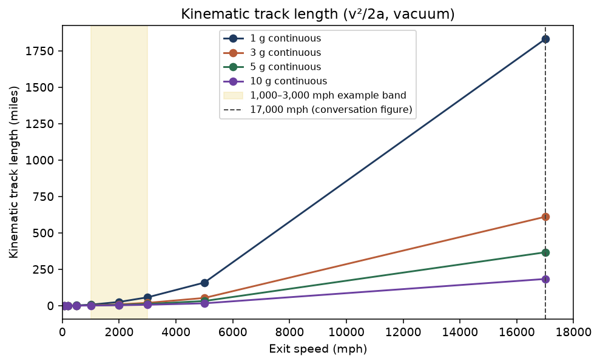{ .half }

Figure B1. Kinematic track length against exit speed and acceleration (Goldilocks case study).

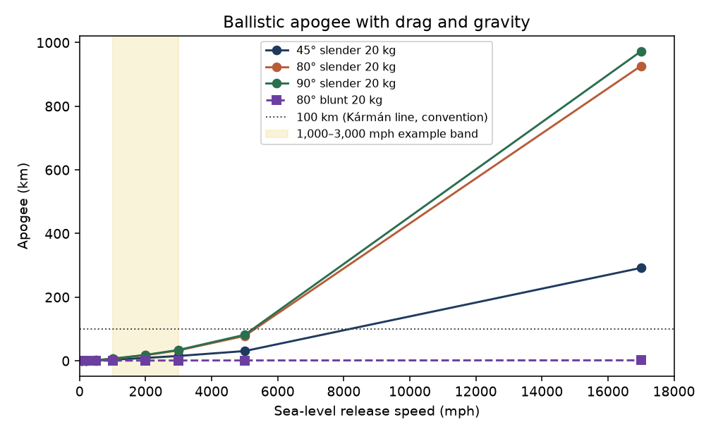{ .half }

Figure B2. Apogee by release story and geometry (Goldilocks case study).

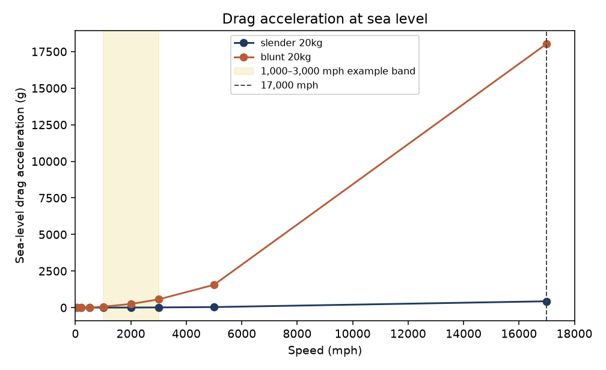{ .half }

Figure B3. Sea-level drag deceleration against speed for the slender and blunt vehicles (Goldilocks case study).

### B2. Ondulatory strings and the wireframe scaffold

**In short.** Caitlyn listed everyday objects as an example of "ondulatory strings": shrink wrap, porcelain, ninja stars, socks, 3-D-printer filament, a straw or tube, and bubbles. We read these as a vibrating string or tube. One finding: because the vehicle speeds up along the track, the pulses get **further apart** as it goes, like a song that keeps speeding up. So no single steady "note" can match the whole track.

Each object was mapped interpretively. Shrink wrap is the constraint envelope. Porcelain is a rigid limit. Ninja stars are hubs of degree three or more. Socks are a knit mesh. Filament is the string itself. The straw is a waveguide. Bubbles are the bowl.

On the placeholder 16-joint, 15-bone wireframe tree (invented joints, not real pose data):

- A hub-and-leaf polarity locked 5 of 15 edges, and alternating by depth locked 15 of 15.
- The Laplacian has one zero mode and 15 positive modes. These are graph modes, not hertz.
- On the 3,000 mph, 80° climb (L = 185.606 km, 367 pulses), the pulse spacing is **chirped**: the mean spatial period is 506.48 m against 1,072.93 m at exit, a ratio of 2.118. The exit spacing is close to uniform string harmonic 346 (detuning −0.020), but no single uniform mode matches the whole pulse train.

### B3. Dream-catcher weave

**In short.** A stick-figure skeleton is a "tree": it branches but never loops. Weaving a dream-catcher web over it created **101 loops**. Odd-sided loops (triangles) cannot be coloured boy-girl all the way round, so **59 edges stay "frustrated"**. The loops also let a pulse spread out from the centre much more thoroughly. This dream-catcher became the niche shape in the cancer model.

The base was a 15-joint kinematic tree from one detected pose (MediaPipe, one frame of personal-use footage). **No video frames or stills are reproduced anywhere**, and raw landmarks are not published. The weave added a 12-gon hoop, four inward midpoint rounds and a centre hole, giving 75 vertices and 175 edges. Results:

- Cycle rank went from 0 to **101**.
- The tree is bipartite: rule B locked 14 of 14 edges. The weave has **59** two-color conflicts, and rule B locked 116 of 175 edges, leaving exactly 59 open.
- The Fiedler value rose from 0.122 to 0.177.
- After 32 lazy-walk steps, mass at the origin was 0.116 on the tree vs 0.025 on the weave, and the weave reached all 75 nodes.
- Recombining the parts left a residual of 7.28×10⁻¹² (a bookkeeping identity).

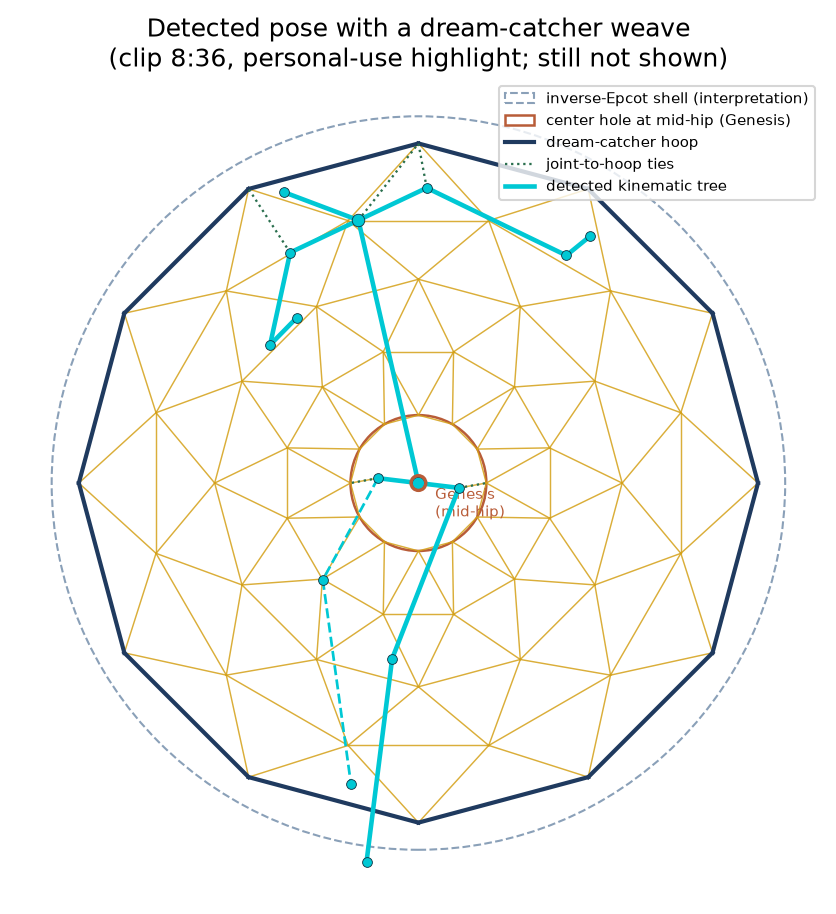{ .half }

Figure B4. Skeleton-only kinematic tree (cyan) with the dream-catcher hoop, web and centre hole. No video imagery is shown.

### B4. Goal-seek continuation, and the 256 → 1,148 m/s correction

**In short.** A search tried thousands of combinations: mass, g-force, start height, track shape, an 80 km **vacuum tube**, hollow "bird-bone" structure, feathers, heat-melted repairs and a non-spinning cabin. The best runs used a vacuum tube that releases the craft at 80 km, leaving **407–431 m/s missing** with no extra rocket. An onboard autopilot built from Oroboro parts made things *worse*. One early headline figure (256 m/s) **turned out to be wrong**. The true value is 1,148 m/s, and it is corrected everywhere.

**Search.** The goal Y has three parts: (a) apogee above 100 km, (b) minimum residual, and (c) reaching circular speed. 211 earlier entries were recycled and 251 new integrations were run. The labeled optimistic upper stages (I_sp 300 or 450 s, f_p 0.85) give Δv of 5,581 or 8,372 m/s. **No configuration met Y(c).** The best frontier points:

- **407 m/s, no stage.** A 12.6 kg hollow dart in an evacuated tube to 80 km, 1,000 g peak, 17,000 mph, flattening 45° → 5°, with the pusher *held* to the mouth. Exit 17,093 mph at 5.0°, apogee 373 km.
- **431 m/s, no stage.** A 5° tilt at 17,000 mph and 80 km, apogee 343 km. A 0° release leaves 333 m/s but does not climb.
- **256 m/s, staged: invalid.** It came from a 900 s coast that had not reached apogee. The true Kepler two-burn residual of the same staged state is **1,148 m/s** (apogee 5,436 km, perigee underground). Adding Earth rotation makes it worse (1,430–1,558 m/s). *Do not compare 256 m/s with anything.*

**Onboard autonomy** (n = 24 Monte Carlo runs) used three noisy votes, the median as consensus, Levy weighted by error and q, and an Oasis commit at 0.65. The closed loop **hurt**: the unstaged apogee fell from 115.1 to 50.2 km (100 km success 1.00 → 0.00), and the staged residual rose from 325 to 744 m/s. Other layers:

- **Hollow bones.** At k = 0.8, equal stiffness saves 53.1% of mass; a 20 kg request flies as 12.56 kg.
- **Feathers and atmospheric tiers.** They add kilometres of glide in thick air but no orbital Δv.
- **Non-spinning interior.** It removes spin-g but not path-g: 73.4 g at 3,000 mph and 2,356 g at 17,000 mph on a 2,500 m bowl.
- **Heat-driven feather regrowth.** On a mid-speed climb, PLA sat in its melt band for 280 s and refilled 7 of 8 missing cells. On the 17,000 mph evacuated path the skin reached about 3,700 °C and the whole filament budget ablated.
- **Tilt.** 5° at an 80 km mouth was the practical optimum.

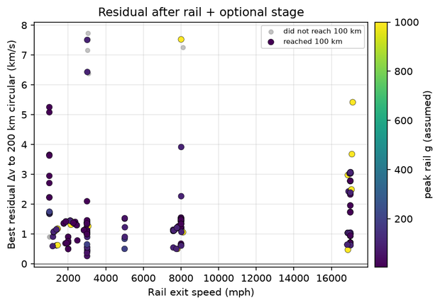{ .half }

Figure B5. Residual against rail exit speed for the goal-seek set.

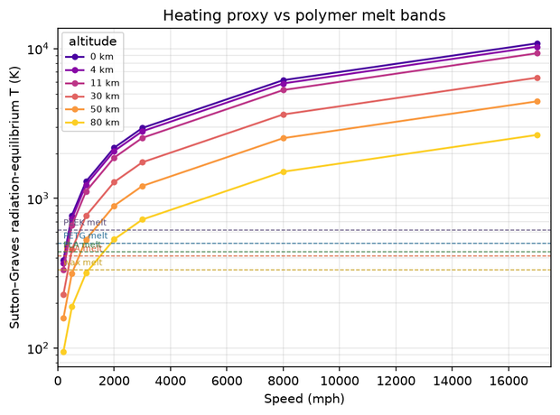{ .half }

Figure B6. Radiation-equilibrium temperature screens against polymer melt and degrade bands (labeled textbook-order values).

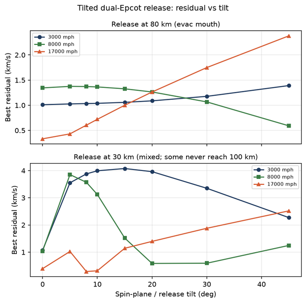{ .half }

Figure B7. Residual against release tilt at several speeds and start heights.

### B5. Geography

**In short.** Earth spins, so launching eastward from the equator gives a free boost of about 465 m/s, like stepping onto a moving walkway. That sounds like exactly the missing amount, but our craft is *already* nearly at orbital speed. Adding the boost **overshoots** and stretches the orbit instead of rounding it off. On the flattest exit, mid-latitude sites came out best: **Baikonur needed only 66 m/s**, and Las Vegas 119 m/s.

The boost is v = 465.1·cos(lat) m/s, scaled to 470.9 m/s at the equator at 80 km. The inclination floor is i_min = |lat|.

- **The equator does not close Y(c).** The 5° residual is still 375 m/s and the evac dart 398 m/s, only a 9–56 m/s improvement.
- **The 0° exit is where geography matters.** With the boost, 80 km becomes perigee and the craft climbs.
- **Ranking:** Baikonur **66**, Māhia 103, Mount Charleston 118, Las Vegas 119, Vandenberg 126, Spaceport America 133, Tanegashima 144, Cape Canaveral 151, Mauna Kea 181, Wenchang 181, Sriharikota 195, Kourou 206, Kilimanjaro 208 and Chimborazo 208 m/s. A latitude near 56° would be ideal.
- **What does not matter here.** Elevation does not change the residual at an 80 km mouth. The coastal preference is about downrange safety, not Δv. A plane change to an equatorial orbit costs about 4.82 km/s from Las Vegas.

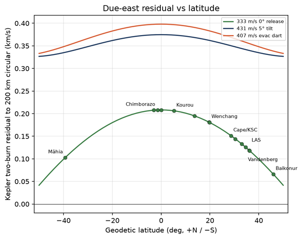{ .half }

Figure B8. Two-burn residual against site latitude. The 0° curve is the one that moves.

### B6. Redstone repeater, comparator, and the no-track run

**In short.** Caitlyn explained the problem in Minecraft redstone terms. The signal is "a few dust short" of locking the final piston, and a side signal (Earth's spin) arrives at the wrong angle and stretches the circuit.

- **Repeater** = a small final rocket burn, paid for with the craft's own fuel, right at the end. **It worked.** Spending 5% of the craft's mass on it closed the gap from all 14 sites on the flat exit.
- **Comparator** = a gate that only allows the spin boost when the craft is nearly there. **It never beat simply aiming in the best direction.**
- **No track** = take the track away and launch from the ground on rockets. **It failed every time.** The thick lower air slows and overheats the craft, so the vacuum tube was doing the real work.

**Repeater.** An impulsive two-burn at apogee and at the 200 km apsis, sized with the rocket equation from the vehicle's own mass at I_sp 450 s. The three fractions f_p = 0.05, 0.30 and 0.85 buy 226, 1,574 and 8,372 m/s.

- **f_p 0.05** (re-using the filament budget) locks **all 14 real sites on the 0°/80 km exit**: due-east leftovers of 66–206 m/s, with Baikonur needing only 0.015 and Las Vegas 0.027. It does *not* circularize the 5° darts (Baikonur 338 → 112 m/s).
- **f_p 0.30** (the payload fraction) **locks every due-east setup**, including the staged stack (Baikonur needs 0.28 of the remaining 18.84 kg). This is a bookkeeping result, and it effectively turns the dart into a staged vehicle.
- Closing the 407 m/s gap takes 1.11 kg of the 12.56 kg dart (f_p 0.088), more than the 0.63 kg filament budget.

**Comparator.** Thresholds were swept from 50 to 2,000 m/s. It never beat always-best-azimuth (**0 of 14**).

| Setup | Always due east | Comparator suppressing | Always best azimuth |
|---|---:|---:|---:|
| 0° / 80 km | 153 m/s | 336 m/s (climb lost) | **42 m/s** |
| 5° evac dart | 372 | 409 | **328** |
| 5° tilt | 353 | 433 | **326** |
| Staged (true 1,148) | 1,507 | 1,144 | **834** |

On the 0° exit, the useful lever is the heading itself. Aiming 40–65° off due east gives 37 m/s at Baikonur and 38 m/s at Las Vegas. AdaptOrDie blocked only the zero-coordinate "idealized equator".

**No track (240 runs, 0 locks).** The 12.56 kg dart flies from the pad at T/W 3 and I_sp 450 s.

- f_p 0.05 reaches only 1.6 km.
- f_p 0.30 peaks at 47 km with a heating proxy of about 1,730 K.
- f_p 0.85 passes 200 km but leaves **661 m/s (Kourou), 708 (Las Vegas), 756 (Baikonur) and 631 (Mauna Kea)**, with perigee underground, peak q of 384–406 kPa and a heating proxy of **5,160–5,240 K**.
- Reserving fuel for a 500 m/s repeater made the ascent worse.

The binding constraint is **thick-air drag and heating**, not the last 100 m/s.

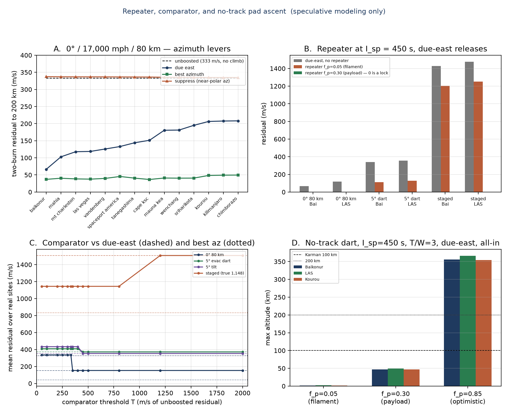

Figure B9. (A) Azimuth levers on the 0° exit. (B) Repeater fractions; 0 is a lock. (C) Comparator threshold sweep. (D) No-track maximum altitude.

### B7. Light-sail push after the track

**In short.** Strip the craft to a frame plus a thin mirror-sail, and push the sail with a powerful laser from the ground, since light carries a tiny push. It is like trying to push a sailboat with a flashlight while it is still in a storm. **0 of 864 runs reached orbit.** Even at 120 km the thin leftover air pushes back harder than a 10 GW laser. The laser also loses sight of the craft before the point where the push is needed, and the sail overheats.

Sweep: 1 MW–100 GW from one site under the tube mouth, sails of 10–1,000 m² at 1–100 g/m², reflectivity 0.90 and a 3 m aperture at 1.06 μm. Four focus sites, a residual gate (the comparator analogue) and smart unfold.

- **Drag.** A 100 m² sail sees about 90 kN at 80 km and about 119 N at 120 km, against 63 N of photon force at 10 GW. On the 0° exit the sail never unfolds, and the residual drifts only from 48 to 38 m/s.
- **Line of sight.** There are about 134 s above 5° elevation, and apogee is out of view, so the light only helps on the climbing leg.
- **Stretching.** An ungated 100 GW push drove the leftover to about 1,400 m/s. The gate stops this but does not close the gap.
- **Heating.** Almost every sail that opened ran hotter than the 803 K PEEK band: 2,176 K at 10 GW and 4,696 K at 100 GW.
- **Best cuts.** The staged case at 100 GW went from about 682 m/s (coast) to 519 m/s, using 12,990 GJ. The no-track burnout went from 661 to 514 m/s at 10 GW. Perigee stayed underground in both. A second, downrange laser was **not** modeled.

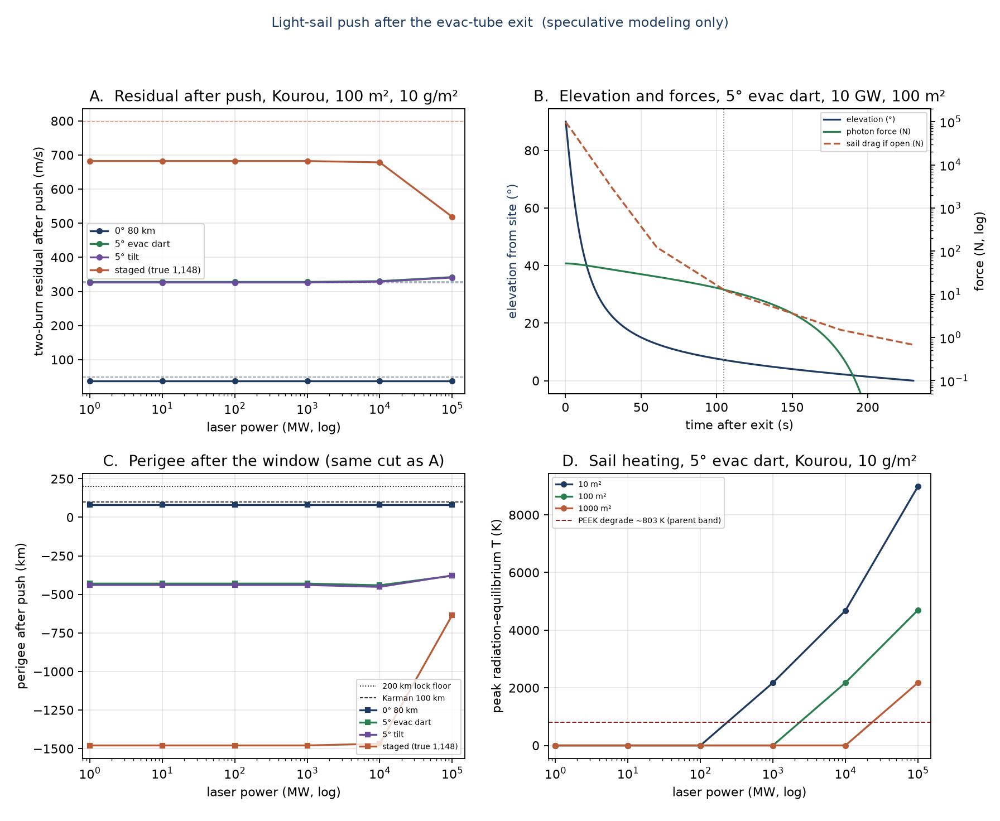

Figure B10. Light-sail push panels from the light-sail addendum (residuals, window and heating across the sweep).

### B8. Kite, fishing line, lane-keeping, smart magnets, and the straw

**In short.** Five ways to steer the no-track craft were tried. A **kite** acted like a parachute while sprinting. A **fishing line** acted like a boat anchor. **Car-style lane-keeping** helped a tiny bit (17 m/s) and wasted almost no steering effort. **Magnets pushing on Earth's magnetic field** gave a push of about a hundred-millionth of a newton, which is effectively nothing. The **straw**, a channel you draw from ground to sky, was the best of the five, but once its air is pumped out it is just the vacuum tube again, about 1,000 km long. **None reached orbit (0 of 46).**

| Variant (f_p 0.85, Kourou) | Residual | Max altitude | Binding constraint |
|---|---:|---:|---|
| Open-loop baseline (no track) | 661 m/s | 354 km | Drag and heating |
| Kite, 10 m², reefed | 1,333 | 208 km | Kite drag in thick air |
| Line, 500 m, from pad | 7,551 | 4.3 km | Line drag (sea anchor) |
| Line, 500 m, from 60 km | 2,791 | 88 km | Line drag in residual air |
| Old γ-law autopilot from pad | 6,890 | 1.1 km (impact) | The harmful controller |
| **Gated lane-keeping** | **644** | 341 km | Still drag and heating |
| Magnets vs Earth's field | 661 | 354 km | Force ≈ 1.4×10⁻⁸ N |
| Open-air straw, steep | 1,407 | 101 km | Aero and path losses |
| **Evacuated straw** | **595** | 524 km | Propellant and gravity |

Lane-keeping used the Nexus-registered path, a median of three sensor votes, Levy-weighted corrections and Oasis commits at 0.65. It made 871 commits with only 0.01 s of thrust-cosine waste. A magnetorquer gives *torque* (0.030 N·m), not a useful *force*, in Earth's field (labeled 30 µT). Reaching 7,788 m/s at T/W 3 in vacuum needs 1,031 km of channel, 1.34× the recycled 767.6 km evacuated tube.

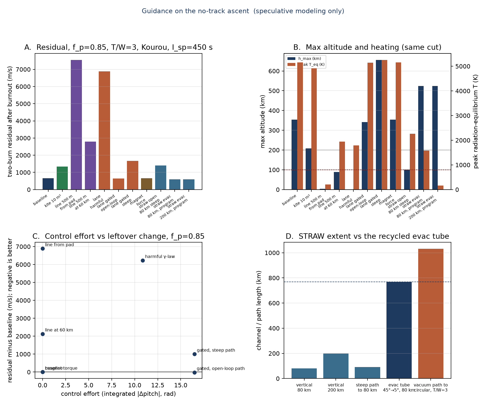

Figure B11. Guidance variants (kite, line, lane-keeping, magnets, straw) against the no-track baseline, from the guidance addendum.

### B9. Adaptive fur and fabric, Pixar-referenced

**In short.** Pixar animates fur and cloth by letting the computer mesh add detail where it is needed, like a scarf whose stitches tighten where it flaps most. We made Caitlyn's surfaces adapt the same way, with her Oroboro gates deciding where to add or remove detail. The **fishing line improved most**, because it learned to reel itself in while it would act as an anchor. Still, **nothing reached orbit.** One surprise: adding detail to cloth that is *already* wrinkled can lock the wrinkle in.

**Sources actually read** (listed in [References](#sources-files-and-references)): Pixar's volumetric hair memo, *Untangling Cloth*, *Holding the Shape in Hair Simulation*, the 2022 cloth-tailoring remeshing talk, the *Turning Red* style-guide talk, the 2022 Dynamic Deformables course, and the 2026 Fizt Strands talk. Baraff and Witkin 1998 is cited only as the model Fizt is built on (a CMU publication).

**Construction.** The target edge length interpolates between L_min and L_max, following Waggoner and de Goes in form. Their painted weights are replaced by live Oroboro signals: tension, q, speed and force. Splits and collapses are admitted only when Oasis/PrinciplesGate and a NaCl majority agree. Delta reconciliation refuses any refine that raises predicted aero work at high q. *That runtime remeshing is an Oroboro construction, not a claim about Pixar's tools.*

| Variant (f_p 0.85, Kourou) | Residual | Max altitude | Note |
|---|---:|---:|---|
| Baseline | 661 m/s | 345 km | Confirms recycled |
| Kite, adaptive gated | 1,344 | 248 km | Reopens; a loft-vs-drag trade on top of a sheet-mass tax |
| Line, fixed (this integrator) | 2,378 | 112 km | Drag integral 7,943 m/s |
| **Line, adaptive gated** | **1,361** | 187 km | Stows, then redeploys: drag 588 m/s, still a brake |
| Evacuated straw with adaptive liner | 595 | 524 km | Liner tip RMS 0.99 m vs 2.45 m; no Δv change |
| Sail, adaptive gated | 554 | 477 km | Openness 0.52; hotter (3,378 K) |

In the standalone gust test, every mesh blew to a ~0.6 m tip envelope. Adaptive refinement during the deformed state left a *larger* tip offset (~0.74 m vs ~0.63 m). The volumetric collision grid refined from 8 to 24 cells.

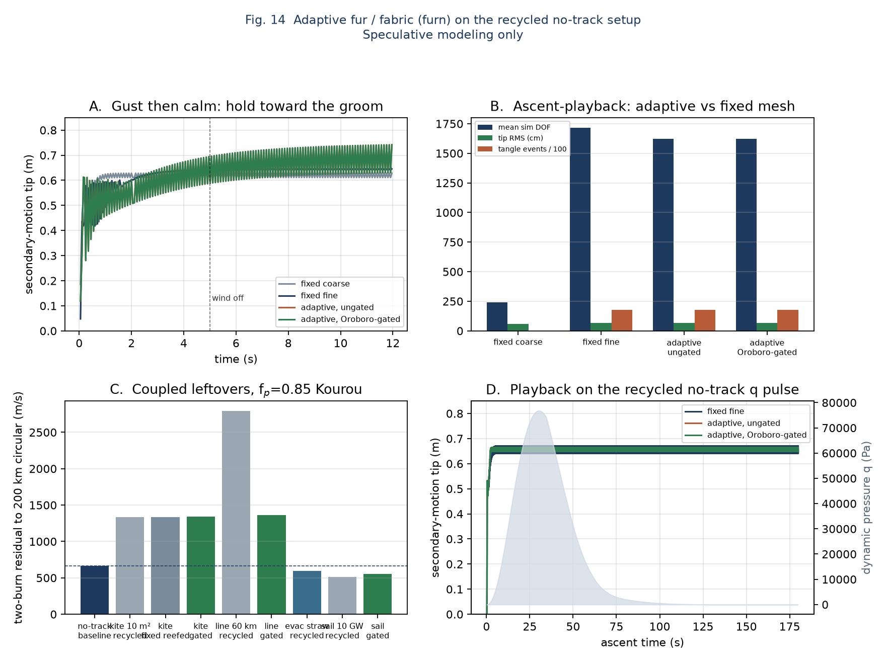

Figure B12. (A) Gust then calm. (B) Ascent playback: DOF, tip RMS, tangles. (C) Coupled leftovers. (D) Playback tip through the q pulse.

### B10. Plumbing on the straw

**In short.** Treat the vacuum straw like plumbing, with airlocks, leaks and a puff of air pressure behind the craft. A longer leak-free vacuum **did not change** the 595 m/s gap, because the rocket had already finished burning at 109 km. Small leaks showed up first as **extra heating**. A fully leaked straw was exactly the no-track run (661 m/s). Pushing with air pressure made things **worse**, because it flung the craft too high (0.1 bar late: 666 m/s; from the pad: 791; 1 bar: 2,934). **0 of 49 locked.**

Inside a staged vacuum segment, residual density is leak_frac / n_stages × the outside ISA density. The pneumatic force is F = ΔP·A, about 607 N at 1 bar against 370 N of chemical thrust, and supply work assumes η = 0.5.

| Case | Residual | Max altitude | Heating proxy | Note |
|---|---:|---:|---:|---|
| Evacuated to 80 km, leak 0 | 595.0 m/s | 524 km | 1,579 K | Matches recycled |
| Vacuum to 200 km or along 1,031 km, no push | 595.0 | 524 km | 160–899 K | Burnout already at 109 km |
| Leak 0.1 | 595.5 | 502 km | 2,571 K | Heat appears before the residual moves |
| Leak 1, or open air | 661.3 | 354 km | 5,158 K | Bit-identical to no-track |
| 0.1 bar, late valve | 666 | 961 km | 1,686 K | Lofts; 6.8 MJ waste |
| 0.1 bar, from the pad | 791 | 1,348 km | 1,545 K | Worse |
| 1 bar | 2,934 | 5,801 km | 1,716 K | 66.8 MJ waste |

Fifteen further cases, including every 1–10 bar push on long channels, were unbound, so no residual exists for them. A 1,031 km flatten-to-5° channel with no push was a worse gravity turn (4,523 m/s).

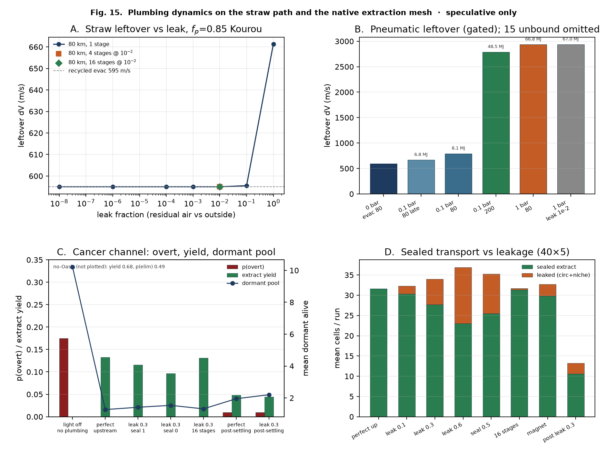

Figure B13. Plumbing dynamics. (A) Leftover against leak fraction. (B) Pneumatic push. (C, D) The cancer-side sealed exit and leaks.

