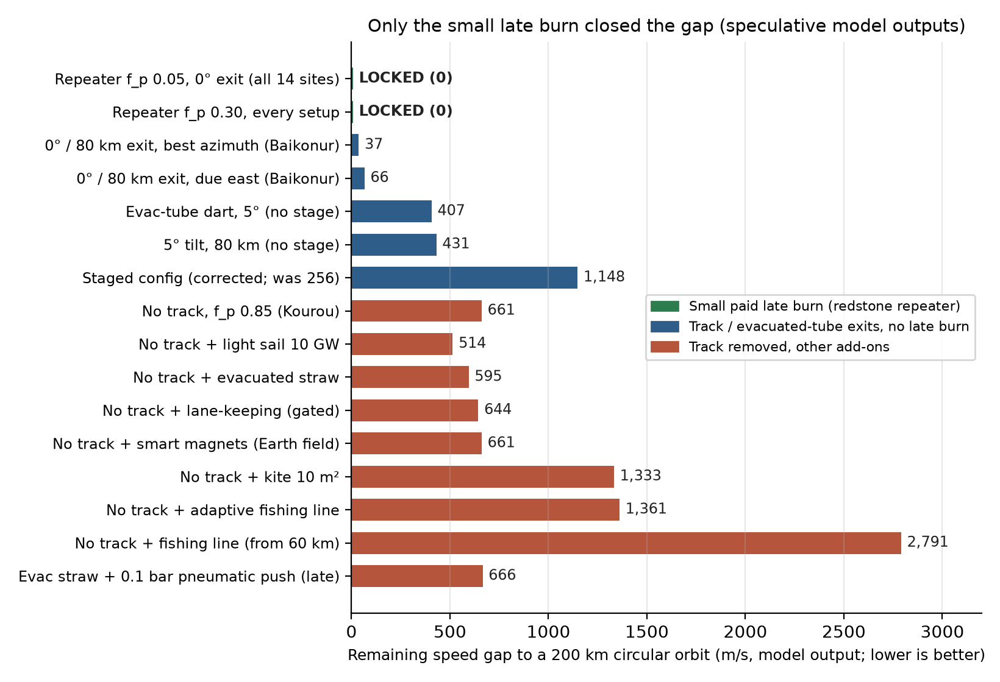

## What the two domains say together

**In short.** Both models tell the same story in different clothes. **What is left over is mostly decided at the door.** In the cancer model the door is the moment a cell is admitted to an organ. In the launch model it is the moment the craft leaves the vacuum tube. Later fixes tidy things up but rarely empty the leftover. The two things that *did* work also look alike: a **small, well-placed, paid-for action at the right moment**. That is the final rocket burn in the launch model and the guarded exit in the cancer model.

Figure C1. Summary of launch-model leftovers drawn only from numbers stated in the addenda (no new simulation). Green bars are locks. The 0°-exit due-east and best-azimuth values still have perigee at 80 km until a repeater burn raises it. The kite, line and straw values are no-track runs at f_p 0.85 from Kourou.

1. **The small late burn is the only thing that closed the launch gap.** A redstone repeater paid from the vehicle's own mass (f_p 0.05) locked all 14 real sites on the 0°/80 km exit, and f_p 0.30 locked every due-east setup. Nothing else locked: the comparator, light sail, kite, line, lane-keeping, magnets against Earth's field, straw, adaptive meshes and plumbing all failed. Their best leftovers sat between about 514 and 661 m/s on the no-track baseline, and several made things worse.
2. **Upstream admission is the cancer-model lever.** In every wiring, only the Oasis threshold and organ permissiveness shrank both colonies and the pool. Post-settling levers cleared colonies and left a pool. The new levers that also shrank both, the light exit and the sealed plumbing exit, work through the same Oasis gate, and work best when applied upstream.
3. **The gate is load-bearing, in both directions.** Oasis keeps the cancer exit from becoming an ungated drain (15% vs 77% yield). In the launch model, the comparator form of a gate is the wrong tool whenever the side pulse is what makes the craft climb.
4. **The same name can have opposite effects.** A 5° *release* tilt is the in-set way to satisfy the climb goal, while *circulation* tilt in the cancer model doubled colonies.
5. **Geography plays the part of organ permissiveness.** Latitude is an admission condition on the leftover, not a free subtraction.
6. **Loops are not the reservoir.** Odd loops tax colonization (18.0% vs 20.6% on a tree) but do not set pool size. Frustrated-edge count moves *opposite* to the pool because self-repair unlocks loops in busy settings.
7. **Conjunctive vs isolated.** Wiring Dictator, Transcriber and Levy into the damper made the damper engage and lowered both cancer leftovers (10.48 → 6.30 and 0.175 → 0.135 in the 200-run check). No qualitative finding flipped. In launch, the one onboard loop that *was* conjunctive (votes, consensus, Levy, Oasis) hurt insertion. Wiring things together is not automatically better; it has to be tested.

## Predictions that failed

**In short.** A good study reports what it got wrong. These are the ideas that the models did **not** support.

| Prediction or claim | What the model actually showed |
|---|---|
| More frustrated loops would mean a larger dormant pool | Opposite: Spearman −0.819 (−0.829 conjunctive) |
| Removing loops would empty the pool | No. Loops tax colonization and leave the pool unchanged |
| The damper matters in the first restart | It was silent (occupancy below rest load). It only engaged once Levy was wired in |
| An onboard Oroboro autopilot would improve insertion | It hurt: apogee 115 → 50 km, staged residual 325 → 744 m/s |
| 256 m/s staged residual | Invalid (incomplete coast). The true value is 1,148 m/s |
| An equatorial launch closes the gap | No. 375–398 m/s remain, and the boost overshoots |
| A subtraction-mode comparator beats due east everywhere | It never beat best azimuth (0/14) and helped only the staged case |
| The no-track launch can work with enough fuel | 0/240. Drag and heating bind first (~5,200 K proxy) |
| A laser light sail closes the gap | 0/864. Drag, line of sight and heating bind |
| A kite or fishing line adds useful lift or guidance | Both acted as brakes (1,333 and 2,791 m/s) |
| Smart magnets can steer off-track | ~1.4×10⁻⁸ N against Earth's field, effectively zero |
| Adaptive meshes close the gap | No. Refining a wrinkled state can lock the wrinkle in |
| A longer vacuum or a pressure push closes the gap | No. 595 m/s unchanged, and pushes widen it |
| The frustrated-vs-pool correlation holds with a light exit | It vanished (Spearman 0.09) |
| Oasis can tell true claims from false | It committed true and false closure claims alike at exactly 0.65. It routes; it does not verify |

## What this report does not claim

- **No clinical, biological or medical claim.** The cancer model is simulated occupancy on a graph, with rates hand-calibrated to a qualitative pattern. "Light", "magnet", "flush" and "plumbing" are mesh edges and gates. They are not evidence that any physical method moves, extracts or treats cells. No dose, wavelength, safety or treatment implication follows.
- **No engineering, flight or siting claim.** The launch model is a 2-D point mass with labeled coefficients, a vacuum two-burn residual metric, an impulsive repeater and equilibrium heating proxies. Hollow-dart mass budgets are bookkeeping, not structural certificates. No site, power level, sail, tube or device is recommended.
- **Uncertainty.** Bootstrap intervals cover Monte Carlo error only. Structural and parameter uncertainty are larger and unquantified.
- **Levy weights and Oasis scores are bookkeeping and routing.** They are not physical energies and not truth tests.
- **Known gaps.** The sponge compartment was never used. PrinciplesGate is wired but never triggers at these loads. The dream-catcher and odd-loop pieces exist in the project workspace, not in the original public repos. The epilepsy model's code was left untouched. The cancer plumbing run's mesh-consensus check failed on four leak/seal rows (see A5).

## GitHub state

<!-- GITHUB-STATE:START -->

**In short.** Every finished study, including guidance, fur/fabric, plumbing, and this combined report, is on Caitlyn's public GitHub. This report lives at [`research/combined-report/`](https://github.com/caitlynrandels-del/Oroboro/tree/main/research/combined-report). The GitHub connection only accepts text files, so PDFs and images appear there as SVG page images and SVG charts, while the original PDF, PNG and DOCX files stay on the project computer.

State as of 27 November 2026, 5:54 PM (America/Denver). All pushes were plain commits to `main` with no force pushes, each fresh clone was checked against the local copy, and each push passed a secret scan. Before this report was added, `main` on Oroboro ended at `3b6d3a7`.

| Repository | Commits | What it holds |
|---|---|---|
| [caitlynrandels-del/Oroboro](https://github.com/caitlynrandels-del/Oroboro) `research/` | `c503de2..66bfa88` (21) | Conjunctive native metastasis sim, the launch case study with the 1,148 m/s correction, the cross-domain comparison, the PIPELINE data-flow diagram, and "superseded" banners on three older consciousness-mapping sims |
| | `1b90bc4..f4b78f1` (8) | Redstone addendum (Markdown, HTML, page images, script, data, chart), geography page images, HTML write-ups with figures, heat-path data, README updates |
| | `4c656cb..3ca03db` (23) | Light-sail addendum with script, data and chart. Light-transport write-up, data, chart and sim code (light off by default; 25/25 runs match the earlier version). Page views for every remaining PDF. README updates |
| | `eef1560..b2c4987` (6) | Guidance (kite, line, lane-keeping, magnets, straw) and adaptive fur/fabric results. The fur/fabric commits are `3ac3940`, `4950666` and `b2c4987`, all inside this range. |
| | `738804f..3b6d3a7` | Plumbing dynamics addendum (launch and cancer), data and figure |
| | this report | Markdown, HTML, build files, SVG figures, and PDF page images, at [`research/combined-report/`](https://github.com/caitlynrandels-del/Oroboro/tree/main/research/combined-report) |
| [oroboro-relay](https://github.com/caitlynrandels-del/oroboro-relay) | `cc77063`, `d3d0940` | The `Math.random()` delta in `oroboro-core.js` replaced with a deterministic delta against the Nexus record. A new `OroboroPipeline` (Dictator → Transcriber → Levy → damper → delta → isolate/recombine → Nexus → Genesis) with a passing test. The Swift port got the same fix but was not compiled |
| [metastatic-cascade-analysis](https://github.com/caitlynrandels-del/metastatic-cascade-analysis) | `30659cd..427e345`; `66dbeba..d9f09c8` | v1 and v2 papers, with the old model marked superseded; then v3–v5 page views. Now at `d9f09c8` |
| [epilepsy-sim](https://github.com/caitlynrandels-del/epilepsy-sim) | `2be4eac` | Audit section only. Partially conjunctive, code untouched; 50/50 tests pass |

**Not published, by design:** binary PDF, PNG and DOCX originals (published as SVG page images instead), raw pose landmarks, and anything from the personal-use video.

<!-- GITHUB-STATE:END -->

## Glossary

**Ablation / leave-one-out.** Switching off one part to see what it was doing.

**Agent-based model.** A simulation that follows many individual units (here, "cells") step by step.

**Apogee / perigee.** The highest and lowest points of an orbit. "Perigee underground" means the path would hit Earth before completing an orbit.

**Azimuth.** Compass heading of the launch. Due east is 90°.

**Bootstrap 95% CI.** A range showing how much a number would wobble from simulation randomness alone.

**Circular orbit speed.** The speed needed to keep falling around Earth: 7,788.5 m/s at 200 km in this model.

**Colony (overt colony).** A simulated cell group that has grown in a distant organ.

**Comparator (redstone).** A conditional gate. Here, it lets Earth's spin boost through only when the main push is already close to enough.

**Conjunctive.** All Oroboro parts running together in one loop, each feeding the next.

**Damper / delta reconciliation.** A shock absorber that smooths spikes. Reconciliation recombines independent parts and checks they add up to the whole.

**Dormant pool.** Simulated cells that have settled but are "asleep". They are the hard-to-clear leftover.

**Dream-catcher niche.** A hoop-and-web graph around each organ. Its triangles create odd loops.

**Δv (delta-v).** Change in speed. The currency of spaceflight.

**Evacuated (evac) tube.** A tube with the air pumped out, so the craft can go fast without drag or heat.

**f_p (propellant fraction).** The share of the craft's mass that is fuel for a burn.

**Frustrated / locked edge.** In the polarity mesh, a link between opposite charges *locks*. In an odd loop, some links cannot, and they stay *frustrated*.

**Genesis, Nexus, Oasis, PrinciplesGate, AdaptOrDie, Dictator, Transcriber, Levy, Homeostasis, Sponge.** Caitlyn's Oroboro components. See the table in [the systems section](#the-oroboro-systems-wired-as-one-loop).

**I_sp (specific impulse).** Fuel efficiency of a rocket engine, in seconds.

**In silico.** Done in a computer simulation.

**Kármán line.** The conventional 100 km edge of space.

**Lock (orbit).** In this report: two-burn residual ≤ 1 m/s, with perigee at or above the stated floor (100 or 200 km).

**`levy_gain`.** How strongly Levy event weights feed the damper. 0.05 is closest to the original calibration; 1.0 is the working baseline.

**Monte Carlo / seed.** Running a random simulation many times. A seed fixes the random sequence so runs repeat exactly.

**Organ permissiveness.** How welcoming a simulated organ is to arriving cells.

**Organotropism.** A cancer type's preference for particular organs.

**Post-settling / upstream.** Acting after cells have settled vs acting at or before admission.

**q (dynamic pressure).** How hard the air pushes on a fast-moving object.

**Radiation-equilibrium temperature (heating proxy).** A rough estimate of how hot a surface gets at speed. It is not a measured wall temperature.

**Repeater (redstone).** A small final burn that "refreshes" the signal right at the end.

**Residual (two-burn residual).** The extra speed still needed, in two ideal burns, to reach a 200 km circular orbit.

**Spearman correlation.** A number from −1 to +1 for how consistently two quantities rise or fall together.

**State reduction.** Splitting the system into independent parts, processing them separately, and recombining them.

**T/W (thrust-to-weight).** How hard the engine pushes compared with the craft's weight.

## Sources, files and references

**Internal sources (project computer).** These were summarized here without recomputation, except the new summary chart C1, which is plotted from their stated numbers.

- `study-writeup/v2/InSilico_Metastasis_Parameter_Sweep_Refined.pdf` (1.21M-run reanalysis)
- `oroboro-research/metastasis_native/notes/Native_Mesh_Restart_HeatTrace.md`
- `notes/Light_Transport_Extraction.md`
- the `metastasis-native` README (conjunctive integration)
- `oroboro-research/cross_domain/Oroboro_CrossDomain_Comparison.md`
- `oroboro-research/magnetic_launch_case_study/`, in order: `Magnetic_Launch_Goldilocks_CaseStudy`, `Ondulatory_Strings_Wireframe_Addendum`, `Dreamcatcher_Weave_FollowOn`, `Magnetic_Launch_GoalSeek_Continuation`, `Geography_Launch_Sites_Addendum`, `Redstone_Repeater_Comparator_Addendum`, `Light_Sail_Push_Addendum`, `Guidance_Kite_Line_Straw_Addendum`, `Fur_Fabric_Adaptive_Addendum`, `Plumbing_Dynamics_Addendum`, and the figures in `outputs/`
- `research/PIPELINE.md` in the Oroboro repository

The physical constants are standard textbook values: standard gravity 9.80665 m/s², Earth's μ 3.986004418×10¹⁴ m³/s², mean radius 6,371 km, and ISA sea-level density 1.225 kg/m³. Launch-site coordinates are published public values.

**External references.** Only these were used, all for the fur and fabric study (B9):

1. Petrovic, Henne and Anderson. *Volumetric Methods for Simulation and Rendering of Hair.* Pixar Technical Memo #06-08 (SIGGRAPH 2005 Talks). research.pixar.com/docs/2005.SiggraphTalks.PHA.pdf
2. Baraff, Witkin and Kass. *Untangling Cloth.* SIGGRAPH 2003. research.pixar.com/docs/2003.SiggraphPapers.BWK.pdf
3. Iben, Brooks and Bolwyn. *Holding the Shape in Hair Simulation.* SIGGRAPH 2019 Talks. research.pixar.com/docs/2019.SiggraphTalks.IBB.pdf
4. Waggoner and de Goes. *Revamping the Cloth Tailoring Pipeline at Pixar.* SIGGRAPH 2022 Talks. research.pixar.com/docs/2022.SiggraphTalks.WG.pdf
5. Montell, de Goes and Brooks. *Hair Emoting with Style Guides in Turning Red.* SIGGRAPH 2022 Talks. research.pixar.com/docs/2022.SiggraphTalks.MGB.pdf
6. Kim and Eberle. *Dynamic Deformables: Implementation and Production Practicalities.* SIGGRAPH 2022 Course. research.pixar.com/docs/2022.SiggraphCourses.KE.pdf
7. Brooks, Eberle and Browning. *Blazing a New Trail of Curls.* SIGGRAPH 2026 Talks. research.pixar.com/docs/2026.SiggraphTalks.BEB.pdf
8. Baraff and Witkin. *Large Steps in Cloth Simulation.* SIGGRAPH 1998 (Carnegie Mellon University). Cited only as the model that Pixar's Fizt is built on. cs.cmu.edu/~baraff/papers/sig98.pdf

Speculative in-silico modeling only. No clinical, biological, medical, engineering, flight or operational claims. © 2026 Caitlyn Randels.

