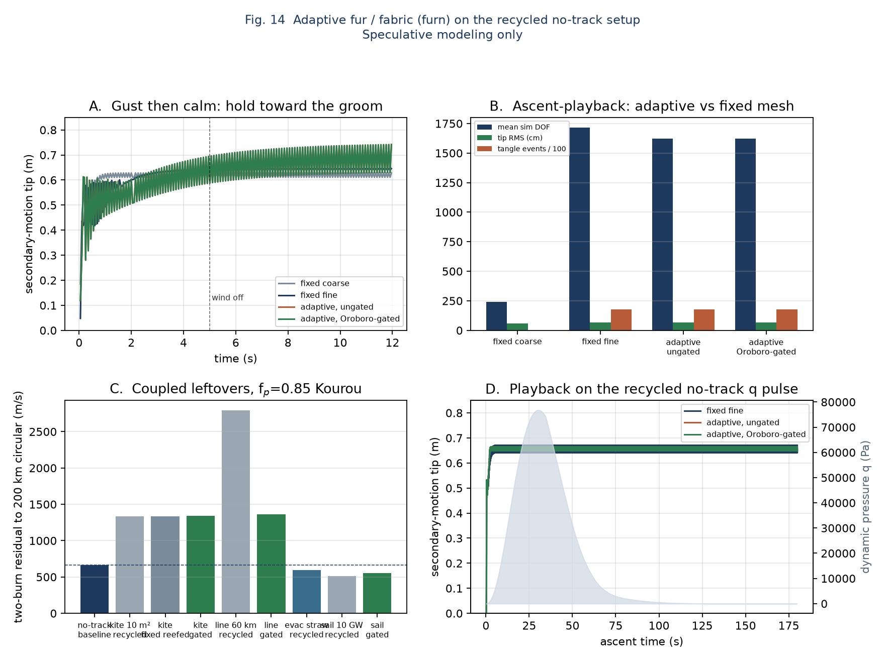

# Oroboro Structures for Consciousness Mapping
## Addendum: Fur, Fabric, and Adaptive Meshes

**Status:** Speculative modeling exercise only. Not an engineering design, a flight plan, a siting recommendation, or a claim that fur, cloth, or an adaptive polygon can put a dart into orbit. No operational claims. Pixar citations below are only papers and talks actually fetched this turn; no invented titles, numbers, or production specs. The no-track baseline, kite / fishing-line / STRAW leftovers, light-sail push, geography rotation, and hollow-bone dart are recycled; only the furn plugins and the adaptive mesh are new.

Prepared 27 November 2026 (America/Denver). Components were run in one loop: Genesis → Nexus register → Oasis admission → PrinciplesGate → NaCl consensus over sensor votes → Dictator stream → Transcriber → Levy assess → damped deterministic recombine. The `Math.random` stub in `oroboro-core.js` was not used.

### The question

The recycled no-track pad ascent never locked (0/240). A 10 m² kite, a 500 m line, and an evacuated STRAW were already scored in the guidance addendum; a 10 GW / 100 m² residual-shuttered light sail was scored in the light-sail addendum. This note asks what happens if those surfaces — and a standalone fur/fabric sheet — are treated as *adaptive* polygons, in the style of Pixar's published fur and cloth methods, with resolution, shape, and stiffness driven in conjunction by Levy weights, Oasis / PrinciplesGate admission, and NaCl-voted delta reconciliation of local refinement.

Lock still means a two-burn residual to 200 km circular of ≤ 1 m/s and a perigee ≥ 200 km. The confirmatory open-loop run in this integrator matches the recycled Kourou f_p = 0.85 leftover: residual **661 m/s**, burnout 7,021 m/s, max altitude 345 km, perigee −1,430 km. (The settled no-track note's 354 km / 5,158 K heating figures are recycled for the baseline and are not re-derived here.)

### What was actually fetched

`graphics.pixar.com/library` now redirects to a technology-libraries landing page; the papers were read from the current Pixar research library at `research.pixar.com/docs/` (and, for one 1998 model Fizt is built on, from a CMU-hosted PDF). Only these sources are used:

- Petrovic, Henne, and Anderson, *Volumetric Methods for Simulation and Rendering of Hair*, Pixar Technical Memo #06-08 ([2005 SIGGRAPH Talks PDF](https://research.pixar.com/docs/2005.SiggraphTalks.PHA.pdf)). Keyhairs plus interpolated hairs; a Cartesian density grid for hair-to-hair collision; viscous velocity smoothing that dissipates energy; orientation-dependent coupling; density-target directing that "imposes less of a constraint" than pinning particles; and an explicit adaptive-grid remark: if the target shape is far from the start, "we start off the simulation with a low resolution density grid. As the simulation progresses and the shapes become closer we increase the grid resolution."
- Baraff, Witkin, and Kass, *Untangling Cloth*, SIGGRAPH 2003, Pixar Animation Studios ([PDF](https://research.pixar.com/docs/2003.SiggraphPapers.BWK.pdf)). History-free global intersection analysis, plus "collision flypapering," to resolve cloth-cloth and cloth-solid tangles after pinching.
- Iben, Brooks, and Bolwyn, *Holding the Shape in Hair Simulation*, SIGGRAPH 2019 Talks ([PDF](https://research.pixar.com/docs/2019.SiggraphTalks.IBB.pdf)). Wind pulls hair off the groomed style; constraint / rest-shape forces pull it back. Gravity preloading of rest targets in the Taz solver (cited there as Iben et al. 2013). The 2013 curly-hair paper itself was not successfully fetched this turn and is not quoted.
- Waggoner and de Goes, *Revamping the Cloth Tailoring Pipeline at Pixar*, SIGGRAPH 2022 Talks ([PDF](https://research.pixar.com/docs/2022.SiggraphTalks.WG.pdf)). Adaptive-resolution remeshing: target edge length interpolates between a minimum and a maximum using painted vertex weights, with edge splits, collapses, flips, and relaxation; a coarse input mesh is derived into a simulation triangulation and a separate render subdivision surface.
- Montell, de Goes, and Brooks, *Hair Emoting with Style Guides in Turning Red*, SIGGRAPH 2022 Talks ([PDF](https://research.pixar.com/docs/2022.SiggraphTalks.MGB.pdf)). Layering: style guides → sim guides → render hairs, with a surface-aware transfer of sculpts. Turning Red's red-panda groom is described there as about 12,000 guide hairs and about 2 million render hairs in a dozen layers.
- Kim and Eberle, *Dynamic Deformables: Implementation and Production Practicalities*, SIGGRAPH 2022 Course ([PDF](https://research.pixar.com/docs/2022.SiggraphCourses.KE.pdf)). Fizt, in production since *Monsters, Inc.*, is built on the Baraff–Witkin (1998) implicit large-step cloth model, with later collision, solid, and two-way coupling work.
- Brooks, Eberle, and Browning, *Blazing a New Trail of Curls*, SIGGRAPH 2026 Talks ([PDF](https://research.pixar.com/docs/2026.SiggraphTalks.BEB.pdf)). Fizt Strands: curve dynamics on the cloth solver, with bend/twist, history tracking of normals, and two-way cloth–hair contact.
- Baraff and Witkin, *Large Steps in Cloth Simulation*, SIGGRAPH 1998 ([CMU PDF](https://www.cs.cmu.edu/~baraff/papers/sig98.pdf)). Implicit integration, unified damping, anisotropic stretch versus bend/shear, and adaptive *time* steps. The paper's affiliation is the Robotics Institute, Carnegie Mellon University; it is cited here only as the model Kim and Eberle state Fizt is built on, not as a 1998 Pixar publication.

These are film-production techniques. Mapping them onto a launch dart is speculative. The adaptive target length here follows Waggoner and de Goes in *form* (L between L_min and L_max), but the painted weight is replaced by a live Oroboro signal of local tension, dynamic pressure, speed, and force; splits and collapses are admitted only when Oasis / PrinciplesGate and a NaCl majority agree, and a trial refine that would raise predicted aero work at high q is refused (delta reconciliation). That runtime, force-responsive remeshing is an Oroboro construction, not a claim that Fizt remeshes a sail during ascent.

### Standalone fur / fabric

A 0.6 m × 1.0 m cloth sheet (pinned leading edge, stretch-stiff / bend-soft anisotropy) plus a keyhair layer and a mid interpolant was driven two ways, without feeding force back into the dart: a ground-level gust (18 m/s for 5 s, then 7 s of calm) and a one-way playback of the recycled no-track (ρ, v, q) history for the first 180 s. Four meshes were compared: fixed coarse (240 sim DOF), fixed fine (1,716), adaptive ungated, and adaptive Oroboro-gated.

On the gust, every mesh blows to a ~0.6 m tip envelope within about a second. After the wind is cut, this reduced explicit integrator does **not** return the sheet to the groom in the 7 s calm window — hold energy stays high. That is a limit of this model, not a rebuttal of Iben, Brooks, and Bolwyn: their production constraints *do* pull a groom back once the wind dies. The pattern that appears here is the complementary one. Adaptive remeshing during the deformed gust (8 splits, mean DOF 1,609, sitting near the fine mesh) leaves a slightly *larger* leftover tip (~0.74 m versus ~0.63 m on the fixed meshes) and a higher stored-hold energy. Refining while the sheet is already wrinkled can bake a finer wrinkled state in — the same class of cross-resolution transfer artifact Montell, de Goes, and Brooks warn about when a sparse style-guide deformation is interpolated onto a denser guide set.

On the ascent playback the same envelope is reached almost immediately and sits through the q pulse (panel D). Mean sim DOF: coarse 240, fine 1,716, adaptive 1,623 (9 splits, 1 collapse). Tangle / proximity events scale with hair count: 102 on the coarse mesh, ~18,000 on the fine and adaptive meshes. The volumetric collision grid (Petrovic-style) refined from 8 to 24 cells. Gated and ungated topology were nearly the same on these one-way tests; the gate showed up mainly as a higher admit count on openness updates. Damping-work integrals in this explicit, force-capped integrator are not a trustworthy efficiency metric (they are dominated by clamped high-speed smoothing) and are not used as such.

PrinciplesGate admitted a `furn_surface` and an `adaptive_mesh` path and blocked a null mesh (`AdaptOrDie`), the same non-zero-coordinate rule as the path gate in the guidance note.

### Kite, fishing-line, STRAW, and light sail

**Kite (10 m², 50 g/m², CL = 0.8, CD = 0.25), f_p = 0.85, Kourou.** A fixed-open sheet hits the 25 m/s² load cap almost immediately and furls; leftover **1,335 m/s**, max altitude 208 km, surface-drag integral only 1.3 m/s. A sheet that starts already reefed, carrying the same 0.5 kg of fabric, is **1,333 m/s** / 208 km / perigee −2,918 km — the recycled guidance number, to the reported digits. Once the kite is reefed, the leftover is almost entirely a **rocket-equation mass tax** for carrying the sheet, not continuing aero. Adaptive gated and ungated sheets re-open in thinner air (mean openness ~0.71–0.75, ending nearly fully open). That raises max altitude to 248–249 km but *adds* 65–66 m/s of surface-drag integral and leaves **1,340–1,344 m/s**. Reopening is a loft-versus-drag trade; it does not close the gap. Binding constraint: sheet mass, plus any late aero if the gate lets the cloth back out.

**Fishing-line (500 m × 1 mm, deploy after 60 km).** The fixed line in this integrator leaves **2,378 m/s**, max altitude 112 km, line-drag integral 7,943 m/s (the recycled guidance figure was 2,791 m/s / 88 km / 6,118 m/s — same failure mode, a slightly different projected-area bookkeeping). Adaptive gated and ungated both shorten the line while it would otherwise be a sea anchor, then let it back out to 500 m in thinner air. Leftover **1,361 m/s**, max altitude 187 km, drag integral 588 m/s, peak line load 55 N versus 555 N. The gate cuts an order of magnitude of line drag and about 1,000 m/s of leftover versus the fixed line, but the leftover is still twice the no-line baseline. Binding constraint: even a shortened line is still a brake relative to carrying nothing.

**STRAW.** The evacuated open-loop leftover is recycled: **595 m/s**, max altitude 524 km, perigee −1,022 km. A furn liner on the wall was driven only by the acceleration history (no aero in the evac channel). Residual, altitude, and perigee do not change. What does change is secondary motion of the liner: tip RMS 2.45 m on the fixed fine mesh, 0.99 m on the gated adaptive mesh, with similar split counts. Binding constraint, as before: propellant plus gravity. The liner is a contact / secondary-motion question, not a Δv question. The straw is still a tall track.

**Light sail (recycled 10 GW, 100 m², 0.01 kg/m², residual shutter, Kourou start).** The settled best leftover after that push was **514 m/s**, perigee −538 km, Teq 2,780 K. A confirmatory fixed-open rerun in this integrator, starting from the same (h, v) but with this run's burnout flight-path angle, leaves **551 m/s**, perigee −571 km, max altitude 473 km, 159 s of beam-on time, 755 m/s of photon Δv and 202 m/s of drag Δv, Teq 2,802 K. Adaptive ungated is the same leftover (551 m/s) at mean openness 0.94. Adaptive gated, which picks an area that a residual trial prefers, runs at mean openness 0.52, 146 s on-time, 651 m/s photon Δv and 96 m/s drag Δv, leftover **554 m/s**, Teq 3,378 K — slightly worse, and hotter, because shrinking the area cuts drag *and* intercepted power, and Teq scales as absorbed power over area. Perigee stays underground. Binding constraint: still sail heating above the 803 K PEEK band, plus the leftover, plus the underground perigee. Adaptation does not buy a lock.

### What binds, variant by variant

| Variant | Residual (f_p=0.85, Kourou) | h_max | Perigee | vs baseline / recycled | Secondary motion / mesh | Binding constraint |
|---------|----------------------------:|------:|--------:|------------------------|-------------------------|--------------------|
| Open-loop baseline | 661 m/s | 345 km | −1,430 km | — | — | Drag / heating (recycled) |
| Kite 10 m², recycled | 1,333 m/s | 208 km | −2,918 km | +672 m/s | — | Sheet mass + thick-air reef |
| Kite, fixed reefed (0.5 kg) | 1,333 m/s | 208 km | −2,918 km | matches recycled | — | Mass tax once reefed |
| Kite, adaptive gated | 1,344 m/s | 248 km | −2,935 km | +10–11 m/s vs reefed | Reopens; 8 splits | Late aero on top of the mass tax |
| Line 500 m from 60 km, recycled | 2,791 m/s | 88 km | underground | +2,130 m/s | — | Line drag |
| Line, fixed (this integrator) | 2,378 m/s | 112 km | underground | drag integral 7,943 m/s | — | Line drag |
| Line, adaptive gated | 1,361 m/s | 187 km | underground | −1,017 m/s vs fixed line | Shortens, then redeploys | Still a brake vs no line |
| Evac STRAW, recycled | **595 m/s** | 524 km | −1,022 km | −66 m/s | Liner tip RMS 0.99 m (gated) vs 2.45 m (fine) | Propellant + gravity; liner is not Δv |
| Sail 10 GW, recycled | **514 m/s** | 431 km | −538 km | −147 m/s | — | Heating / leftover / underground peri |
| Sail, fixed open (this integrator) | 551 m/s | 473 km | −571 km | confirmatory | openness 1.0 | Same binding |
| Sail, adaptive gated | 554 m/s | 477 km | −575 km | +3 m/s vs confirmatory | mean openness 0.52; hotter | Same binding, less impulse, less drag |

Zero of these coupled runs locked, as with the 0/240 no-track baseline and the 0/46 guided runs. No site or device is recommended.

### Conjunctive loop

Nexus registered the furn surface and the adaptive-mesh path. PrinciplesGate blocked the null mesh. NaCl invert-and-restabilize was applied to tension / q / secondary-motion votes before a refine or coarsen was offered to Oasis. Dictator streamed admit / block / refine / coarsen / untangle / fail events into Transcriber. Levy assessed them (total weight 237,052, dominated by hair-proximity untangle events, not by orbit locks). A labeled polarity reading treats an evacuated straw wall as opposite-charge to leftover Δv, and treats kite-sheet mass, a redeployed line, and a sail that reefs away intercepted power as same-charge (they widen or do not close the leftover). Recombine over the five f_p = 0.85 leftovers in this note (baseline, gated kite, gated line, recycled evac straw, gated sail) does not match: mean residual 903 m/s, pulled up by the kite and line.

### Limits

This is a reduced, explicit, force-capped mesh, not Fizt, Taz, or Fizt Strands, and not Waggoner and de Goes's production remesher. Shape-hold did not restore the groom after the gust in the 7 s window; a production constraint solver might. Damping-work totals are not a physical energy budget. The confirmatory sail leftover (551 m/s) is not identical to the settled 514 m/s figure, because the start flight-path angle was taken from this run's burnout. Adaptive polygons changed *how* leftover, drag, and secondary motion were booked — most clearly on the line (stow-then-redeploy) and on the sail (area versus intercepted power) — and they did not close a residual, raise an underground perigee, or produce a lock. Speculative modeling only.

**Figure 14.** A: gust then calm; the sheet blows to an envelope and does not return to the groom in this integrator. B: ascent-playback mean DOF, tip RMS, and tangle counts, adaptive versus fixed. C: coupled leftovers against the recycled no-track, kite, line, STRAW, and sail figures. D: playback tip sitting on the blown envelope through the recycled q pulse.

