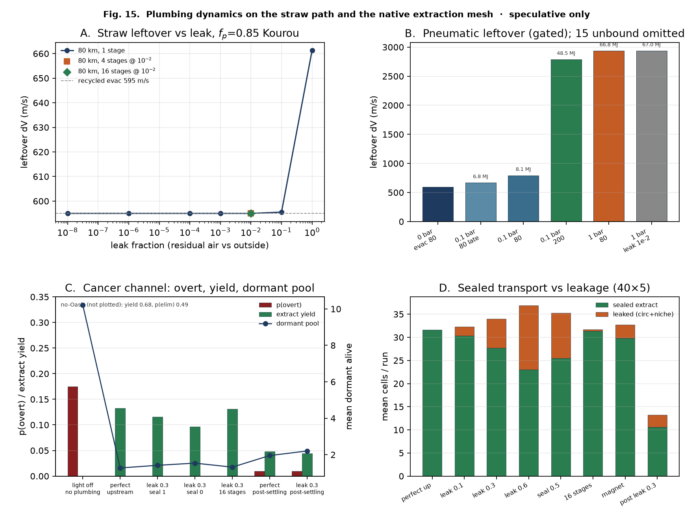

# Oroboro Structures for Consciousness Mapping

## Addendum: Plumbing Dynamics

Status: Speculative modeling exercise only. Not an engineering design, a vacuum-tube specification, a flight plan, a pump or seal rating, or a biological, clinical, or therapeutic claim. No operational claims. The evacuated-STRAW leftover, the 1,030.94 km vacuum path to a 200 km circular at T/W = 3, the hollow-bone dart, and the light-off no-plumbing cancer signature are recycled; only the plumbing plugins are new.

Prepared 27 November 2026 (America/Denver). Components were run in one loop: Genesis -> Nexus register -> Oasis admission -> PrinciplesGate -> NaCl consensus -> Dictator stream -> Transcriber -> Levy assess -> damped deterministic recombine. The Math.random stub in oroboro-core.js was not used.

## The question

Two recycled leftovers sit on opposite sides of a similar picture: a continuous channel that is supposed to carry something from here to there without leaking. On the pad, an evacuated STRAW along the open-loop pitch program left 595 m/s to a 200 km circular (hmax 524 km, perigee -1,022 km, Kourou fp = 0.85). A vacuum acceleration to circular speed at T/W = 3 already needs about 1,031 km of path, 1.34x the recycled 767.6 km flatten tube. On the native cancer mesh, the light-off, no-extraction, no-plumbing signature at calibrated levy_gain 0.05 is p(overt) = 0.175, mean dormant pool 10.215, levy 1,905.61, mean frustrated edges 22.515, extracted 0 (40 seeds x 5 cancers). This note asks what happens if those paths are treated as plumbing: staged vacuum or sealed extraction channels, valves and seals, a pressure-gradient push, and an honest leak back into the surroundings — with residual gap, momentum, energy waste, and transport/leakage booked in both domains.

Lock still means a two-burn residual to 200 km circular of = 200 km. Cancer outcomes are mesh-accounting numbers, not disease course.

## How the plumbing was booked

The dart is unchanged: 12.56 kg hollow-bone vehicle, area 0.005991 m2, CD = 0.2, Isp = 450 s, T/W = 3, Kourou due-east burnout boost. Inside a staged vacuum segment the residual density is leak_frac / n_stages times the outside ISA density at that altitude (leak_frac = 0 is the recycled evac; leak_frac = 1 with one stage is open air). A pneumatic push is applied only while the dart is in the channel: F = (Pbehind - Pahead) A, directed along the commanded pitch. At 1 bar the force is about 607 N, versus chemical thrust of about 370 N. Mechanical work on the dart is &int;F v dt. Supply work is &int;Pbehind A v dt / eta with a labeled compressor efficiency eta = 0.5, plus a labeled orifice-scale leak makeup. Residual is scored at chemical burnout unless a push is still on after burnout, in which case it is scored at the last accelerating state. A late-only valve admits the push only after the program has flattened below 20 deg. A labeled flatten-to-5 deg channel, stretched over 767.6 or 1,031 km, is compared with the recycled open-loop program; it is not the 1,000 g evac tube.

On the cancer side, plumbing is off by default. The new step is a strict no-op — no RNG, no state change — unless native["plumbing"] is on, so the light-off no-plumbing signature must stay bit-identical. When it is on, the exit path is the existing extraction mesh (lure, magnet, flush edges). Oasis is the valve: a PrinciplesGate / Oasis commit is required to enter the channel. A pressure-gradient strength sets the attempt rate. A seal check then either books a sealed EXTRACTED hop (Levy extract) or leaks the cell back into circulation or into its niche (Levy fail). Effective leak rises with a poorer seal and a stronger push, and falls with staged isolation; a labeled smart-magnet hold halves the effective leak. Timing is upstream (circulating and seated cells) or post-settling (dormant and overt only, from month 61). Whole-versus-parts checks use the same Prostate seed 17,000 as the light-transport note.

## Launch: leak, stages, and a pneumatic push

The confirmatory leak-free evac-80 open-loop run in this integrator matches the recycled leftover to the reported digit: residual 595.0 m/s (595.003 recycled, 595.003 here), hmax 524 km, perigee -1,022 km, burnout 7,275 m/s at 109 km, Teq 1,579 K. Extending a leak-free vacuum to 200 km altitude, or along the 1,031 km path, leaves the same 595 m/s leftover, because chemical burnout is already at 109 km; a longer vacuum after burnout does not rewrite the two-burn residual. A 1,031 km flatten-to-5 deg program with no push is worse, not better (residual 4,523 m/s, perigee -5,989 km): a slow flatten is a poorer gravity turn, on this dart, than the recycled open-loop program.

Leak does not move the leftover until it is already a large fraction of outside air. At leak_frac = 10-2 the evac-80 leftover is still 595.0 m/s; sixteen airlock stages at that leak are indistinguishable from a tight evac at the leftover digit. At leak_frac = 0.1 the leftover is only 595.5 m/s, but drag is 38.5 m/s, Teq rises to 2,571 K, hmax falls to 502 km, and perigee drops to -1,056 km: heating and drag show up before the two-burn leftover does. At leak_frac = 1, and in an open-air straw with no evac, the run is bit-identical to the recycled no-track baseline: residual 661.3 m/s, hmax 354 km, perigee -1,429 km, Teq 5,158 K, drag 7,863 m/s. That is the honest cost of a fully leaked channel.

A pressure-gradient push behind the vehicle adds momentum, and it does not close the gap. Directed along the open-loop channel, even a late 0.1 bar push (admitted only after the program is below 20 deg) raises the leftover from 595 to 666 m/s, lofts hmax to 961 km, and spends 6.8 MJ of wasted supply work (eta = 0.5; mechanical work 6.8 MJ, supply 13.6 MJ). A 0.1 bar push from the pad is worse (791 m/s, hmax 1,348 km, waste 8.1 MJ). A 1 bar push on the 80 km evac leaves 2,934 m/s and spends 67 MJ of waste. A 0.1 bar push continued to 200 km leaves 2,787 m/s with a barely-positive perigee (9 km), still far from a 200 km circular. Fifteen of 49 launch cases, including every 1 bar or 10 bar run on the long path, are unbound: no two-burn residual exists. Gated and ungated valves agreed whenever the ahead side was a vacuum. Zero of 49 cases locked. Recombine over the 34 bound leftovers has mean 1,362 m/s, pulled up by lofted and flatten-mismatch runs, not by a closed gap.

| Case | Residual | hmax | Perigee | Teq | Drag / dVp | Waste | Note |
| --- | --- | --- | --- | --- | --- | --- | --- |
| Recycled evac-80 open-loop | 595.0 m/s | 524 km | -1,022 km | 1,579 K | recycled | — | Settled leftover |
| Confirm evac-80, leak 0 | 595.0 m/s | 524 km | -1,022 km | 1,579 K | 0.3 / 0 | 0 | Matches recycled |
| Evac-200 or 1,031 km path, no push | 595.0 m/s | 524 km | -1,022 km | 160&ndash;899 K | ~0 / 0 | 0 | Burnout already at 109 km |
| 1,031 km flatten, no push | 4,523 m/s | 4,831 km | -5,989 km | ~0 K | 0 / 0 | 0 | Worse gravity turn |
| Evac-80, leak 0.1, 1 stage | 595.5 m/s | 502 km | -1,056 km | 2,571 K | 38.5 / 0 | 0 | Heat before leftover |
| Evac-80, leak 1, or open-air | 661.3 m/s | 354 km | -1,429 km | 5,158 K | 7,863 / 0 | 0 | Bit-identical to no-track |
| 0.1 bar, evac-80, late valve | 666 m/s | 961 km | -494 km | 1,686 K | 0.3 / 446 | 6.8 MJ | Adds dVv, lofts |
| 0.1 bar, evac-80, from the pad | 791 m/s | 1,348 km | -399 km | 1,545 K | 0.2 / 663 | 8.1 MJ | Worse leftover |
| 0.1 bar, evac-200 | 2,787 m/s | 4,993 km | +9 km | 207 K | 0 / 2,925 | 48.5 MJ | Peri barely positive |
| 1 bar, evac-80 | 2,934 m/s | 5,801 km | -103 km | 1,716 K | 0.1 / 3,297 | 66.8 MJ | Does not lock |

Zero of these launch runs locked, as with the 0/240 no-track baseline. Fifteen further cases were unbound (no apogee state for a two-burn residual), including 1 bar and 10 bar pushes on the 200 km and 1,031 km channels. No site or device is recommended. For scale, the labeled pneumatic waste (7&ndash;67 MJ on the bound 0.1&ndash;1 bar 80 km cases) is small next to a rough chemical-exhaust kinetic scale of order 1011 J for the 10.7 kg of propellant, and it is still spent in the wrong direction.

## Cancer: a sealed extraction channel

The light-off no-plumbing signature is unchanged: p(overt) = 0.175, dorm_alive_mean = 10.215, levy_mean = 1,905.61, n_frustrated_mean = 22.515, extracted = 0, on the same 40 x 5 cohort, with census and levy checks holding. Whole-versus-parts was consistent on the no-plumbing path and on three plumbing paths (perfect upstream, leaky upstream, perfect post-settling).

When the sealed channel is turned on, Oasis acts as a restrictive valve. Under a perfect seal, upstream, strength 0.5, mean attempts were 285.5 per run, of which the valve blocked 253.8 and committed 31.6; all 31.65 committed hops sealed (yield 0.132). In this mesh accounting, p(overt) fell from 0.175 to 0.000 across all five cancers, and the mean dormant pool fell from 10.215 to 1.270. A leftover dormant pool remains: p(eliminated) is only 0.03. Extraction came mostly from circulation (mean 21.2) and dormancy (6.5), almost never from overt. Frustrated extract edges are a fixed mesh fact (8 frustrated, 9 locked) once the extraction layer is present; overall frustrated edges rise from 22.515 to about 33 because those edges are added, not because the valve failed.

Leakage returns cells mostly to circulation when the attempt is upstream (leak 0.3: 5.88 to circ, 0.45 to niche, sealed yield 0.116, dormant pool 1.415, p(overt) still 0) and mostly to the niche after settling (leak 0.3 post: 0.86 to circ, 1.77 to niche). Sixteen airlock stages at leak 0.3 almost restore the perfect-seal yield (sealed 31.34, leaked 0.38). A labeled smart-magnet hold at leak 0.3 cuts leakage from 6.33 to 2.97. Post-settling transport, even with a perfect seal, is weaker: yield 0.048, p(overt) 0.010 (Prostate and Colorectal still 0.025), dormant pool 1.95, only 70.6 attempts, because circulating cells are no longer eligible and the valve opens at month 61. Turning the Oasis valve off is not a better plumbing result to chase: yield jumps to 0.684 and p(eliminated) to 0.49, with levy 2,403, because every attempt commits. That is an ablation of the gate, not a recommended setting. Raising pressure-gradient strength from 0.2 to 0.8 raises yield from 0.053 to 0.245 and cuts the dormant pool from 4.465 to 0.200, with p(overt) 0.020 then 0.000; it also raises valve blocks (152 then 300) and levy. None of these figures is a treatment effect.

| Condition (40 x 5, gain 0.05) | p(overt) | Dormant | Yield | Sealed | Leaked | Valve block / commit | Note |
| --- | --- | --- | --- | --- | --- | --- | --- |
| Light-off, no plumbing (recycled target) | 0.175 | 10.215 | 0 | 0 | 0 | 0 / 0 | Signature unchanged |
| Perfect seal, upstream | 0.000 | 1.270 | 0.132 | 31.65 | 0 | 253.8 / 31.6 | Leftover dormant pool |
| Leak 0.1, seal 1, upstream | 0.000 | 1.325 | 0.127 | 30.33 | 1.95 | 255.4 / 32.3 | Most leak to circ |
| Leak 0.3, seal 1, upstream | 0.000 | 1.415 | 0.116 | 27.68 | 6.33 | 262.6 / 34.0 | 5.88 circ, 0.45 niche |
| Leak 0.6, seal 1, upstream | 0.000 | 1.535 | 0.096 | 23.05 | 13.85 | 268.6 / 36.9 | Same leakeff as seal 0, leak 0.3 |
| Leak 0.3, 16 stages | 0.000 | 1.315 | 0.131 | 31.34 | 0.38 | 254.8 / 31.7 | Isolation almost restores seal |
| Leak 0.3, smart magnet | 0.000 | 1.335 | 0.125 | 29.79 | 2.97 | 256.3 / 32.8 | Labeled hold, not a therapy |
| Perfect seal, post-settling | 0.010 | 1.950 | 0.048 | 11.45 | 0 | 59.1 / 11.4 | Weaker; circ no longer eligible |
| Leak 0.3, post-settling | 0.010 | 2.200 | 0.044 | 10.63 | 2.62 | 64.3 / 13.3 | Leak prefers the niche |
| Perfect, upstream, no Oasis (ablation) | 0.000 | 0.050 | 0.684 | 163.52 | 0 | 0 / 163.5 | Gate off; not a setting to chase |

Per cancer, baseline overt is highest in Prostate (0.40) and lowest in Lung (0.05). Perfect upstream plumbing sent p(overt) to 0 in all five, with dormant leftovers between 0.98 (Lung) and 1.70 (Prostate). Post-settling left Prostate and Colorectal at p(overt) = 0.025. Census, levy, consensus, and inversion checks held on every condition.

## Conjunctive loop and the two leftovers

Nexus registered a sealed channel, staged vacuum, pneumatic push, and Oasis valve. PrinciplesGate admitted those four and blocked a null channel (AdaptOrDie). Dictator streamed admit / block / leak / stage / extract / fail events into Transcriber. Levy assessed them (total weight 2,676 in this ledger: launch leak, pneumatic, and stage events, plus cancer extract and leak counts; not dominated by orbit locks, of which there were none). A labeled polarity reading treats a leak-free evac and a tight seal as opposite-charge to leftover dVv or to a lingering dormant pool, and treats a pneumatic push along a steep open-loop channel, a leaked straw that returns the no-track heating bill, and a leak back into circulation as same-charge (they widen the leftover, or they return cargo to the pool). Recombine over the bound launch leftovers does not match (mean 1,362 m/s). On the cancer side the residual gap that remains after a perfect upstream seal is the dormant pool (1.27 cells/run, p(eliminated) = 0.03), not the overt colony rate.

Mapped onto her components: the polygon / extraction mesh is the pipe wall; Levy pulses book extract, fail, and leak; delta reconciliation is the whole-versus-parts check and the damped launch recombine; smart magnets are a labeled directional hold in the channel (halving effective leak here, and still useless as a translational actuator on the pad, as in the guidance note); Oasis / PrinciplesGate is the valve; Nexus registers the path. None of that closes a 595 m/s orbital leftover, and none of it is a clinical extraction method.

## Limits

- Speculative modeling only. Not an engineering design, vacuum-tube, seal, or compressor specification, and not a biological, clinical, or therapeutic claim.
- The leak model is a labeled equilibrium residual density, leak_frac / n_stages times outside ISA, not a pump-down PDE, a real orifice, or a measured seal rate.
- Pneumatic energy uses F = dVP A and supply work at eta = 0.5. Waste equals mechanical work when the ahead side is a vacuum, because the labeled compressor is 50% efficient. 1&ndash;10 bar over a long tube readily unbinds this dart; those cases are reported as unbound, not as a trajectory.
- A flatten-to-5 deg program over 1,031 km is a labeled geometry, not the recycled 1,000 g evac tube, and it is a worse gravity turn on this T/W = 3 dart than the open-loop program.
- Confirmatory evac-80 leftover matches the recycled 595 m/s. Leak = 1 recovers the recycled no-track 661.3 m/s / 5,158 K exactly. Those matches are bookkeeping checks, not a claim that a real tube would do the same.
- The light-off no-plumbing cancer signature was required to stay unchanged and did. Turning plumbing on adds an extraction mesh (frustrated edges rise because edges are added). Oasis-gated p(overt) = 0 and a leftover dormant pool are mesh-accounting outcomes, not disease course, and the no-Oasis ablation is not a recommended setting.
- Smart-magnet leak reduction is a labeled hold, not a device. Lock remains residual = 200 km. No launch case locked (0/49, plus the recycled 0/240).

*Fig. 15. Plumbing dynamics on the straw path and the native extraction mesh. A: evac-80 leftover is flat near 595 m/s until the channel is substantially leaked, then returns the no-track 661 m/s. B: a gated pneumatic push lofts and widens leftover; waste in MJ is supply inefficiency at eta = 0.5; 15 unbound cases omitted. C: Oasis-gated sealed transport cuts p(overt) and the dormant pool in this mesh but leaves a leftover dormant pool; post-settling is weaker; the no-Oasis ablation (yield 0.68) is not plotted. D: sealed extract versus leak back into circulation or niches (40 seeds x 5 cancers). Speculative only.*

Paths are relative to this repo: `research/magnetic-launch/Plumbing_Dynamics_Addendum.md` (PDF as page images: `pdf-pages/Plumbing_Dynamics_Addendum/view.html`); `outputs/plumbing_dynamics.json`; `scripts/run_plumbing_dynamics.py`; figure `figures/fig15_plumbing_dynamics.svg`. Cancer tables: `research/metastasis-native/data/plumbing/` (`plumbing_summaries.csv`, `plumbing_ledger.json`). The hook lives in `research/metastasis-native/oro_native.py` and is a no-op when plumbing is off.
