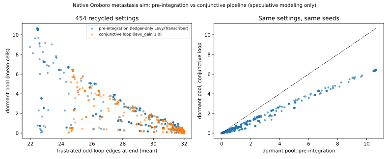

# metastasis-native: native Oroboro metastasis cascade, conjunctive pipeline

**Speculative in-silico modeling only. No biological, clinical or medical claims, and no treatment implications.** Cascade rates are carried over from the original `oro_cascade` calibration. Every number is a model output.

## What this is
A monthly cascade (shed → circulate → arrest → dormant → reawaken → colonize). Its core state is the **NaCl polarity mesh**: Genesis origin, a circulation ring, a dream-catcher niche around each organ, and return edges. Odd loops leave frustrated edges that cannot lock, so they cannot colonize. Since 27 Nov 2026 **every Oroboro component runs in one loop**. See [../PIPELINE.md](../PIPELINE.md) for the diagram.

## Adjustments made for conjunctive use (27 Nov 2026)
| Component | Before (published restart) | Now (`integrated=True`) |
|---|---|---|
| Dictator | Chronicle written after the run, only with `record=True` | `Dictator.stream()` sends each month's events to the Transcriber inside the step |
| Transcriber | Passive log | Ingests the stream and flags critical entries (colonize, exit), following `oroboro-core.js` `isCritical` |
| Levy | Per-part counters, used only as an end-of-run check | `LevyLedger.assess()` weighs the Transcriber entries (clear 1, detach 7, fail 2, exit 4, colonize 14). The monthly pulse **feeds delta reconciliation**. The pipeline Levy must equal the running Levy (`pipeline_levy_ok`) |
| Delta reconciliation (damper) | Occupancy spike vs rest load 40; **never engaged at baseline** (ablating it changed nothing) | Damped occupancy spike **+ Levy-pulse spike** (`levy_gain`). Pressure raises the next month's Oasis threshold. Mean pressure is 0.030 at baseline |
| Nexus | Registry and telemetry | Registers each month's state (occupancy, Levy pulse, mesh frustration fraction, pressure, Genesis closure). **The next month's environment is built from it** |
| PrinciplesGate | Absent | Port of `OroboroCorePrinciplesGate_REAL.cs` placed after the Oasis score: AcceptHumanPain clamp, RerouteFrustration (+0.3·f when the frustration fraction is above 0.6), InternalDiagnosticFirst (comfort H < 0.3 → no commit), AdaptOrDie (re-seat after 2 or more frustrated failures) |
| Genesis | Registered once | Monthly closure check: every state traces back to a detach |
| Mesh consensus, dream-catcher repair, homeostasis, Oasis, state reduction | Already in-step | Unchanged; they now read the Nexus state |

`integrated=False` reproduces the pre-integration run exactly. Whole-system vs decomposed (4 parts) is bit-identical in both modes.

## Results (5 cancers; baseline 200 seeds each; leave-one-out 100; 454 recycled settings × 40)
Baseline (original calibration targets: colony probability 0.217, dormant pool 10.38):

| Wiring | p(any colony) | dormant pool |
|---|---|---|
| Pre-integration | 0.180 | 10.36 |
| Conjunctive, `levy_gain` 0.05 (closest to the calibration targets) | 0.175 | 10.09 |
| Conjunctive, `levy_gain` 0.5 | 0.134 | 8.01 |
| **Conjunctive, `levy_gain` 1.0 (working baseline, `params.json`)** | **0.091** | **6.36** |

Coupling Levy into the loop lowers both colonies and the dormant pool, and the effect grows steadily with gain. The calibration targets favor weak coupling. A joint recalibration at full coupling is an open next step. `levy_gain` 1.0 is kept as the working baseline so the cross-domain comparison and this run agree.

Leave-one-out at baseline (conjunctive, gain 1.0). Each row removes one component:

| Removed | p(colony) | dormant |
|---|---|---|
| none (full loop) | 0.096 | 6.37 |
| PrinciplesGate | 0.096 | 6.37 (**inert at this load**: H never < 0.3, frustration fraction ≤ 0.36 (32 of 89 edges at most) < 0.6, AdaptOrDie re-seats ≈ 0) |
| Levy feedback | 0.178 | 10.41 |
| damped reconciliation | 0.178 | 10.41 |
| adaptive dream-catcher niche | 0.080 | 6.37 |
| odd loops (tree niche) | 0.112 | 6.36 |

Key settings (conjunctive vs pre-integration dormant): valuation threshold 0.80 → 0 colonies, 0.30 vs 0.55. Organ permissiveness × 0.4 → 0 colonies, 1.44 vs 2.22. Dormant clearance × 20 → 0.014 colonies, 0.57 vs 0.81. Colonization barrier 0.3 → 0.036 colonies, 6.40 vs 10.52. Tilt still worsens outcomes: tilt 0, 0.3, 0.6 → colonies 0.102, 0.203, 0.297 and dormant 6.34, 8.68, 10.26.

Across the 454 settings, the frustrated-edge count vs the dormant pool is Spearman −0.829 under the conjunctive loop (−0.819 before). Loops still do not track the pool positively. Dormant-pool rank order is preserved vs pre-integration (ρ = 0.988). Census, Levy, pipeline-Levy, mesh consensus and Genesis closure checks pass in every run.

## Light as directed transport to an extraction node (27 Nov 2026; model outputs)
Speculative modeling only. This is not a treatment, protocol or clinical claim. Light is modeled as a directed transport signal on the native polarity mesh. It moves occupancy to a collection node; it does not kill occupancy in place. There are 5 modes (lure, tag + magnet, flush, photoacoustic, combined), 3 timings (upstream, circulation, post-settling) and 3 strengths, at Levy gains 0.05 and 1.0. **Light is off by default** (`params.json`: `light=false`, `extraction=false`). With it off, the code reproduces the earlier integrated run bit-for-bit (checked on 25 seeds).
- The extraction node alone, with no transport, changes nothing about fates.
- **All 45 sweep conditions (gain 0.05) shrink both the colony rate and the dormant pool** against the matched baseline (17.5%, 10.22). None shrinks only one of them. Example: combined, upstream, 0.5 → 0.0%, 0.67. Combined, upstream, 0.8 → pool 0.045.
- Upstream is more efficient. Circulation has the higher raw yield. Post-settling still leaves more behind. Almost no occupancy is moved out of overt colonies.
- The circulation ring stays locked. The correlation between frustrated loops and the pool does not carry over (Spearman 0.09, not significant).
- **Oasis is load-bearing:** skipping Oasis admission on extract proposals only raises the yield from 15% to 77% and turns the exit into an ungated drain. PrinciplesGate, Levy feedback, the damper, adaptive niches and loops barely move the result at gain 0.05.
- All checks pass on every condition: census, Levy, consensus, pipeline Levy, Genesis closure, mesh inversion and whole-vs-parts. These were re-checked before the push, with light on and off.

Note: [`notes/Light_Transport_Extraction.md`](notes/Light_Transport_Extraction.md) ([page view](notes/pdf-pages/Light_Transport_Extraction/view.html)). Figure: [`charts/fig_light_transport.svg`](charts/fig_light_transport.svg). Data: `data/light_transport/`. Run: `python3 run_light_transport.py`.

## Files
- `oro_native.py` (sim and components), `oro_mesh.py` (looped polarity mesh), `params.json`
- `run_integrated.py`: conjunctive rerun (`--calibrate` picks the calibration-best gain)
- `run_priority.py`: original pre-integration driver
- `data/integrated/` (gain 1.0), `data/integrated_levy_gain_0.05/`, `data/pre_integration/` (published restart, superseded)
- `charts/`, `outputs/*.log`
- `notes/Native_Mesh_Restart_HeatTrace.md` (pre-integration write-up; [page view](notes/pdf-pages/Native_Mesh_Restart_HeatTrace/view.html))
- `run_light_transport.py`, `data/light_transport/`, `notes/Light_Transport_Extraction.md`
- `notes/github_scan_inventory.md`

Run: `python3 run_integrated.py` (numpy, pandas, scipy, matplotlib).
