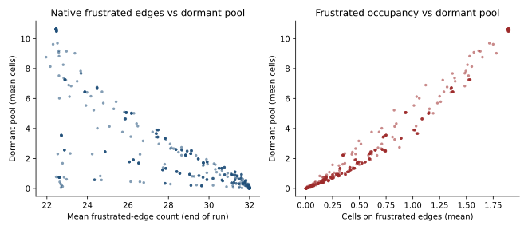

> **Status update (27 Nov 2026):** these are the *pre-integration* native results. In that wiring Dictator/Transcriber/Levy were ledgers only and the damper never engaged. The same model with all components on one loop (conjunctive pipeline) is reported in [../README.md](../README.md). Speculative modeling only; no clinical claims.

# Oroboro Structures for Consciousness Mapping
## Case Study Addendum: A Native Mesh Restart of the Metastasis Cascade
### Speculative modeling only

**Status:** Speculative modeling exercise only. Not a medical treatment, protocol, diagnostic tool, or claim of clinical or biological efficacy. No operational claims. This note restarts the in-silico cascade so that loops, mesh consensus, and reconciliation are native Oroboro state, then re-tests whether a frustrated-loop count tracks the dormant pool.

Prepared 27 November 2026 (America/Los_Angeles) after a full public-GitHub rescan of `caitlynrandels-del` and a from-scratch rebuild, left in `metastasis_native/` under the research workspace. Original cascade files were not overwritten.

### 1. Why this restart

The user instruction was that the cascade should already have loops if it is using her systems, and that the full GitHub archive is what those systems are. A previous overlay idea — that the stubborn dormant pool looked like odd-sided dream-catcher loops that can never lock — had been stopped before it produced a result, because that overlay would have bolted a loop count onto a sim that might not contain her mesh at all.

This run therefore did three things, in order: rescan every public repository; audit the existing metastasis sims with file and line evidence; and, because those sims were not natively looped, rebuild the cascade from scratch with her polarity mesh as the core state, injecting the launch-chat mechanisms only where they become a real rule.

### 2. GitHub rescan

All 30 public repositories of `caitlynrandels-del` were shallow-cloned on 27 November 2026 into `/tmp/gscan2`. A prior workspace inventory of 27 repos (snapshots from 24 November) was stale. New or freshly pushed repos include `metastatic-cascade-analysis`, `epilepsy-sim`, `caitlynrandels-del`, and updates to `Oroboro` and `oroboro-relay`.

The file `sky-ari-ai/Oroboro AI Companion` was not opened or copied. It is known to contain an exposed Gemini API key; that key was not used.

Canonical implementations located in the scan:

| Component | Where it actually lives |
|-----------|-------------------------|
| Genesis / IonicOrigin | `Oroboro/consciousness-mapping/nacl_polarity_mesh.py`; `oroboro-relay/oroboro-core.js` (`OroboroGenesis`); `oroboro-os/oroboro` |
| Nexus registry | `oroboro-relay/oroboro-core.js`; `oroboro-os/oroboro`; epilepsy-sim `epi_core.py` |
| Transcriber / Dictator | `oroboro-relay/oroboro-core.js`. `oroboro-os/oroboro` has Transcriber and Levy but not Dictator. |
| Levy ledger | `oroboro-core.js`; `nacl_polarity_mesh.py` (`apply_levy`); event weights in the metastasis scripts |
| NaCl polarity mesh | `nacl_polarity_mesh.py` in Oroboro (identical copy in oroboro-relay). Four nodes, three edges — a tree. Opposite charges lock. No odd-cycle or frustration test. |
| Mesh consensus | Two different meanings. Polarity: `Mesh.consensus()` returns locked edges. Cascade / epilepsy sims: event ledger, heat-trace and census must agree. |
| Delta reconciliation | Intended recombination of independent parts. In `oroboro-core.js` the delta is a `Math.random()` stub. In the relay metastasis sketch, reconcile is a log line. In `oro_cascade.py` / `epi_core.py` it is a whole-versus-parts accounting check, not in-step feedback. |
| Oasis / salience gate | Commit / buffer / recycle at threshold 0.65 in `oro_cascade.py`. OASIS itself lives in `sky-ari-ai`. |
| Homeostasis / sponge | Homeostasis in sky-ari-ai and as a rest-load bump in `oro_cascade.py`. Sponge in `Sponge_Absorption_Mechanic.md`, `epilepsy-sim/code/sponge.py`, and `metastatic-cascade-analysis`. |
| Odd-loop frustration / dream-catcher weave | **Not implemented in any public repo.** The only GitHub hit on "frustration" is an Oasis user-friction reroute in `OroboroCorePrinciplesGate_REAL.cs`, which is a psychological gate, not a mesh. The odd-loop result lives in the launch-chat workspace studies. |

A longer repo-by-repo listing is in `notes/github_scan_inventory.md`.

### 3. Verdict: the existing metastasis sims are not native

**Verdict: not native.** Loops, polarity-mesh consensus, and frustrated odd-loop edges are not part of the core state of any current metastasis sim. The leftover overlay run was already stopped and produced no result. The cascade was restarted from scratch rather than patched.

Evidence:

- `nacl_polarity_mesh.py` (Oroboro lines 66–73, 32–46): Genesis, Edge, Mesh, Levy, Nexus, Transcriber, invert-and-restabilize are all present — and the demo graph is a **tree** (four nodes, three edges). `consensus()` returns opposite-charge locks. There is no cycle walk and no frustrated-edge state.
- `metastasis_extended_sim.py` lines 88–91 and `metastasis_data_informed_sim.py` lines 118–121: a class named `MetastasisMesh` is a list of cells. `reconcile()` only logs counts with Levy weight 0 and returns a dictionary. It does not feed back into the next step.
- `corrected_multi_cancer_sim.py`: no reconcile method at all. Line 80, `log(..., 4)`, is a spontaneous exit attempt with an **undocumented** Levy weight of +4.
- `oroboro-relay/metastasis-sim/index.html` lines 133–136: `reconcile()` writes a timestamp and the sentence "Delta reconciliation complete." It does not recombine anything. Placement and pulses use `Math.random()` (lines 75–76, 111–114, 124).
- `oroboro-relay/oroboro-core.js` line 124: `delta: Math.random() * 0.1  // small reconciliation delta` — the known stub.
- `/workspace/oroboro-prevention-sim/oro_cascade.py` is the most complete workspace cascade (Genesis, Nexus, Levy, Oasis gate, homeostasis, Dictator chronicle, counter-based RNG, and a documented +4 exit at lines 17 and 185). Its "mesh consensus" (lines 275–277) is agreement among the event ledger, heat-trace and census, not a polarity mesh. `reconcile_whole_vs_parts` (lines 311–316) is an accounting identity. There is still no graph, no circulation loop, no dream-catcher niche, and no frustrated edge.
- `metastatic-cascade-analysis/metastatic_cascade_model.py`: a sponge compartment and `random.random` transitions. No Oroboro components and no loops.

The components exist in her archive. They were not the core state of the metastasis sims that produced the 454-setting sweep.

### 4. What was rebuilt

A new sim was written at `/workspace/oroboro-research/metastasis_native/` (originals left untouched). Its monthly state **is** a polarity mesh:

- **Genesis** is the ionic origin of the primary site. Shed events are magnetic-style detach pulses (Levy +7) from Genesis into a circulation ring.
- **Nexus** registers the origin, the mesh, and each month's reduced part summaries, then recombines them.
- **Cells, vessels, organs and niches are mesh nodes.** Each target organ is wrapped in a dream-catcher: an 8-node even hoop, a hub, and spokes, sitting on an inverse-Epcot bowl. Return edges close recirculation and reawakening loops. For a four-organ cancer this is 49 nodes and 89 edges, with 32 edges frustrated at construction and 57 locked. Invert-and-restabilize preserves the lock set (`inversion_holds = True`).
- **Mesh consensus** runs every step: opposite charges lock; odd-loop edges that cannot 2-color stay frustrated, unless the adaptive niche has marked them repaired.
- **Delta reconciliation is real feedback.** A leaky integrator, in the spirit of a viscous / tuned-mass damper, turns occupancy spikes into a raised Oasis admission threshold. It never lowers the threshold when the system is slack. A separate whole-versus-parts accounting check still recombines exactly (all count deltas 0, signatures equal) on the Prostate seed used as a probe.
- **The +4 exit is a documented Levy-weighted reawakening / origami-unfold pulse.** It is listed in `params.json` next to clear +1, detach +7, fail +2, and colonize +14. A cell on a frustrated edge cannot colonize until it hops onto a lockable path or the edge is repaired.
- **Oasis** is the commit / buffer / recycle gate (threshold 0.65, recycle below half), including the homeostasis rest-load bump.
- **Adaptive niche** (labeled `repair_rate = 0.08`, `rebuild_rate = 0.04`, melt window 0.15–0.85): heat from fail, exit and colonize pulses can mark a frustrated edge repaired; after dormant clearance, a repaired edge may be restored to frustrated (heat-driven web regrowth).
- **Tilt / torque** is a rotational bias on the circulation loop's organ-encounter weights, `w_i ← w_i (1 + tilt · cos(θ_i − φ))`. Default tilt is 0 so the 454-setting sweep stays comparable. A side probe is reported below.
- **Dictator / Transcriber** chronicle colonize, exit and recycle events when recording is on.
- **State reduction** still partitions cells into independent parts that see only local state plus last month's Nexus summary.

Cascade timing rates (shed, clearance, arrest, fit thresholds, 120 months, five organotropism configurations) were recycled from the original `oro_cascade` calibration so that a close baseline could be asked for.

#### Launch-chat mappings that became mechanisms

| Mapping | How it is a rule in this sim |
|---------|------------------------------|
| Inverse-Epcot bowl | `bowl_depth` is the chance an arresting cell falls into the web (spokes / hub) rather than the hoop. |
| Dream-catcher weave / odd-loop frustration | Native niche geometry; odd faces cannot fully lock. |
| Magnetic pulses | Discrete Levy-weighted detach, clear, fail, exit and colonize events. |
| Origami fold / unfold | Dormancy depth is a fold; the +4 pulse is the unfold attempt. |
| Skyscraper dampers | In-step damped occupancy feedback on the Oasis threshold. |
| Heat-driven feather regrowth / onboard adaptation | Labeled repair and rebuild rates on frustrated niche edges, inside a melt window. |
| Tilt / torque | Rotational bias of the circulation loop (side probe; default 0). |

#### Launch-chat mappings not used, and why

- **Helix force reduction.** This cascade has no launch-force variable. The circulation compartment is already a closed ring; a helix would have been redundant geometry.
- **Feathers / hollow-bone mass scaling.** There is no mass or aerodynamics in the cell model.
- **Spinning dual-Epcot fling, and a non-spinning interior.** The bowl is a static landing shell, not a rotating launcher.
- **Atmospheric tiers / air currents.** There is no atmosphere compartment here.
- **Smart magnets as a physical track.** Already represented as the discrete magnetic-style pulses above.

### 5. Calibration against the original baseline

Original cascade baseline (2,500 runs): colony probability **21.72%**, mean overt **0.255**, dormant pool **10.380**, shed **239.89**, Levy **1912.7**.

Native mesh baseline (1,000 runs, 200 seeds × five cancers): colony probability **18.00%**, mean overt **0.210**, dormant pool **10.355**, shed **239.55**, Levy **1909.6**. Census, Levy bookkeeping, ledger-heat-census consensus, and inversion all held.

The dormant pool and the shed stream match to two decimal cells and to a fraction of a cell-shed. Colony probability is about four points lower. That residual is the native loop rule: a frustrated odd-loop edge cannot lock, so some +4 unfold pulses fail. Confirming that reading, a tree-niche ablation (no hoop ring, no return edges, zero frustrated edges) raises colony probability to **20.6%**, almost back to the original 21.7%, while the dormant pool stays at 10.38. The loops tax colonization; they do not, by themselves, set the size of the 10.4-cell pool. At baseline only **2.07** of those 10.36 dormant cells sit on a frustrated edge. The rest sit on lockable hoop edges, waiting for a +4 pulse.

### 6. Priority check: does frustrated-loop count track the dormant pool?

The recycled 454 unique lever settings were re-run on the native sim (40 seeds × five cancers = 200 runs per setting). Nothing already settled in the original timing rates was re-derived. Native dormant-pool means track the original ones almost perfectly (Spearman **0.999**, 95% CI 0.998–0.999). Native colony probabilities track as well (Pearson **0.989**, CI 0.984–0.992), sitting slightly lower for the reason above.

Three different "frustrated counts" were scored against the dormant pool. Bootstrap CIs are 2,000 resamples.

| Predictor (native) vs dormant pool | Spearman r (95% CI) | Pearson r (95% CI) | Notes |
|------------------------------------|----------------------|---------------------|--------|
| Dynamic frustrated-edge count at end of run | **−0.819** (−0.863, −0.765) | **−0.771** (−0.818, −0.721) | Opposite of the overlay prediction |
| Month-averaged frustrated-edge count | **−0.824** (−0.867, −0.772) | **−0.782** (−0.828, −0.732) | Same direction |
| Static frustrated-edge count at construction (F0) | undefined | undefined | F0 is 32 in every setting (four organs, same wheel). It cannot track anything. |
| Cells sitting on frustrated edges | **+0.990** (0.987, 0.993) | **+0.985** (0.982, 0.987) | Circular: a subset of the dormant pool |
| Shuffled frustrated-edge count (control) | **+0.007** (−0.084, 0.093) | — | Null, as it should be |
| Frustrated-edge count, partial on cells released (shed) | — | **−0.745** (p = 2.4×10⁻⁸¹) | The negative link is not just a shed effect |
| Shed vs dormant pool, for scale | **+0.229** (0.142, 0.310) | **+0.298** (0.246, 0.350) | Weaker than the frustrated-edge link |

**The overlay prediction does not hold** once the mesh, repair, and loops are native. Dynamic frustrated-edge count is strongly and negatively associated with the dormant pool. The reason is the adaptive niche: settings that admit many cells also generate heat, repair odd-loop edges, and therefore leave fewer frustrated edges — while at the same time filling the dormant pool on mostly lockable hoop edges. Settings that shut the door upstream (high Oasis threshold, low organ permissiveness) leave the mesh unrepaired at 32 frustrated edges and almost no dormant cells.

The strong positive correlation of "cells on frustrated edges" with the dormant pool is a circularity, and is reported only so it is not mistaken for confirmation. At baseline that occupancy is about 20% of the pool; it scales with the pool because it is part of the pool. The shuffle control on the edge count is consistent with noise. F0 cannot be used as a predictor because the organ count, and therefore the constructed wheel, is the same in every setting.

*Figure. Left: dynamic frustrated-edge count versus dormant pool (negative). Right: cells occupying frustrated edges versus the same pool (positive, and circular).*

### 7. Comparison table and ablations

Native values below are 100 seeds × five cancers (500 runs), except the calibrated baseline, which is 1,000 runs. Original values are from the 2,500-run sweep.

| Setting | Orig. p(colony) | Native p(colony) | Orig. dormant | Native dormant |
|---------|----------------:|-----------------:|--------------:|---------------:|
| Baseline | 0.217 | 0.180 | 10.380 | 10.355 |
| Valuation threshold 0.80 | 0.001 | 0.000 | 0.530 | 0.550 |
| Valuation threshold 0.85 | 0.000 | 0.000 | 0.138 | 0.140 |
| Organ permissiveness ×0.4 | 0.002 | 0.000 | 2.275 | 2.222 |
| Organ permissiveness ×0.2 | 0.000 | 0.000 | 0.050 | 0.046 |
| Dormant clearance ×10 | 0.054 | 0.042 | 1.813 | 1.816 |
| Dormant clearance ×20 | 0.029 | 0.022 | 0.834 | 0.806 |
| Dormant clearance ×50 | 0.008 | 0.006 | 0.258 | 0.216 |
| Dormant maintenance 1.0 (post-settling) | 0.000 | 0.000 | 10.588 | 10.562 |
| Colonization barrier 0.3 (post-settling) | 0.079 | 0.058 | 10.514 | 10.516 |
| Colonization barrier 0.5 (post-settling) | 0.006 | 0.000 | 10.584 | 10.562 |

The original qualitative pattern is preserved. Upstream levers (admission threshold, organ permissiveness) shrink both colonies and the dormant pool. Post-settling levers that block unfolding or colonization (maintenance, barrier) clear or suppress colonies and **leave the 10.5-cell pool in place**. Dormant-clearance multipliers shrink the pool because they remove cells, not because they unlock loops.

Ablations, at baseline and at those same settings:

- **Ablate the looped niche** (tree: no hoop, no return edges). Frustrated-edge count goes to 0. Colony probability rises (baseline 0.178 → 0.206). The dormant pool barely moves. The same pattern appears under clearance and barrier settings: loops tax colonization, they do not set pool size.
- **Ablate damped reconciliation.** At every setting tested here the result is identical to the full native run. Occupancy stays well below the homeostasis rest load of 40, so the damper, which only meters spikes, never engages. It is implemented as real feedback and is silent on this calibrated cascade.
- **Ablate the adaptive niche** (`repair_rate = 0`). Frustrated-edge count freezes at 32. Colony probability falls slightly (baseline 0.178 → 0.154). Cells on frustrated edges roughly double (2.14 → 4.62). Repair is what lets the frustrated-edge count vary across the 454 settings, and it is what produced the negative correlation above.

### 8. Tilt and torque

Tilt was not used in the 454-setting sweep (default 0). A side probe on the baseline lever, 80 seeds × five cancers, shows that a circulation-loop rotational bias is a real variable: it concentrates encounters and raises both outcomes.

| Tilt | p(colony) | Mean overt | Dormant pool | Preferred-organ share of colonies |
|-----:|----------:|-----------:|-------------:|----------------------------------:|
| 0.0 | 0.165 | 0.188 | 10.40 | 0.973 |
| 0.3 | 0.348 | 0.408 | 13.22 | 0.988 |
| 0.6 | 0.438 | 0.553 | 15.19 | 0.991 |

Torque phase was held at 0; it would only rotate which organ is favored. Tilt is therefore included as a documented circulation-loop parameter, and is not required to close the native-mesh baseline.

### 9. Observable claims (modeling only)

Each claim is tied to this restart. None is a biological or clinical statement.

1. The public GitHub systems contain Genesis, Nexus, Transcriber, Dictator, Levy, a NaCl polarity mesh, Oasis/salience, homeostasis and sponge notes — and the metastasis sims that were actually run did not use a looped polarity mesh as core state.
2. A from-scratch native mesh, with dream-catcher niches and return edges, 2-colors with leftover frustrated edges (32 of 89 on a four-organ wheel). A tree ablation of the same niche has zero frustrated edges. Invert-and-restabilize holds in both cases.
3. Recycled cascade rates plus that mesh reproduce the original dormant pool (10.36 versus 10.38) and slightly under-reproduce colony probability (18.0% versus 21.7%). A tree ablation closes most of that colony gap (20.6%).
4. Across the 454 recycled settings, dynamic frustrated-edge count is negatively associated with the dormant pool (Spearman −0.819, CI −0.863 to −0.765). The association survives a partial on cells released and vanishes under a shuffle. A static construction count cannot be used: it does not vary. Occupancy of frustrated edges is a circular predictor.
5. Post-settling maintenance and colonization barriers still leave a ~10.5-cell pool after colonies are gone. That pool is mostly on lockable hoop edges, not on odd-loop edges, which is why loop ablation does not empty it.
6. Adaptive repair is the mechanism that makes frustrated-edge count move. Damped reconciliation is implemented and is silent at this load. Tilt raises both colonies and the pool when it is turned on.

### 10. Next possible steps

- Lower the homeostasis rest load, or raise shed, until the damper actually engages, and report whether spike-metering then changes the dormant pool.
- Let hoop size differ by organ, so F0 is no longer a constant, and repeat the correlation.
- Weave a Miura-style even-faced niche (the launch-chat fold that locked completely) as a second ablation, against the triangular dream-catcher.
- Leave tilt and torque free in a small additional sweep, rather than only as a probe.

No claim is made that this describes metastatic biology, predicts a clinical reservoir, or recommends an intervention. It records what changed when the cascade was restarted with her mesh, loops, and reconciliation as native state.

---

*Sources: fresh clones of the 30 public `caitlynrandels-del` repositories (27 November 2026); `/workspace/oroboro-prevention-sim/oro_cascade.py` and `data/COMBINED_all_condition_summaries.csv` (original 454 settings and baseline); this restart at `/workspace/oroboro-research/metastasis_native/`. Related: Metastasis_HeatTrace_CaseStudy.md, Dreamcatcher_Weave_FollowOn.md, Magnetic_Launch_Goldilocks_CaseStudy.md. Figure: charts/frustrated_vs_dormant_pre_integration.svg. Full inventory: notes/github_scan_inventory.md.*
