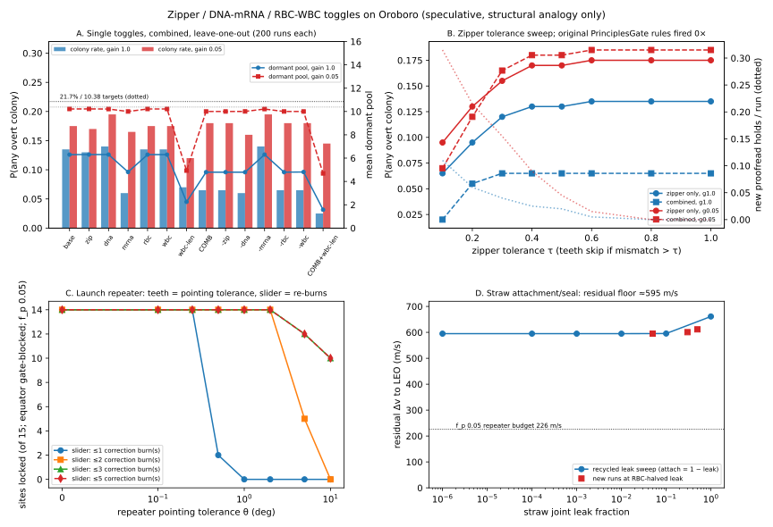

# Addendum t96u: Zipper, DNA/mRNA and RBC/WBC toggles on Oroboro

**Status: speculative structural-analogy modeling only.** No clinical, biological or engineering claims. No external biology models. Every number below is a model output from Caitlyn's existing Oroboro code, or a recycled settled result. 

## What was done
Each mechanic is a toggle, **off by default**, inside existing code paths in [`research/metastasis-native/oro_native.py`](../metastasis-native/oro_native.py). With every toggle off the output is bit-identical to before (90/90 runs; `sigcheck.py`; backup `backup/oro_native.py.pre_t96u`). Every run used the full conjunctive loop: Genesis → Oasis → PrinciplesGate → NaCl mesh → Dictator/Transcriber → Levy → Nexus → damper/homeostasis → niche → Genesis closure. Census, Levy and Genesis closure held in all 121 conditions.

| Mechanic | Mapped onto (existing component) |
|---|---|
| Zipper teeth / tolerance / size | NaCl polarity edges; a tooth skips when `size·|fit−perm| + (1−material)·U > τ` |
| Zipper slider | Oasis re-test of skipped teeth during the dormant block |
| Zipper tape / spring | damper α ÷ tape; levy_gain × spring |
| Zipper attachment | seating anchor (an unanchored cell stays in circulation) |
| DNA pairing / helicase | polarity pairs; delta-reconciliation reseat of frustrated occupants; ledger of OVERT cells unzipped to circulation |
| DNA proofreading | **new rule** inside PrinciplesGate: hold a commit when mismatch > threshold |
| mRNA vs Nexus | Levy EMA uses a transient decay (0.7) vs the persistent Nexus record |
| RBC | plumbing leak × (1 − seal); transport hop + deform·(1 − hop) |
| WBC | dormant patrol through the Oasis gate; strict = clears on RECYCLE, lenient = clears on non-COMMIT |

## Cancer side (200 runs per condition: 40 seeds × 5 cancers)
| Condition | colony g1.0 | pool g1.0 | colony g0.05 | pool g0.05 |
|---|---|---|---|---|
| baseline | 0.135 | 6.30 | 0.175 | 10.22 |
| zipper (τ 0.5) | 0.130 | 6.31 | 0.170 | 10.22 |
| dna | 0.140 | 6.31 | 0.195 | 10.21 |
| mrna | **0.060** | **4.81** | 0.165 | 10.00 |
| rbc | 0.135 | 6.30 | 0.175 | 10.22 |
| wbc (strict) | 0.135 | 6.30 | 0.175 | 10.22 |
| wbc (lenient) | 0.070 | **2.25** | 0.120 | **4.93** |
| combined | 0.065 | 4.80 | 0.180 | 10.00 |
| combined + lenient WBC | 0.025 | 1.58 | 0.145 | 4.69 |

**Leave-one-out.** Only removing mRNA moves the combined result (g1.0 back to 0.140 / 6.31). Removing zipper, RBC or WBC (strict) changes nothing. Removing DNA changes the colony rate by ≤0.02.

**Zipper τ sweep.** A tighter tolerance lowers the colony rate: zipper alone goes from 0.135 → 0.065 at g1.0 and 0.175 → 0.095 at g0.05 (τ 1.0 → 0.1). The pool does not move (6.30 → 6.35). Skipped teeth block waking; they do not drain the pool. The slider is **inert with rigid material** (re-zips = 0, because the re-test is deterministic). With material 0.7 or 0.4 it re-zips 2.3–5.4 teeth per run, which restores the colony rate to baseline.

**Upstream vs post-settling.** The pattern is unchanged. Upstream levers (threshold 0.80, permissiveness ×0.4) collapse the pool (to 0.2–2.2). Post-settling levers (maintenance 1.0, barrier 0.5) zero the colonies but leave the pool at 4.8–10.4, under both baseline and combined.

**Frustrated loops vs pool.** Spearman ρ is negative everywhere: −0.85 (baseline g1.0), −0.83 (combined g1.0), −0.80 / −0.80 (g0.05); 60 settings, p < 1e-13. Zipper teeth skips did not raise the mesh's frustrated-edge count (24.78 → 24.78).

## Launch side
**Repeater, with teeth as pointing tolerance θ (vector geometry on the recycled f_p 0.05, 0° due-east rows).** There are 14 lockable sites; the equator is gate-blocked in the recycled run. With a single burn, the lock tolerance runs from θ_max 0.28° (Kourou) to 0.87° (Baikonur): 14/14 lock at 0.25°, 2/14 at 0.5° and 0/14 at 1°. The **slider (≤2 correction burns) restores 14/14 up to 2°**. At 5°, ≤3 burns give 12/14; at 10°, 10/14. Those limits come from the 226 m/s budget.

**Straw, with attachment as joint leak (recycled sweep plus 3 new runs).** The residual stays at 595.0 m/s from leak 1e-6 to 1e-2, then rises to 595.5 m/s at 0.1 and 661.3 m/s at 1.0. The RBC seal halves the leak. New runs give 595.1 m/s at leak 0.05, 600.8 m/s at 0.3 and 611.6 m/s at 0.5. So the best a seal can do is the leak-0 floor of **≈595 m/s, which needs f_p ≈ 0.126** at I_sp 450 s (derived). That is still above the 226 m/s f_p-0.05 budget. Peak heating rises steeply with leak (1,579 K → 5,314 K at leak 0.3).

**Coupling.** Neither zipper tolerance nor RBC sealing closes the straw gap. Zipper tolerance only matters for the repeater, and only above about 0.3° per burn without a slider. DNA, mRNA and WBC have no launch dynamics in these scripts; they were not applied.

## Open items
- **Calibration toward 21.7% / 10.38: not closed.** The closest is DNA at g0.05, with colony 0.195 and pool 10.21 (baseline 0.175 / 10.22). That difference is within the binomial SE (≈0.027).
- **PrinciplesGate firing: not closed.** The original rules made **0 score modifications and 0 vetoes in every condition**. Holds appear (0.01–0.32 per run) **only because a new proofread rule was added**.
- **The 4 consensus rows: closed, as bookkeeping.** Each failing row had 1/200 runs where an OVERT cell leaked to circulation without being recorded. The DNA unzip ledger books it, giving 0/200 failures, and cell trajectories are unchanged. RBC also gives 0/200, but only because the halved leak avoids that event. That is not a fix.

## Falsified / no effect
- "Frustrated loops feed the dormant pool": ρ ≈ −0.8 across all four settings.
- Strict WBC: Oasis almost never recycles dormant cells, so it cleared 0–0.04 cells per run.
- RBC in the cancer mesh without plumbing or light: a no-op. Inside plumbing, the transport-hop bonus never triggered (rbc_passes = 0); only the leak seal acted.
- Zipper slider with rigid material: 0 re-zips.
- Zipper or RBC closing the launch residual: no. The floor is ≈595 m/s.

## Caveats
mRNA's effect is a change in the Levy EMA decay, so it is effectively a damper retune and not new structure. Lenient WBC is a strong, assumed recognition rule; its pool drop reflects that choice. These are analogies onto model components, not claims about cells, molecules or vehicles.

Files (relative to `research/zipper-dna-blood/`): `zipper_dna_blood.json`, `figures/zipper_dna_blood_figure.svg`, PDF as page images `pdf-pages/Zipper_DNA_Blood_Addendum/view.html`, `data/` (cancer_summaries.csv, launch_zdb.json, frustrated_vs_pool.json, slider_followup.json, run_cancer.log), `scripts/`.

